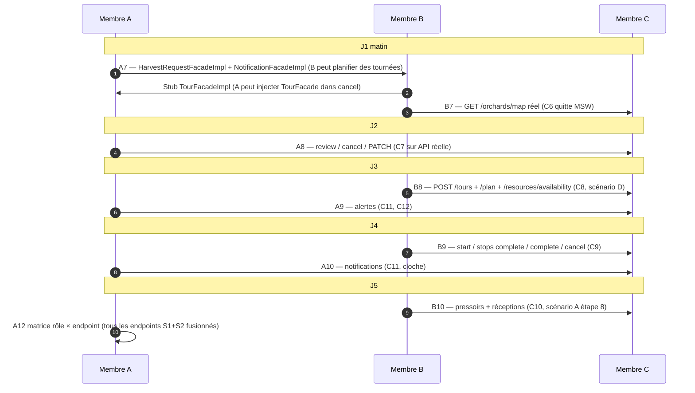
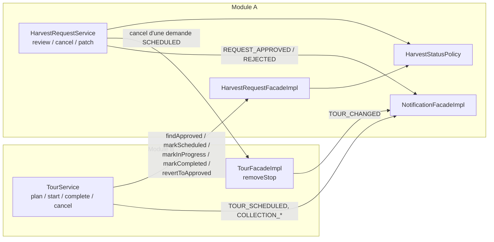

# OliveConnect — Semaine 2 : guide pas à pas (tous les membres)

> **Sources** : [OliveConnect_Plan_Projet.md](file:///c:/Users/GMI/Desktop/My_Projects/jeee/OliveConnect_Plan_Projet.md) (§4 machines à états, §5 contrats figés, §6 endpoints, §7 tâches A7–A13 / B7–B10 / C7–C12, §8 planning S2, §9 présentations, §10 règles et plan de repli) et le code livré en Semaine 1 ([SEMAINE_1_GUIDE.md](file:///c:/Users/GMI/Desktop/My_Projects/jeee/SEMAINE_1_GUIDE.md)).
> Ce guide **réutilise sans les modifier** les briques de S1 : `ApiException`, `ErrorCode`, `PageResponse`, `GeoPointDto`, `AuthUser`, `AbstractIntegrationTest` (+ `bearer(...)`, `assertExactKeys(...)`), les 4 façades de `common/facade`, `CacheInvalidator`, `contract.ts`, `apiFetch`.
> **Le contrat `contracts-v1` reste gelé** : aucun champ, enum, code d'erreur ou statut HTTP n'est renommé.

**Objectif de la Semaine 2** (plan §8) : *Scénario A en entier (verger, demande, approbation, tournée, chef d'équipe, pressoir, retour à l'agriculteur) plus les scénarios B (alerte), C (accès refusé) et D (conflit de ressource).*

## Périmètre strict de la Semaine 2

| Membre | Tâches (dans l'ordre du plan) | Preuve à livrer vendredi |
|---|---|---|
| **A** | A7 Façades · A8 Politique de transitions · A9 Alertes · A10 Notifications · A11 Audit · A12 Tests de sécurité · A13 OpenAPI | PR : review, cancel, patch, alertes, notifications ; un test par transition interdite ; tableau rôle × endpoint |
| **B** | B7 Carte · B8 Tournées : planning · B9 Tournées : exécution · B10 Pressoir | PR : carte, tournées, pressoir ; test de conflit 409 ; chef non assigné → 403 |
| **C** | C7 Resp. demandes · C8 Resp. tournées · C9 Chef d'équipe · C10 Pressoir · C11 Agriculteur suivi · C12 Alertes + logistique | Écrans de chaque rôle branchés sur l'API réelle (plus de mocks pour les modules livrés) |
| **COMMUN** | Aucune tâche commune ; démo ensemble le vendredi | Scénarios A, B, C, D joués ensemble sur les vrais endpoints |

**Démo du vendredi** (plan §8) : scénario A complet avec retour de l'agriculteur (`COMPLETED` + notification) ; scénario B (alerte reconnue puis résolue) ; scénario D (même tracteur deux fois le même jour → **409** affiché à l'écran) ; scénario C (l'agriculteur B ouvre le verger de A → **404**).

> [!WARNING]
> **Hors périmètre S2** (ne pas commencer) : cache Redis réel (B12, S3), dashboard (B11/C14, S3), imports CSV/JSON (A15/A16, S3), administration des comptes (A17, S3), rate-limit 429 (A18, S3), Nginx/VM (C13, S3), k6 (B14, S3). Le `CacheInvalidator` reste **vide** : on continue simplement à l'appeler.

---

## Sommaire

- [0. Avant de commencer (tous)](#0-avant-de-commencer-tous)
- [1. Planning jour par jour et dépendances](#1-planning-jour-par-jour-et-dépendances)
- [2. MEMBRE A — A7 → A13](#2-membre-a--a7--a13)
- [3. MEMBRE B — B7 → B10](#3-membre-b--b7--b10)
- [4. MEMBRE C — C7 → C12](#4-membre-c--c7--c12)
- [5. Documents de fin de semaine (data-dictionary, test-plan)](#5-documents-de-fin-de-semaine)
- [6. Scénarios A, B, C, D et démo du vendredi](#6-scénarios-a-b-c-d-et-démo-du-vendredi)
- [7. Présentations de 5 min, plan de repli, pièges et dépannage](#7-présentations-de-5-min-plan-de-repli-pièges-et-dépannage)

---

## 0. Avant de commencer (tous)

### 0.1 Point de départ obligatoire

```powershell
git switch main
git pull origin main --tags
git tag -l contracts-v1          # doit afficher contracts-v1
docker compose -f infra/compose.yaml --env-file .env up -d
cd backend; .\mvnw.cmd test      # tout le S1 doit être vert avant d'ajouter du S2
```

> [!IMPORTANT]
> Si un test S1 est rouge, on le répare **avant** toute nouvelle branche S2 (`main` toujours démarrable, plan §10).

### 0.2 Rappel des règles qui deviennent critiques en S2

- **Aucune transition de statut hors des services** (plan §10). React affiche les boutons, mais c'est le serveur qui accepte ou refuse (`409 INVALID_STATE_TRANSITION`).
- **A et B ne se parlent que par les 4 façades** (`HarvestRequestFacade`, `NotificationFacade`, `TourFacade`, `CacheInvalidator`), jamais par les repositories de l'autre (plan §3.5).
- **Redis ne décide jamais** si un tracteur est libre : le conflit 409 est vérifié **dans MongoDB** (plan §3.3, B8).
- Rôle → **403** ; propriété → **404** (plan §3.4). Exception du contrat : un **autre chef d'équipe** qui démarre / termine un arrêt d'une tournée → **403** (table des transitions §4).
- Messages d'erreur et de notification **en français** (§5.2).

### 0.3 Propriété des nouveaux packages (S2)

| Package / dossier | Propriétaire |
|---|---|
| `harvest/` (policy, facade impl, review/cancel/patch), `alert/`, `notification/`, `audit/`, `config/OpenApiConfig` | **A** |
| `map/`, `tour/`, `press/`, `resource/` (+ `/resources/availability`), `data/MongoIndexConfig` (nouveaux index) | **B** |
| `frontend/src/features/{collection,tours,leader,press,tracking,alerts,logistics}` | **C** |

> Les index sont dans `data/MongoIndexConfig` (propriété **B**). Quand A a besoin d'un index (notifications, audit, alertes), il ouvre une petite PR **relue par B** (règle « un propriétaire par package »).

### 0.4 Types manquants à ajouter dans `frontend/src/types/contract.ts` (C, J1)

Ce ne sont **pas** des changements de contrat : ce sont les corps de requête déjà décrits en §5.5 qui n'avaient pas encore de type TypeScript.

```ts
// --- Corps de requête §5.5 utilisés en S2 (ajout de types, pas de changement de contrat) ---
export interface HarvestRequestPatchRequest {
  type?: HarvestType;
  preferredDate?: string;          // YYYY-MM-DD
  estimatedQuantityKg?: number;
  urgencyReason?: string | null;
}
export interface TourCreateRequest { tourDate: string; }
export interface StopCompleteRequest { actualQuantityKg: number; note: string | null; }
export interface PressCapacityRequest { availableCapacityKg: number; }
export interface AlertResolveRequest { note: string; }
export interface AlertDismissRequest { reason: string; }
```

---

## 1. Planning jour par jour et dépendances

> Charge S2 prévue (plan §8) : **A 29 h · B 28 h · C 29 h**. « C'est la semaine la plus chargée. A livre les façades dès le jour 1 de la semaine pour ne pas bloquer B. »

| Jour | Membre A | Membre B | Membre C |
|---|---|---|---|
| **J1** | **A7 Façades (3 h) fusionnées avant midi** · A8 début | **Stub `TourFacadeImpl` (30 min) fusionné avant midi** · B7 Carte (5 h) | Types §0.4 · C7 Resp. demandes (4 h) sur mocks review |
| **J2** | A8 Politique de transitions (fin) | B8 Tournées : planning (8 h) | C7 bascule API réelle · C8 Planificateur (6 h) |
| **J3** | A9 Alertes terrain (7 h) | B8 (fin) · B9 Tournées : exécution (début) | C8 (fin, affichage du 409) · C9 Chef d'équipe (4 h) |
| **J4** | A10 Notifications (4 h) · A11 Audit (2 h) | B9 (fin) · B10 Pressoir (début) | C10 Pressoir (4 h) · C11 Agriculteur suivi (5 h) |
| **J5** | A12 Tests de sécurité (4 h) · A13 OpenAPI (2 h) · **data-dictionary.md** | B10 (fin) · relecture data-dictionary | C12 Alertes + logistique (6 h) · bascule carte C6 sur B7 · **démo** |

### 1.1 Qui débloque qui en S2



### 1.2 Critères d'acceptation des tâches de la Semaine 2

| Tâche | Resp. | Critère d'acceptation (vérifiable) |
|---|---|---|
| A7 | A | `HarvestRequestFacadeImpl` et `NotificationFacadeImpl` fusionnés le J1 ; B les injecte sans erreur Spring. |
| A8 | A | `HarvestStatusPolicyTest` : **un test par transition interdite** (40 cas) ; review / cancel / PATCH testés (200, 400, 403, 404, 409). |
| A9 | A | Transitions d'alerte testées ; résolution sans note → 400 ; l'agriculteur ne voit que ses alertes. |
| A10 | A | Approuver une demande crée **1** notification pour l'agriculteur ; `POST /notifications/{id}/read` d'un autre → 404. |
| A11 | A | `audit_events` contient review, cancel, accès refusé (403) et refus de propriété (scénario C). |
| A12 | A | `SecurityMatrixTest` vert ; `target/security-matrix.md` généré pour le rapport. |
| A13 | A | `/swagger-ui.html` affiche tous les endpoints §6 avec le schéma Bearer et les exemples du contrat. |
| B7 | B | Tests : bbox obligatoire (400), ordre `[lon, lat]`, aucune donnée privée sans token, `truncated` au-delà de 500. |
| B8 | B | Scénario D : même véhicule deux fois le même jour → **409 RESOURCE_CONFLICT** avec `fieldErrors`. |
| B9 | B | Transitions de tournée testées ; chef non assigné → **403** ; `removeStop` réel. |
| B10 | B | Poids négatif → 400 ; doublon `(tourId, binId)` → 409 ; tournée `PLANNED` → 409. |
| C7 | C | Scénario A étapes 3–4 à l'écran (approuver / rejeter avec motif). |
| C8 | C | Scénario D visible à l'écran (message 409 + ressource en conflit surlignée). |
| C9 | C | Scénario A étape 7 (démarrer, terminer un arrêt avec la quantité réelle). |
| C10 | C | Scénario A étape 8 (réception poids + qualité, historique). |
| C11 | C | Scénario A étape 9 (chronologie `COMPLETED` + notification) et scénario B côté agriculteur. |
| C12 | C | File d'alertes par priorité + carte des alertes ; écrans ressources + disponibilité par date. |

---

## 2. MEMBRE A — A7 → A13

**Preuve vendredi** : PR fusionnées : review, cancel, patch, alertes, notifications ; un test par transition interdite ; tableau rôle × endpoint.

### Architecture des appels A ↔ B en S2



> **Pas de cycle Spring** : `HarvestRequestFacadeImpl` ne dépend **pas** de `HarvestRequestService`, et `TourFacadeImpl` ne dépend **pas** de `TourService`. Chaque façade ne dépend que de son repository + de la policy / des notifications.

---

### A7 · Façades de A (3 h) — **J1, fusion avant midi**

**Branche** : `feature/harvest-facades-a7` · **Preuve** : B peut appeler les façades dès le jour 2.

#### Étape 1 — `harvest/service/HarvestStatusPolicy.java` (la table §4, écrite une seule fois)

```java
package tn.oliveconnect.harvest.service;

import static tn.oliveconnect.common.enums.HarvestStatus.*;

import java.util.EnumSet;
import java.util.Map;
import java.util.Set;
import org.springframework.stereotype.Component;
import tn.oliveconnect.common.enums.HarvestStatus;
import tn.oliveconnect.common.error.ApiException;

/**
 * Table des transitions autorisées d'une demande (plan §4).
 * La policy ne connaît pas l'acteur : ce sont les services qui vérifient QUI a le droit
 * (ex. SCHEDULED -> APPROVED n'est déclenché que par le système via la façade).
 */
@Component
public class HarvestStatusPolicy {

    private static final Map<HarvestStatus, Set<HarvestStatus>> ALLOWED = Map.of(
            SUBMITTED,   EnumSet.of(APPROVED, REJECTED, CANCELLED),
            APPROVED,    EnumSet.of(SCHEDULED, CANCELLED),
            SCHEDULED,   EnumSet.of(IN_PROGRESS, APPROVED, CANCELLED),
            IN_PROGRESS, EnumSet.of(COMPLETED),
            REJECTED,    EnumSet.noneOf(HarvestStatus.class),   // final
            COMPLETED,   EnumSet.noneOf(HarvestStatus.class),   // final
            CANCELLED,   EnumSet.noneOf(HarvestStatus.class));  // final

    public boolean canTransition(HarvestStatus from, HarvestStatus to) {
        return ALLOWED.getOrDefault(from, Set.of()).contains(to);
    }

    public void assertTransition(HarvestStatus from, HarvestStatus to) {
        if (!canTransition(from, to)) {
            throw ApiException.invalidTransition("Transition " + from + " → " + to + " interdite.");
        }
    }

    /** PATCH autorisé seulement avant validation définitive (§6 : SUBMITTED, APPROVED). */
    public boolean isEditable(HarvestStatus status) {
        return status == SUBMITTED || status == APPROVED;
    }
}
```

#### Étape 2 — Champ interne `cancelReason` dans `HarvestRequestDocument`

Le contrat n'a pas de champ « motif d'annulation » dans la réponse : on le stocke **en interne** (comme `externalId`), il n'apparaît dans **aucun DTO**.

```java
    // Ajouter dans HarvestRequestDocument (S1) :
    private String cancelReason;   // interne : jamais exposé (HarvestRequestResponse reste à 18 clés)
```

#### Étape 3 — `harvest/service/HarvestRequestFacadeImpl.java`

```java
package tn.oliveconnect.harvest.service;

import static tn.oliveconnect.common.enums.HarvestStatus.*;

import java.math.BigDecimal;
import java.time.Instant;
import java.util.HashSet;
import java.util.List;
import org.springframework.stereotype.Service;
import tn.oliveconnect.common.error.ApiException;
import tn.oliveconnect.common.facade.CacheInvalidator;
import tn.oliveconnect.common.facade.HarvestRequestFacade;
import tn.oliveconnect.common.facade.HarvestRequestView;
import tn.oliveconnect.harvest.document.HarvestRequestDocument;
import tn.oliveconnect.harvest.repository.HarvestRequestRepository;

/**
 * Transitions déclenchées par le SYSTÈME (tournées de B). Règle : on valide TOUT avant d'écrire,
 * pour ne jamais laisser la moitié des demandes dans un nouvel état.
 */
@Service
public class HarvestRequestFacadeImpl implements HarvestRequestFacade {

    private final HarvestRequestRepository requests;
    private final HarvestStatusPolicy policy;
    private final CacheInvalidator cache;

    public HarvestRequestFacadeImpl(HarvestRequestRepository requests, HarvestStatusPolicy policy,
                                    CacheInvalidator cache) {
        this.requests = requests; this.policy = policy; this.cache = cache;
    }

    @Override
    public List<HarvestRequestView> findApproved(List<String> ids) {
        return requests.findAllById(ids).stream()
                .filter(r -> r.getStatus() == APPROVED)
                .map(r -> new HarvestRequestView(r.getId(), r.getFarmerId(), r.getOrchardId(),
                        r.getOrchardName(), r.getEstimatedQuantityKg(), r.getStatus()))
                .toList();
    }

    @Override
    public void markScheduled(List<String> ids, String tourId) {
        List<HarvestRequestDocument> docs = loadAll(ids);
        docs.forEach(d -> policy.assertTransition(d.getStatus(), SCHEDULED));
        Instant now = Instant.now();
        docs.forEach(d -> { d.setStatus(SCHEDULED); d.setScheduledTourId(tourId); d.setScheduledAt(now); });
        saveAndInvalidate(docs, false);
    }

    @Override
    public void markInProgress(List<String> ids) {
        List<HarvestRequestDocument> docs = loadAll(ids);
        docs.forEach(d -> policy.assertTransition(d.getStatus(), IN_PROGRESS));
        docs.forEach(d -> d.setStatus(IN_PROGRESS));
        saveAndInvalidate(docs, false);
    }

    @Override
    public void markCompleted(String id, BigDecimal actualKg) {
        List<HarvestRequestDocument> docs = loadAll(List.of(id));
        HarvestRequestDocument d = docs.get(0);
        policy.assertTransition(d.getStatus(), COMPLETED);
        d.setStatus(COMPLETED);
        d.setActualQuantityKg(actualKg);       // la source de la quantité réelle est l'arrêt de tournée (§5.5)
        d.setCompletedAt(Instant.now());
        saveAndInvalidate(docs, true);
    }

    @Override
    public void revertToApproved(List<String> ids) {
        List<HarvestRequestDocument> docs = loadAll(ids);
        docs.forEach(d -> policy.assertTransition(d.getStatus(), APPROVED));
        docs.forEach(d -> { d.setStatus(APPROVED); d.setScheduledTourId(null); d.setScheduledAt(null); });
        saveAndInvalidate(docs, false);
    }

    private List<HarvestRequestDocument> loadAll(List<String> ids) {
        List<HarvestRequestDocument> docs = requests.findAllById(ids);
        if (docs.size() != new HashSet<>(ids).size()) {
            throw ApiException.notFound("Demande introuvable.");
        }
        return docs;
    }

    private void saveAndInvalidate(List<HarvestRequestDocument> docs, boolean dashboard) {
        requests.saveAll(docs);
        docs.forEach(d -> cache.orchardChanged(d.getOrchardId()));
        cache.mapChanged();                 // harvestStatus affiché sur la carte
        if (dashboard) cache.dashboardChanged();
    }
}
```

#### Étape 4 — Notifications : document, repository, façade (`notification/`)

```java
package tn.oliveconnect.notification.document;

import java.time.Instant;
import lombok.Getter;
import lombok.NoArgsConstructor;
import lombok.Setter;
import org.springframework.data.annotation.CreatedDate;
import org.springframework.data.annotation.Id;
import org.springframework.data.mongodb.core.mapping.Document;
import org.springframework.data.mongodb.core.mapping.Field;
import org.springframework.data.mongodb.core.mapping.FieldType;
import tn.oliveconnect.common.enums.EntityType;
import tn.oliveconnect.common.enums.NotificationType;

@Document("notifications")
@Getter @Setter @NoArgsConstructor
public class NotificationDocument {
    @Id private String id;
    @Field(targetType = FieldType.OBJECT_ID) private String userId;     // destinataire
    private NotificationType type;
    private String message;                                             // en français
    private EntityType entityType;                                      // HARVEST_REQUEST, TOUR, ALERT
    @Field(targetType = FieldType.OBJECT_ID) private String entityId;
    private Instant readAt;
    @CreatedDate private Instant createdAt;
}
```

```java
package tn.oliveconnect.notification.repository;

import java.util.Optional;
import org.springframework.data.domain.Page;
import org.springframework.data.domain.Pageable;
import org.springframework.data.mongodb.repository.MongoRepository;
import tn.oliveconnect.notification.document.NotificationDocument;

public interface NotificationRepository extends MongoRepository<NotificationDocument, String> {
    Page<NotificationDocument> findByUserId(String userId, Pageable pageable);
    Page<NotificationDocument> findByUserIdAndReadAtIsNull(String userId, Pageable pageable);
    Optional<NotificationDocument> findByIdAndUserId(String id, String userId);
    long countByUserId(String userId);
}
```

```java
package tn.oliveconnect.notification.service;

import org.slf4j.Logger;
import org.slf4j.LoggerFactory;
import org.springframework.stereotype.Service;
import tn.oliveconnect.common.enums.NotificationType;
import tn.oliveconnect.common.facade.EntityRef;
import tn.oliveconnect.common.facade.NotificationFacade;
import tn.oliveconnect.notification.document.NotificationDocument;
import tn.oliveconnect.notification.repository.NotificationRepository;

/**
 * Appelée par A (review, alertes) et par B (tournées). Une notification ratée ne doit pas annuler
 * l'action métier déjà écrite dans MongoDB : on journalise et on continue.
 */
@Service
public class NotificationFacadeImpl implements NotificationFacade {

    private static final Logger log = LoggerFactory.getLogger(NotificationFacadeImpl.class);
    private final NotificationRepository repo;

    public NotificationFacadeImpl(NotificationRepository repo) { this.repo = repo; }

    @Override
    public void notify(String userId, NotificationType type, String message, EntityRef ref) {
        try {
            NotificationDocument n = new NotificationDocument();
            n.setUserId(userId);
            n.setType(type);
            n.setMessage(message);
            n.setEntityType(ref.entityType());
            n.setEntityId(ref.entityId());
            repo.save(n);
        } catch (RuntimeException e) {
            log.warn("Notification non enregistrée : type={} entityType={} entityId={}",
                    type, ref.entityType(), ref.entityId(), e);
        }
    }
}
```

#### Étape 5 — Coordination avec B (stub `TourFacadeImpl`)

A injecte `TourFacade` dans `HarvestRequestService` (A8). **B fusionne le J1 matin** un stub (voir [B9 étape 1](#b9--tournées--exécution-8-h--j3-j4)) ; sans bean `TourFacade`, l'application ne démarre plus.

✅ **Fini quand** : `.\mvnw.cmd test` vert, PR relue par **C**, et B confirme sur le canal d'équipe qu'il peut injecter `HarvestRequestFacade` et `NotificationFacade`.

---

### A8 · Politique de transitions : review, cancel, PATCH (7 h) — J1–J2

**Branche** : `feature/harvest-transitions-a8` · **Preuve** : un test par transition interdite.

| Endpoint (§6) | Rôles | OK | Erreurs |
|---|---|---|---|
| `POST /harvest-requests/{id}/review` | COLLECTION_MANAGER | 200 | 400, 403, 404, 409 |
| `PATCH /harvest-requests/{id}` | FARMER propriétaire (SUBMITTED, APPROVED) | 200 | 400, 404, 409 |
| `POST /harvest-requests/{id}/cancel` | FARMER propriétaire ; COLLECTION_MANAGER | 200 | 404, 409 |

#### Étape 1 — DTOs (`harvest/dto/`)

```java
package tn.oliveconnect.harvest.dto;

/** Valeurs figées par le contrat §5.5 : {"decision": "APPROVE" | "REJECT"}. */
public enum ReviewDecision { APPROVE, REJECT }
```

```java
package tn.oliveconnect.harvest.dto;

import jakarta.validation.constraints.NotNull;
import jakarta.validation.constraints.Size;

public record ReviewRequest(
        @NotNull(message = "Obligatoire") ReviewDecision decision,
        @Size(max = 500, message = "500 caractères maximum") String reason) {}
```

```java
package tn.oliveconnect.harvest.dto;

import jakarta.validation.constraints.Size;

public record CancelRequest(@Size(max = 500, message = "500 caractères maximum") String reason) {}
```

```java
package tn.oliveconnect.harvest.dto;

import jakarta.validation.constraints.Positive;
import jakarta.validation.constraints.Size;
import java.math.BigDecimal;
import java.time.LocalDate;
import tn.oliveconnect.common.enums.HarvestType;

/** PATCH : même corps que la création, tous les champs optionnels ; orchardId non modifiable. */
public record HarvestRequestPatchRequest(
        HarvestType type,
        LocalDate preferredDate,
        @Positive(message = "Doit être > 0") BigDecimal estimatedQuantityKg,
        @Size(max = 500, message = "500 caractères maximum") String urgencyReason) {}
```

#### Étape 2 — Compléter `HarvestRequestService`

Nouvelles dépendances injectées : `HarvestStatusPolicy`, `NotificationFacade`, `TourFacade`, `AuditService` (A11 — en attendant, créez la classe `AuditService` vide de A11 étape 2 ou ajoutez l'appel au J4).

```java
// Nouveaux champs + constructeur complet de HarvestRequestService
    private final HarvestStatusPolicy policy;
    private final NotificationFacade notifications;
    private final TourFacade tours;
    private final AuditService audit;

    public HarvestRequestService(HarvestRequestRepository requests, HarvestRequestSearchRepository search,
                                 OrchardRepository orchards, CacheInvalidator cache, HarvestStatusPolicy policy,
                                 NotificationFacade notifications, TourFacade tours, AuditService audit) {
        this.requests = requests; this.search = search; this.orchards = orchards; this.cache = cache;
        this.policy = policy; this.notifications = notifications; this.tours = tours; this.audit = audit;
    }
```

```java
// --- A8 : review ---------------------------------------------------------------
    public HarvestRequestResponse review(AuthUser me, String id, ReviewRequest req) {
        if (req.decision() == ReviewDecision.REJECT && isBlank(req.reason())) {
            throw ApiException.validation("reason", "Motif obligatoire pour un rejet");
        }
        HarvestRequestDocument d = requests.findById(id).orElseThrow(() -> ApiException.notFound(NOT_FOUND));
        // §4 : « 409 si ≠ SUBMITTED ». On le vérifie explicitement car la policy autorise aussi
        // SCHEDULED -> APPROVED (transition système, pas une revue).
        if (d.getStatus() != HarvestStatus.SUBMITTED) {
            throw ApiException.invalidTransition("Seule une demande SUBMITTED peut être revue (statut actuel : "
                    + d.getStatus() + ").");
        }
        HarvestStatus target = req.decision() == ReviewDecision.APPROVE ? HarvestStatus.APPROVED : HarvestStatus.REJECTED;
        policy.assertTransition(d.getStatus(), target);

        d.setStatus(target);
        d.setReviewedBy(me.id());
        d.setReviewNote(trimOrNull(req.reason()));
        d = requests.save(d);

        boolean approved = target == HarvestStatus.APPROVED;
        notifications.notify(d.getFarmerId(),
                approved ? NotificationType.REQUEST_APPROVED : NotificationType.REQUEST_REJECTED,
                approved ? "Votre demande du %s est approuvée.".formatted(d.getPreferredDate())
                         : "Votre demande du %s est rejetée : %s".formatted(d.getPreferredDate(), d.getReviewNote()),
                new EntityRef(EntityType.HARVEST_REQUEST, d.getId()));
        audit.record(me, approved ? "HARVEST_REQUEST_APPROVED" : "HARVEST_REQUEST_REJECTED",
                "HARVEST_REQUEST", d.getId(), d.getReviewNote());
        cache.orchardChanged(d.getOrchardId());
        cache.mapChanged();
        return HarvestRequestResponse.from(d);
    }

// --- A8 : cancel ---------------------------------------------------------------
    public HarvestRequestResponse cancel(AuthUser me, String id, CancelRequest req) {
        HarvestRequestDocument d = loadForOwnerOrManager(me, id);
        policy.assertTransition(d.getStatus(), HarvestStatus.CANCELLED); // 409 si IN_PROGRESS ou état final

        if (d.getStatus() == HarvestStatus.SCHEDULED) {
            tours.removeStop(d.getId());   // §4 : l'arrêt est retiré de la tournée (B, via façade)
        }
        d.setStatus(HarvestStatus.CANCELLED);
        d.setCancelReason(req == null ? null : trimOrNull(req.reason()));
        d.setScheduledTourId(null);
        d.setScheduledAt(null);
        d = requests.save(d);

        audit.record(me, "HARVEST_REQUEST_CANCELLED", "HARVEST_REQUEST", d.getId(), d.getCancelReason());
        cache.orchardChanged(d.getOrchardId());
        cache.mapChanged();
        return HarvestRequestResponse.from(d);
    }

// --- A8 : PATCH ----------------------------------------------------------------
    public HarvestRequestResponse patch(AuthUser me, String id, HarvestRequestPatchRequest req) {
        HarvestRequestDocument d = requests.findById(id)
                .filter(r -> me.id().equals(r.getFarmerId()))          // propriétaire sinon 404
                .orElseThrow(() -> ApiException.notFound(NOT_FOUND));
        if (!policy.isEditable(d.getStatus())) {
            throw ApiException.invalidTransition("Modification impossible au statut " + d.getStatus() + ".");
        }
        HarvestType newType = req.type() != null ? req.type() : d.getType();
        String newReason = req.urgencyReason() != null ? trimOrNull(req.urgencyReason()) : d.getUrgencyReason();
        if (newType == HarvestType.URGENT && isBlank(newReason)) {
            throw ApiException.validation("urgencyReason", "Obligatoire pour une demande urgente");
        }
        d.setType(newType);
        d.setUrgencyReason(newType == HarvestType.URGENT ? newReason : null);
        if (req.preferredDate() != null) d.setPreferredDate(req.preferredDate());
        if (req.estimatedQuantityKg() != null) d.setEstimatedQuantityKg(req.estimatedQuantityKg());
        d = requests.save(d);   // le statut ne change pas (aucune transition APPROVED -> SUBMITTED au §4)
        cache.orchardChanged(d.getOrchardId());
        return HarvestRequestResponse.from(d);
    }

// --- helpers -------------------------------------------------------------------
    /** FARMER : seulement les siennes (404 sinon) ; COLLECTION_MANAGER : toutes. */
    private HarvestRequestDocument loadForOwnerOrManager(AuthUser me, String id) {
        HarvestRequestDocument d = requests.findById(id).orElseThrow(() -> ApiException.notFound(NOT_FOUND));
        boolean owner = me.hasRole(Role.FARMER) && me.id().equals(d.getFarmerId());
        if (!owner && !me.hasRole(Role.COLLECTION_MANAGER)) throw ApiException.notFound(NOT_FOUND);
        return d;
    }

    private static boolean isBlank(String s) { return s == null || s.isBlank(); }
    private static String trimOrNull(String s) { return isBlank(s) ? null : s.trim(); }
```

Imports à ajouter : `tn.oliveconnect.common.enums.{EntityType, NotificationType}`, `tn.oliveconnect.common.facade.{EntityRef, NotificationFacade, TourFacade}`, `tn.oliveconnect.audit.service.AuditService`, `tn.oliveconnect.harvest.dto.*`.

#### Étape 3 — Endpoints dans `HarvestRequestController`

```java
    @PostMapping("/{id}/review")
    @PreAuthorize("hasRole('COLLECTION_MANAGER')")
    public HarvestRequestResponse review(@AuthenticationPrincipal AuthUser me, @PathVariable String id,
                                         @Valid @RequestBody ReviewRequest req) {
        return service.review(me, id, req);
    }

    @PostMapping("/{id}/cancel")
    @PreAuthorize("hasAnyRole('FARMER','COLLECTION_MANAGER')")
    public HarvestRequestResponse cancel(@AuthenticationPrincipal AuthUser me, @PathVariable String id,
                                         @Valid @RequestBody(required = false) CancelRequest req) {
        return service.cancel(me, id, req);
    }

    @PatchMapping("/{id}")
    @PreAuthorize("hasRole('FARMER')")
    public HarvestRequestResponse patch(@AuthenticationPrincipal AuthUser me, @PathVariable String id,
                                        @Valid @RequestBody HarvestRequestPatchRequest req) {
        return service.patch(me, id, req);
    }
```

#### Étape 4 — Test unitaire : **un test par transition interdite** (`HarvestStatusPolicyTest`)

```java
package tn.oliveconnect.harvest.service;

import static org.assertj.core.api.Assertions.assertThat;
import static org.assertj.core.api.Assertions.assertThatThrownBy;
import static tn.oliveconnect.common.enums.HarvestStatus.*;

import java.util.Set;
import java.util.stream.Stream;
import org.junit.jupiter.params.ParameterizedTest;
import org.junit.jupiter.params.provider.Arguments;
import org.junit.jupiter.params.provider.MethodSource;
import tn.oliveconnect.common.enums.HarvestStatus;
import tn.oliveconnect.common.error.ApiException;
import tn.oliveconnect.common.error.ErrorCode;

/** Test unitaire pur (pas de Spring, pas de base) : 9 transitions autorisées, 40 interdites. */
class HarvestStatusPolicyTest {

    private final HarvestStatusPolicy policy = new HarvestStatusPolicy();

    private static final Set<String> ALLOWED = Set.of(
            "SUBMITTED>APPROVED", "SUBMITTED>REJECTED", "SUBMITTED>CANCELLED",
            "APPROVED>SCHEDULED", "APPROVED>CANCELLED",
            "SCHEDULED>IN_PROGRESS", "SCHEDULED>APPROVED", "SCHEDULED>CANCELLED",
            "IN_PROGRESS>COMPLETED");

    static Stream<Arguments> allowed() {
        return pairs().filter(a -> ALLOWED.contains(key(a)));
    }

    static Stream<Arguments> forbidden() {
        return pairs().filter(a -> !ALLOWED.contains(key(a)));
    }

    @ParameterizedTest(name = "{0} -> {1} autorisée")
    @MethodSource("allowed")
    void allowedTransition(HarvestStatus from, HarvestStatus to) {
        assertThat(policy.canTransition(from, to)).isTrue();
    }

    @ParameterizedTest(name = "{0} -> {1} interdite (409)")
    @MethodSource("forbidden")
    void forbiddenTransition(HarvestStatus from, HarvestStatus to) {
        assertThatThrownBy(() -> policy.assertTransition(from, to))
                .isInstanceOf(ApiException.class)
                .satisfies(e -> assertThat(((ApiException) e).getCode()).isEqualTo(ErrorCode.INVALID_STATE_TRANSITION));
    }

    private static Stream<Arguments> pairs() {
        return Stream.of(HarvestStatus.values())
                .flatMap(from -> Stream.of(HarvestStatus.values()).map(to -> Arguments.of(from, to)));
    }

    private static String key(Arguments a) {
        return a.get()[0] + ">" + a.get()[1];
    }
}
```

> 7 × 7 = 49 couples : **9 autorisés**, **40 interdits** (dont les 7 « X → X »). Ce test est la preuve « un test par transition interdite » du plan.

#### Étape 5 — Aides de test partagées (A ajoute dans `AbstractIntegrationTest`)

Utilisées par A **et** B (scénarios complets) :

```java
    protected static final String ORCHARD_BODY = """
        {"name":"North Orchard","areaHectares":4.2,"oliveVariety":"Chemlali",
         "location":{"type":"Point","coordinates":[10.76,34.73]},"publicVisibility":true}""";

    /** Crée un verger via l'API et renvoie son id. */
    protected String createOrchard(String farmerBearer) throws Exception {
        String json = mvc.perform(post("/api/v1/orchards").header("Authorization", farmerBearer)
                        .contentType(MediaType.APPLICATION_JSON).content(ORCHARD_BODY))
                .andExpect(status().isCreated()).andReturn().getResponse().getContentAsString();
        return JsonPath.read(json, "$.id");
    }

    /** Crée une demande PLANNED de 2500 kg et renvoie son id. */
    protected String createRequest(String farmerBearer, String orchardId) throws Exception {
        String body = """
            {"orchardId":"%s","type":"PLANNED","preferredDate":"%s","estimatedQuantityKg":2500,"urgencyReason":null}"""
            .formatted(orchardId, java.time.LocalDate.now().plusDays(3));
        String json = mvc.perform(post("/api/v1/harvest-requests").header("Authorization", farmerBearer)
                        .contentType(MediaType.APPLICATION_JSON).content(body))
                .andExpect(status().isCreated()).andReturn().getResponse().getContentAsString();
        return JsonPath.read(json, "$.id");
    }

    /** Approuve une demande (review APPROVE) en tant que responsable de collecte. */
    protected void approve(String managerBearer, String requestId) throws Exception {
        mvc.perform(post("/api/v1/harvest-requests/" + requestId + "/review").header("Authorization", managerBearer)
                        .contentType(MediaType.APPLICATION_JSON).content("{\"decision\":\"APPROVE\",\"reason\":null}"))
           .andExpect(status().isOk());
    }

    /** Renvoie l'id (24 hex) d'un utilisateur à partir d'un "Bearer <jwt>". */
    protected String userId(String bearer) {
        return jwtService.parse(bearer.substring(7)).orElseThrow().id();
    }
```

Imports à ajouter dans `AbstractIntegrationTest` : `org.springframework.http.MediaType`, `static ...MockMvcRequestBuilders.post`, `static ...MockMvcResultMatchers.status`.

#### Étape 6 — Tests d'intégration `HarvestTransitionIntegrationTest`

```java
package tn.oliveconnect.harvest;

import static org.springframework.test.web.servlet.request.MockMvcRequestBuilders.*;
import static org.springframework.test.web.servlet.result.MockMvcResultMatchers.*;

import org.bson.Document;
import org.bson.types.ObjectId;
import org.junit.jupiter.api.BeforeEach;
import org.junit.jupiter.api.Test;
import org.springframework.http.MediaType;
import tn.oliveconnect.AbstractIntegrationTest;
import tn.oliveconnect.common.enums.Role;

class HarvestTransitionIntegrationTest extends AbstractIntegrationTest {

    String farmer, otherFarmer, manager, requestId;

    @BeforeEach
    void setUp() throws Exception {
        farmer = bearer(Role.FARMER, "a@example.test");
        otherFarmer = bearer(Role.FARMER, "b@example.test");
        manager = bearer(Role.COLLECTION_MANAGER, "m@example.test");
        requestId = createRequest(farmer, createOrchard(farmer));
    }

    @Test
    void approve_200_thenSecondReview_409() throws Exception {
        mvc.perform(post("/api/v1/harvest-requests/" + requestId + "/review").header("Authorization", manager)
                        .contentType(MediaType.APPLICATION_JSON).content("{\"decision\":\"APPROVE\",\"reason\":null}"))
           .andExpect(status().isOk())
           .andExpect(jsonPath("$.status").value("APPROVED"))
           .andExpect(jsonPath("$.reviewedBy").value(userId(manager)));
        mvc.perform(post("/api/v1/harvest-requests/" + requestId + "/review").header("Authorization", manager)
                        .contentType(MediaType.APPLICATION_JSON).content("{\"decision\":\"REJECT\",\"reason\":\"x\"}"))
           .andExpect(status().isConflict())
           .andExpect(jsonPath("$.code").value("INVALID_STATE_TRANSITION"));
    }

    @Test
    void reject_withoutReason_400() throws Exception {
        mvc.perform(post("/api/v1/harvest-requests/" + requestId + "/review").header("Authorization", manager)
                        .contentType(MediaType.APPLICATION_JSON).content("{\"decision\":\"REJECT\",\"reason\":\"  \"}"))
           .andExpect(status().isBadRequest())
           .andExpect(jsonPath("$.fieldErrors.reason").exists());
    }

    @Test
    void farmerCannotReview_403() throws Exception {
        mvc.perform(post("/api/v1/harvest-requests/" + requestId + "/review").header("Authorization", farmer)
                        .contentType(MediaType.APPLICATION_JSON).content("{\"decision\":\"APPROVE\",\"reason\":null}"))
           .andExpect(status().isForbidden());
    }

    @Test
    void farmerCancelsOwn_200_thenCancelAgain_409() throws Exception {
        mvc.perform(post("/api/v1/harvest-requests/" + requestId + "/cancel").header("Authorization", farmer)
                        .contentType(MediaType.APPLICATION_JSON).content("{\"reason\":\"Pluie annoncée\"}"))
           .andExpect(status().isOk())
           .andExpect(jsonPath("$.status").value("CANCELLED"));
        mvc.perform(post("/api/v1/harvest-requests/" + requestId + "/cancel").header("Authorization", farmer))
           .andExpect(status().isConflict());
    }

    @Test
    void otherFarmerCancel_404() throws Exception {
        mvc.perform(post("/api/v1/harvest-requests/" + requestId + "/cancel").header("Authorization", otherFarmer))
           .andExpect(status().isNotFound());
    }

    @Test
    void cancelInProgress_409() throws Exception {
        mongo.getCollection("harvest_requests").updateOne(new Document("_id", new ObjectId(requestId)),
                new Document("$set", new Document("status", "IN_PROGRESS")));
        mvc.perform(post("/api/v1/harvest-requests/" + requestId + "/cancel").header("Authorization", manager))
           .andExpect(status().isConflict());
    }

    @Test
    void cancelScheduled_callsRemoveStop_andCancels() throws Exception {
        // Pas de tournée réelle : TourFacadeImpl ne trouve rien et ne fait rien -> l'annulation passe.
        mongo.getCollection("harvest_requests").updateOne(new Document("_id", new ObjectId(requestId)),
                new Document("$set", new Document("status", "SCHEDULED")));
        mvc.perform(post("/api/v1/harvest-requests/" + requestId + "/cancel").header("Authorization", farmer))
           .andExpect(status().isOk())
           .andExpect(jsonPath("$.status").value("CANCELLED"))
           .andExpect(jsonPath("$.scheduledTourId").isEmpty());
    }

    @Test
    void patch_inSubmitted_200_afterReject_409() throws Exception {
        mvc.perform(patch("/api/v1/harvest-requests/" + requestId).header("Authorization", farmer)
                        .contentType(MediaType.APPLICATION_JSON).content("{\"estimatedQuantityKg\":3000}"))
           .andExpect(status().isOk())
           .andExpect(jsonPath("$.estimatedQuantityKg").value(3000));
        mvc.perform(post("/api/v1/harvest-requests/" + requestId + "/review").header("Authorization", manager)
                        .contentType(MediaType.APPLICATION_JSON).content("{\"decision\":\"REJECT\",\"reason\":\"Trop tôt\"}"))
           .andExpect(status().isOk());
        mvc.perform(patch("/api/v1/harvest-requests/" + requestId).header("Authorization", farmer)
                        .contentType(MediaType.APPLICATION_JSON).content("{\"estimatedQuantityKg\":1000}"))
           .andExpect(status().isConflict());
    }

    @Test
    void patch_toUrgentWithoutReason_400() throws Exception {
        mvc.perform(patch("/api/v1/harvest-requests/" + requestId).header("Authorization", farmer)
                        .contentType(MediaType.APPLICATION_JSON).content("{\"type\":\"URGENT\"}"))
           .andExpect(status().isBadRequest())
           .andExpect(jsonPath("$.fieldErrors.urgencyReason").exists());
    }
}
```

✅ **Fini quand** : 40 transitions interdites + 9 autorisées vertes, tests d'intégration verts, PR relue par **C** (qui vérifie les messages pour l'écran C7).

---

### A9 · Alertes terrain (7 h) — J3

**Branche** : `feature/alerts-a9` · **Preuve** : tests des transitions (`OPEN → ACKNOWLEDGED → RESOLVED`, `DISMISSED`), résolution sans note → 400, l'agriculteur ne voit que ses alertes.

| Endpoint (§6) | Rôles | OK | Erreurs |
|---|---|---|---|
| `POST /alerts` | FARMER | 201 | 400, 403, 404 |
| `GET /alerts` | FARMER (les siennes) ; COLLECTION_MANAGER, ADMIN (toutes) | 200 | 400, 403 |
| `GET /alerts/{id}` | propriétaire ; COLLECTION_MANAGER, ADMIN | 200 | 404 |
| `POST /alerts/{id}/acknowledge` | COLLECTION_MANAGER | 200 | 403, 404, 409 |
| `POST /alerts/{id}/resolve` | COLLECTION_MANAGER | 200 | 400, 404, 409 |
| `POST /alerts/{id}/dismiss` | COLLECTION_MANAGER | 200 | 400, 404, 409 |

#### Étape 1 — Document & Repositories (`alert/document/`, `alert/repository/`)

```java
// FieldAlertDocument.java
package tn.oliveconnect.alert.document;

import java.time.Instant;
import lombok.Getter;
import lombok.NoArgsConstructor;
import lombok.Setter;
import org.springframework.data.annotation.CreatedDate;
import org.springframework.data.annotation.Id;
import org.springframework.data.mongodb.core.geo.GeoJsonPoint;
import org.springframework.data.mongodb.core.mapping.Document;
import org.springframework.data.mongodb.core.mapping.Field;
import org.springframework.data.mongodb.core.mapping.FieldType;
import tn.oliveconnect.common.enums.AlertPriority;
import tn.oliveconnect.common.enums.AlertStatus;
import tn.oliveconnect.common.enums.AlertType;

@Document("field_alerts")
@Getter @Setter @NoArgsConstructor
public class FieldAlertDocument {
    @Id private String id;
    @Field(targetType = FieldType.OBJECT_ID) private String farmerId;
    @Field(targetType = FieldType.OBJECT_ID) private String orchardId;
    private AlertType type;
    private String description;
    private GeoJsonPoint location;     // [lon, lat]
    private AlertPriority priority;
    private AlertStatus status;
    @CreatedDate private Instant createdAt;
    private Instant acknowledgedAt;
    private Instant resolvedAt;        // renseigné pour RESOLVED et DISMISSED (§5.5)
    private String resolutionNote;     // stocke la note (resolve) ou le motif (dismiss)
}
```

```java
// FieldAlertRepository.java
package tn.oliveconnect.alert.repository;

import org.springframework.data.mongodb.repository.MongoRepository;
import tn.oliveconnect.alert.document.FieldAlertDocument;

public interface FieldAlertRepository extends MongoRepository<FieldAlertDocument, String> {}
```

```java
// FieldAlertSearchRepository.java — exploite l'index {status, priority, createdAt} créé par B3
package tn.oliveconnect.alert.repository;

import java.util.List;
import org.springframework.data.domain.Page;
import org.springframework.data.domain.PageImpl;
import org.springframework.data.domain.Pageable;
import org.springframework.data.mongodb.core.MongoTemplate;
import org.springframework.data.mongodb.core.query.Criteria;
import org.springframework.data.mongodb.core.query.Query;
import org.springframework.stereotype.Repository;
import tn.oliveconnect.alert.document.FieldAlertDocument;
import tn.oliveconnect.common.enums.AlertPriority;
import tn.oliveconnect.common.enums.AlertStatus;

@Repository
public class FieldAlertSearchRepository {
    private final MongoTemplate mongo;
    public FieldAlertSearchRepository(MongoTemplate mongo) { this.mongo = mongo; }

    public Page<FieldAlertDocument> search(String farmerIdOrNull, AlertStatus status,
                                           AlertPriority priority, Pageable pageable) {
        Query q = new Query();
        if (farmerIdOrNull != null) q.addCriteria(Criteria.where("farmerId").is(farmerIdOrNull));
        if (status != null) q.addCriteria(Criteria.where("status").is(status));
        if (priority != null) q.addCriteria(Criteria.where("priority").is(priority));
        long total = mongo.count(q, FieldAlertDocument.class);
        List<FieldAlertDocument> content = mongo.find(Query.of(q).with(pageable), FieldAlertDocument.class);
        return new PageImpl<>(content, pageable, total);
    }
}
```

#### Étape 2 — DTOs (`alert/dto/`) — 12 clés exactement (§5.5 `FieldAlertResponse`)

```java
package tn.oliveconnect.alert.dto;

import jakarta.validation.Valid;
import jakarta.validation.constraints.*;
import java.time.Instant;
import tn.oliveconnect.alert.document.FieldAlertDocument;
import tn.oliveconnect.common.enums.*;
import tn.oliveconnect.common.web.GeoPointDto;

public final class AlertDtos {
    private AlertDtos() {}

    public record FieldAlertCreateRequest(
            @NotBlank(message = "Obligatoire") String orchardId,
            @NotNull(message = "Obligatoire") AlertType type,
            @NotBlank(message = "Obligatoire") @Size(max = 1000) String description,
            @NotNull(message = "Obligatoire") @Valid GeoPointDto location,
            @NotNull(message = "Obligatoire") AlertPriority priority) {}

    public record ResolveAlertRequest(
            @NotBlank(message = "Note obligatoire") @Size(max = 1000) String note) {}

    public record DismissAlertRequest(
            @NotBlank(message = "Motif obligatoire") @Size(max = 1000) String reason) {}

    /** Contrat §5.5 FieldAlertResponse — 12 clés exactement. */
    public record FieldAlertResponse(
            String id, String farmerId, String orchardId, AlertType type, String description,
            GeoPointDto location, AlertPriority priority, AlertStatus status,
            Instant createdAt, Instant acknowledgedAt, Instant resolvedAt, String resolutionNote) {

        public static FieldAlertResponse from(FieldAlertDocument a) {
            return new FieldAlertResponse(a.getId(), a.getFarmerId(), a.getOrchardId(), a.getType(),
                    a.getDescription(), GeoPointDto.from(a.getLocation()), a.getPriority(), a.getStatus(),
                    a.getCreatedAt(), a.getAcknowledgedAt(), a.getResolvedAt(), a.getResolutionNote());
        }
    }
}
```

#### Étape 3 — Service & Controller (`alert/service/FieldAlertService.java`, `alert/controller/FieldAlertController.java`)

```java
package tn.oliveconnect.alert.service;

import java.time.Instant;
import org.springframework.data.domain.Pageable;
import org.springframework.stereotype.Service;
import tn.oliveconnect.alert.document.FieldAlertDocument;
import tn.oliveconnect.alert.dto.AlertDtos.*;
import tn.oliveconnect.alert.repository.FieldAlertRepository;
import tn.oliveconnect.alert.repository.FieldAlertSearchRepository;
import tn.oliveconnect.common.enums.*;
import tn.oliveconnect.common.error.ApiException;
import tn.oliveconnect.common.facade.EntityRef;
import tn.oliveconnect.common.facade.NotificationFacade;
import tn.oliveconnect.common.web.PageResponse;
import tn.oliveconnect.orchard.repository.OrchardRepository;
import tn.oliveconnect.security.AuthUser;

@Service
public class FieldAlertService {

    private static final String NOT_FOUND = "Alerte introuvable.";
    private final FieldAlertRepository alerts;
    private final FieldAlertSearchRepository search;
    private final OrchardRepository orchards;
    private final NotificationFacade notifications;

    public FieldAlertService(FieldAlertRepository alerts, FieldAlertSearchRepository search,
                             OrchardRepository orchards, NotificationFacade notifications) {
        this.alerts = alerts; this.search = search; this.orchards = orchards; this.notifications = notifications;
    }

    public FieldAlertResponse create(AuthUser me, FieldAlertCreateRequest req) {
        // Le verger doit appartenir à l'agriculteur (sinon 404)
        var orchard = orchards.findById(req.orchardId())
                .filter(o -> me.id().equals(o.getFarmerId()))
                .orElseThrow(() -> ApiException.notFound("Verger introuvable."));

        FieldAlertDocument a = new FieldAlertDocument();
        a.setFarmerId(me.id());
        a.setOrchardId(orchard.getId());
        a.setType(req.type());
        a.setDescription(req.description().trim());
        a.setLocation(req.location().toGeoJson("location"));
        a.setPriority(req.priority());
        a.setStatus(AlertStatus.OPEN);
        return FieldAlertResponse.from(alerts.save(a));
    }

    public PageResponse<FieldAlertResponse> list(AuthUser me, AlertStatus status, AlertPriority priority, Pageable p) {
        String scopedFarmer = me.hasRole(Role.FARMER) ? me.id() : null;
        return PageResponse.from(search.search(scopedFarmer, status, priority, p), FieldAlertResponse::from);
    }

    public FieldAlertResponse get(AuthUser me, String id) {
        FieldAlertDocument a = alerts.findById(id).orElseThrow(() -> ApiException.notFound(NOT_FOUND));
        boolean owner = me.hasRole(Role.FARMER) && me.id().equals(a.getFarmerId());
        if (!owner && !me.isStaff()) throw ApiException.notFound(NOT_FOUND);
        return FieldAlertResponse.from(a);
    }

    public FieldAlertResponse acknowledge(String id) {
        FieldAlertDocument a = alerts.findById(id).orElseThrow(() -> ApiException.notFound(NOT_FOUND));
        if (a.getStatus() != AlertStatus.OPEN) {
            throw ApiException.invalidTransition("Seule une alerte OPEN peut être prise en charge.");
        }
        a.setStatus(AlertStatus.ACKNOWLEDGED);
        a.setAcknowledgedAt(Instant.now());
        a = alerts.save(a);
        notifications.notify(a.getFarmerId(), NotificationType.ALERT_ACKNOWLEDGED,
                "Votre alerte terrain a été prise en charge.", new EntityRef(EntityType.ALERT, a.getId()));
        return FieldAlertResponse.from(a);
    }

    public FieldAlertResponse resolve(String id, ResolveAlertRequest req) {
        FieldAlertDocument a = alerts.findById(id).orElseThrow(() -> ApiException.notFound(NOT_FOUND));
        if (a.getStatus() != AlertStatus.ACKNOWLEDGED) {
            throw ApiException.invalidTransition("Seule une alerte ACKNOWLEDGED peut être résolue.");
        }
        a.setStatus(AlertStatus.RESOLVED);
        a.setResolvedAt(Instant.now());
        a.setResolutionNote(req.note().trim());
        a = alerts.save(a);
        notifications.notify(a.getFarmerId(), NotificationType.ALERT_RESOLVED,
                "Votre alerte terrain est résolue : " + a.getResolutionNote(), new EntityRef(EntityType.ALERT, a.getId()));
        return FieldAlertResponse.from(a);
    }

    public FieldAlertResponse dismiss(String id, DismissAlertRequest req) {
        FieldAlertDocument a = alerts.findById(id).orElseThrow(() -> ApiException.notFound(NOT_FOUND));
        if (a.getStatus() != AlertStatus.OPEN && a.getStatus() != AlertStatus.ACKNOWLEDGED) {
            throw ApiException.invalidTransition("Seule une alerte OPEN ou ACKNOWLEDGED peut être écartée.");
        }
        a.setStatus(AlertStatus.DISMISSED);
        a.setResolvedAt(Instant.now());
        a.setResolutionNote(req.reason().trim());
        a = alerts.save(a);
        notifications.notify(a.getFarmerId(), NotificationType.ALERT_DISMISSED,
                "Votre alerte terrain a été écartée : " + a.getResolutionNote(), new EntityRef(EntityType.ALERT, a.getId()));
        return FieldAlertResponse.from(a);
    }
}
```

```java
package tn.oliveconnect.alert.controller;

import jakarta.validation.Valid;
import org.springframework.data.domain.Pageable;
import org.springframework.data.domain.Sort;
import org.springframework.data.web.PageableDefault;
import org.springframework.http.HttpStatus;
import org.springframework.security.access.prepost.PreAuthorize;
import org.springframework.security.core.annotation.AuthenticationPrincipal;
import org.springframework.web.bind.annotation.*;
import tn.oliveconnect.alert.dto.AlertDtos.*;
import tn.oliveconnect.alert.service.FieldAlertService;
import tn.oliveconnect.common.enums.AlertPriority;
import tn.oliveconnect.common.enums.AlertStatus;
import tn.oliveconnect.common.web.PageResponse;
import tn.oliveconnect.security.AuthUser;

@RestController
@RequestMapping("/api/v1/alerts")
public class FieldAlertController {

    private final FieldAlertService service;
    public FieldAlertController(FieldAlertService service) { this.service = service; }

    @PostMapping
    @ResponseStatus(HttpStatus.CREATED)
    @PreAuthorize("hasRole('FARMER')")
    public FieldAlertResponse create(@AuthenticationPrincipal AuthUser me,
                                     @Valid @RequestBody FieldAlertCreateRequest req) {
        return service.create(me, req);
    }

    @GetMapping
    @PreAuthorize("hasAnyRole('FARMER','COLLECTION_MANAGER','ADMIN')")
    public PageResponse<FieldAlertResponse> list(@AuthenticationPrincipal AuthUser me,
            @RequestParam(required = false) AlertStatus status,
            @RequestParam(required = false) AlertPriority priority,
            @PageableDefault(size = 20, sort = "createdAt", direction = Sort.Direction.DESC) Pageable pageable) {
        return service.list(me, status, priority, pageable);
    }

    @GetMapping("/{id}")
    @PreAuthorize("hasAnyRole('FARMER','COLLECTION_MANAGER','ADMIN')")
    public FieldAlertResponse get(@AuthenticationPrincipal AuthUser me, @PathVariable String id) {
        return service.get(me, id);
    }

    @PostMapping("/{id}/acknowledge")
    @PreAuthorize("hasRole('COLLECTION_MANAGER')")
    public FieldAlertResponse acknowledge(@PathVariable String id) { return service.acknowledge(id); }

    @PostMapping("/{id}/resolve")
    @PreAuthorize("hasRole('COLLECTION_MANAGER')")
    public FieldAlertResponse resolve(@PathVariable String id, @Valid @RequestBody ResolveAlertRequest req) {
        return service.resolve(id, req);
    }

    @PostMapping("/{id}/dismiss")
    @PreAuthorize("hasRole('COLLECTION_MANAGER')")
    public FieldAlertResponse dismiss(@PathVariable String id, @Valid @RequestBody DismissAlertRequest req) {
        return service.dismiss(id, req);
    }
}
```

#### Étape 4 — Tests : `src/test/java/tn/oliveconnect/alert/FieldAlertIntegrationTest.java`

```java
package tn.oliveconnect.alert;

import static org.springframework.test.web.servlet.request.MockMvcRequestBuilders.*;
import static org.springframework.test.web.servlet.result.MockMvcResultMatchers.*;

import com.jayway.jsonpath.JsonPath;
import org.junit.jupiter.api.Test;
import org.springframework.http.MediaType;
import tn.oliveconnect.AbstractIntegrationTest;
import tn.oliveconnect.common.enums.Role;

class FieldAlertIntegrationTest extends AbstractIntegrationTest {

    String createAlert(String farmer, String orchardId) throws Exception {
        String body = """
            {"orchardId":"%s","type":"PEST","description":"Activité de ravageurs",
             "location":{"type":"Point","coordinates":[10.76,34.73]},"priority":"HIGH"}""".formatted(orchardId);
        String json = mvc.perform(post("/api/v1/alerts").header("Authorization", farmer)
                        .contentType(MediaType.APPLICATION_JSON).content(body))
                .andExpect(status().isCreated())
                .andExpect(jsonPath("$.status").value("OPEN"))
                .andReturn().getResponse().getContentAsString();
        assertExactKeys(json, "id", "farmerId", "orchardId", "type", "description", "location",
                "priority", "status", "createdAt", "acknowledgedAt", "resolvedAt", "resolutionNote");
        return JsonPath.read(json, "$.id");
    }

    @Test
    void lifecycle_openToAcknowledgeToResolve_andRejectInvalidTransitions() throws Exception {
        String farmer = bearer(Role.FARMER, "a@example.test");
        String manager = bearer(Role.COLLECTION_MANAGER, "m@example.test");
        String id = createAlert(farmer, createOrchard(farmer));

        // Resolve avant acknowledge -> 409
        mvc.perform(post("/api/v1/alerts/" + id + "/resolve").header("Authorization", manager)
                        .contentType(MediaType.APPLICATION_JSON).content("{\"note\":\"Traité\"}"))
           .andExpect(status().isConflict());

        // Acknowledge -> 200
        mvc.perform(post("/api/v1/alerts/" + id + "/acknowledge").header("Authorization", manager))
           .andExpect(status().isOk())
           .andExpect(jsonPath("$.status").value("ACKNOWLEDGED"))
           .andExpect(jsonPath("$.acknowledgedAt").isNotEmpty());

        // Resolve sans note -> 400
        mvc.perform(post("/api/v1/alerts/" + id + "/resolve").header("Authorization", manager)
                        .contentType(MediaType.APPLICATION_JSON).content("{\"note\":\"  \"}"))
           .andExpect(status().isBadRequest())
           .andExpect(jsonPath("$.fieldErrors.note").exists());

        // Resolve avec note -> 200
        mvc.perform(post("/api/v1/alerts/" + id + "/resolve").header("Authorization", manager)
                        .contentType(MediaType.APPLICATION_JSON).content("{\"note\":\"Intervention équipe\"}"))
           .andExpect(status().isOk())
           .andExpect(jsonPath("$.status").value("RESOLVED"))
           .andExpect(jsonPath("$.resolutionNote").value("Intervention équipe"));

        // Dismiss après RESOLVED -> 409
        mvc.perform(post("/api/v1/alerts/" + id + "/dismiss").header("Authorization", manager)
                        .contentType(MediaType.APPLICATION_JSON).content("{\"reason\":\"doublon\"}"))
           .andExpect(status().isConflict());
    }

    @Test
    void farmerSeesOnlyOwnAlerts_andOtherFarmerGets404() throws Exception {
        String a = bearer(Role.FARMER, "a@example.test");
        String b = bearer(Role.FARMER, "b@example.test");
        String idA = createAlert(a, createOrchard(a));

        mvc.perform(get("/api/v1/alerts").header("Authorization", b))
           .andExpect(status().isOk()).andExpect(jsonPath("$.totalElements").value(0));
        mvc.perform(get("/api/v1/alerts/" + idA).header("Authorization", b))
           .andExpect(status().isNotFound());
    }
}
```

---

### A10 · Notifications (4 h) — J4

**Branche** : `feature/notifications-a10` · **Preuve** : approuver une demande crée **1** notification pour l'agriculteur ; `POST /notifications/{id}/read` d'un autre utilisateur → 404.

#### Étape 1 — DTO, Service et Controller (`notification/dto/`, `notification/service/`, `notification/controller/`)

```java
// NotificationResponse.java — 7 clés exactement (§5.5)
package tn.oliveconnect.notification.dto;

import java.time.Instant;
import tn.oliveconnect.common.enums.EntityType;
import tn.oliveconnect.common.enums.NotificationType;
import tn.oliveconnect.notification.document.NotificationDocument;

public record NotificationResponse(
        String id, NotificationType type, String message,
        EntityType entityType, String entityId, Instant readAt, Instant createdAt) {

    public static NotificationResponse from(NotificationDocument n) {
        return new NotificationResponse(n.getId(), n.getType(), n.getMessage(),
                n.getEntityType(), n.getEntityId(), n.getReadAt(), n.getCreatedAt());
    }
}
```

```java
// NotificationService.java
package tn.oliveconnect.notification.service;

import java.time.Instant;
import org.springframework.data.domain.Page;
import org.springframework.data.domain.Pageable;
import org.springframework.stereotype.Service;
import tn.oliveconnect.common.error.ApiException;
import tn.oliveconnect.common.web.PageResponse;
import tn.oliveconnect.notification.document.NotificationDocument;
import tn.oliveconnect.notification.dto.NotificationResponse;
import tn.oliveconnect.notification.repository.NotificationRepository;
import tn.oliveconnect.security.AuthUser;

@Service
public class NotificationService {

    private final NotificationRepository repo;
    public NotificationService(NotificationRepository repo) { this.repo = repo; }

    public PageResponse<NotificationResponse> list(AuthUser me, boolean unreadOnly, Pageable pageable) {
        Page<NotificationDocument> page = unreadOnly
                ? repo.findByUserIdAndReadAtIsNull(me.id(), pageable)
                : repo.findByUserId(me.id(), pageable);
        return PageResponse.from(page, NotificationResponse::from);
    }

    public NotificationResponse markRead(AuthUser me, String id) {
        NotificationDocument n = repo.findByIdAndUserId(id, me.id())
                .orElseThrow(() -> ApiException.notFound("Notification introuvable."));
        if (n.getReadAt() == null) {
            n.setReadAt(Instant.now());
            n = repo.save(n);
        }
        return NotificationResponse.from(n);
    }
}
```

```java
// NotificationController.java
package tn.oliveconnect.notification.controller;

import org.springframework.data.domain.Pageable;
import org.springframework.data.domain.Sort;
import org.springframework.data.web.PageableDefault;
import org.springframework.security.core.annotation.AuthenticationPrincipal;
import org.springframework.web.bind.annotation.*;
import tn.oliveconnect.common.web.PageResponse;
import tn.oliveconnect.notification.dto.NotificationResponse;
import tn.oliveconnect.notification.service.NotificationService;
import tn.oliveconnect.security.AuthUser;

@RestController
@RequestMapping("/api/v1/notifications")
public class NotificationController {

    private final NotificationService service;
    public NotificationController(NotificationService service) { this.service = service; }

    @GetMapping
    public PageResponse<NotificationResponse> list(@AuthenticationPrincipal AuthUser me,
            @RequestParam(defaultValue = "false") boolean unreadOnly,
            @PageableDefault(size = 20, sort = "createdAt", direction = Sort.Direction.DESC) Pageable pageable) {
        return service.list(me, unreadOnly, pageable);
    }

    @PostMapping("/{id}/read")
    public NotificationResponse markRead(@AuthenticationPrincipal AuthUser me, @PathVariable String id) {
        return service.markRead(me, id);
    }
}
```

#### Étape 2 — Test `NotificationIntegrationTest.java`

```java
package tn.oliveconnect.notification;

import static org.springframework.test.web.servlet.request.MockMvcRequestBuilders.*;
import static org.springframework.test.web.servlet.result.MockMvcResultMatchers.*;

import com.jayway.jsonpath.JsonPath;
import org.junit.jupiter.api.Test;
import tn.oliveconnect.AbstractIntegrationTest;
import tn.oliveconnect.common.enums.Role;

class NotificationIntegrationTest extends AbstractIntegrationTest {

    @Test
    void approveRequest_createsOneNotification_andMarkReadEnforcesOwner404() throws Exception {
        String farmer = bearer(Role.FARMER, "a@example.test");
        String other = bearer(Role.FARMER, "b@example.test");
        String manager = bearer(Role.COLLECTION_MANAGER, "m@example.test");

        String reqId = createRequest(farmer, createOrchard(farmer));
        approve(manager, reqId);

        String listJson = mvc.perform(get("/api/v1/notifications?unreadOnly=true").header("Authorization", farmer))
                .andExpect(status().isOk())
                .andExpect(jsonPath("$.totalElements").value(1))
                .andExpect(jsonPath("$.content[0].type").value("REQUEST_APPROVED"))
                .andExpect(jsonPath("$.content[0].entityType").value("HARVEST_REQUEST"))
                .andExpect(jsonPath("$.content[0].entityId").value(reqId))
                .andReturn().getResponse().getContentAsString();

        String notifId = JsonPath.read(listJson, "$.content[0].id");

        // Un autre utilisateur ne peut pas marquer la notif comme lue -> 404
        mvc.perform(post("/api/v1/notifications/" + notifId + "/read").header("Authorization", other))
           .andExpect(status().isNotFound());

        // Le destinataire la marque lue -> readAt rempli ; unreadOnly=true devient vide
        String readJson = mvc.perform(post("/api/v1/notifications/" + notifId + "/read").header("Authorization", farmer))
                .andExpect(status().isOk())
                .andExpect(jsonPath("$.readAt").isNotEmpty())
                .andReturn().getResponse().getContentAsString();
        assertExactKeys(readJson, "id", "type", "message", "entityType", "entityId", "readAt", "createdAt");

        mvc.perform(get("/api/v1/notifications?unreadOnly=true").header("Authorization", farmer))
           .andExpect(status().isOk())
           .andExpect(jsonPath("$.totalElements").value(0));
    }
}
```

---

### A11 · Audit (`audit_events`) (2 h) — J4

**Branche** : `feature/audit-a11` · **Preuve** : collection `audit_events` remplie dans les scénarios A (`review`, `cancel`) et C (`ACCESS_DENIED`).

```java
// audit/document/AuditEventDocument.java
package tn.oliveconnect.audit.document;

import java.time.Instant;
import lombok.Getter;
import lombok.NoArgsConstructor;
import lombok.Setter;
import org.springframework.data.annotation.Id;
import org.springframework.data.mongodb.core.mapping.Document;

@Document("audit_events")
@Getter @Setter @NoArgsConstructor
public class AuditEventDocument {
    @Id private String id;
    private String actorId;
    private String actorRole;
    private String action;       // HARVEST_REQUEST_APPROVED, HARVEST_REQUEST_CANCELLED, ACCESS_DENIED, ROLE_CHANGED
    private String entityType;
    private String entityId;
    private String details;      // jamais de mot de passe ni de token
    private Instant at;
}
```

```java
// audit/repository/AuditEventRepository.java
package tn.oliveconnect.audit.repository;

import org.springframework.data.mongodb.repository.MongoRepository;
import tn.oliveconnect.audit.document.AuditEventDocument;

public interface AuditEventRepository extends MongoRepository<AuditEventDocument, String> {}
```

```java
// audit/service/AuditService.java
package tn.oliveconnect.audit.service;

import java.time.Instant;
import org.slf4j.Logger;
import org.slf4j.LoggerFactory;
import org.springframework.stereotype.Service;
import tn.oliveconnect.audit.document.AuditEventDocument;
import tn.oliveconnect.audit.repository.AuditEventRepository;
import tn.oliveconnect.security.AuthUser;

@Service
public class AuditService {
    private static final Logger log = LoggerFactory.getLogger(AuditService.class);
    private final AuditEventRepository repo;

    public AuditService(AuditEventRepository repo) { this.repo = repo; }

    public void record(AuthUser actor, String action, String entityType, String entityId, String details) {
        try {
            AuditEventDocument e = new AuditEventDocument();
            e.setActorId(actor == null ? "ANONYMOUS" : actor.id());
            e.setActorRole(actor == null ? "VISITOR" : actor.role().name());
            e.setAction(action);
            e.setEntityType(entityType);
            e.setEntityId(entityId);
            e.setDetails(details);
            e.setAt(Instant.now());
            repo.save(e);
        } catch (RuntimeException ex) {
            log.warn("Échec enregistrement audit action={}", action, ex);
        }
    }
}
```

**Brancher l'audit sur les 403** dans `GlobalExceptionHandler.handleDenied` (et sur les refus de propriété dans `OrchardService.loadReadable`) :

```java
// Dans GlobalExceptionHandler.java : injecter AuditService et compléter handleDenied :
    @ExceptionHandler({AccessDeniedException.class, AuthorizationDeniedException.class})
    ResponseEntity<ApiError> handleDenied(Exception ex, jakarta.servlet.http.HttpServletRequest req) {
        var auth = org.springframework.security.core.context.SecurityContextHolder.getContext().getAuthentication();
        AuthUser actor = (auth != null && auth.getPrincipal() instanceof AuthUser u) ? u : null;
        audit.record(actor, "ACCESS_DENIED", "HTTP_ENDPOINT", req.getMethod() + " " + req.getRequestURI(), null);
        return build(ErrorCode.ACCESS_DENIED, null, null);
    }
```

---

### A12 · Tests de sécurité : matrice rôle × endpoint (4 h) — J5

**Branche** : `feature/security-matrix-a12` · **Preuve** : tableau rôle × endpoint vérifié automatiquement avec MockMvc (sera repris dans le rapport final).

`src/test/java/tn/oliveconnect/security/SecurityMatrixTest.java` :

```java
package tn.oliveconnect.security;

import static org.springframework.test.web.servlet.request.MockMvcRequestBuilders.*;
import static org.springframework.test.web.servlet.result.MockMvcResultMatchers.status;

import java.nio.file.Files;
import java.nio.file.Path;
import java.util.LinkedHashMap;
import java.util.List;
import java.util.Map;
import org.junit.jupiter.api.Test;
import org.springframework.http.MediaType;
import tn.oliveconnect.AbstractIntegrationTest;
import tn.oliveconnect.common.enums.Role;

/**
 * Exécute la matrice §4 (Visiteur + 6 rôles × endpoints S1+S2) et génère target/security-matrix.md.
 * Chaque case interdite doit renvoyer 401 (visiteur) ou 403 (mauvais rôle).
 */
class SecurityMatrixTest extends AbstractIntegrationTest {

    record Case(String label, String method, String uri, String body, Map<String, Integer> expected) {}

    @Test
    void verifyRoleMatrix_andExportMarkdownTable() throws Exception {
        Map<String, String> tokens = new LinkedHashMap<>();
        tokens.put("VISITOR", null);
        for (Role r : Role.values()) {
            tokens.put(r.name(), bearer(r, r.name().toLowerCase() + "@matrix.test"));
        }

        // Exemples clés de la matrice §4 (ajouter tous les endpoints S2 une fois B7–B10 fusionnés)
        List<Case> cases = List.of(
            new Case("GET /users/me", "GET", "/api/v1/users/me", null,
                Map.of("VISITOR", 401, "FARMER", 200, "COLLECTION_MANAGER", 200, "TEAM_LEADER", 200,
                       "LOGISTICS_MANAGER", 200, "PRESS_MANAGER", 200, "ADMIN", 200)),
            new Case("GET /orchards/mine", "GET", "/api/v1/orchards/mine", null,
                Map.of("VISITOR", 401, "FARMER", 200, "COLLECTION_MANAGER", 403, "TEAM_LEADER", 403,
                       "LOGISTICS_MANAGER", 403, "PRESS_MANAGER", 403, "ADMIN", 403)),
            new Case("GET /harvest-requests", "GET", "/api/v1/harvest-requests", null,
                Map.of("VISITOR", 401, "FARMER", 403, "COLLECTION_MANAGER", 200, "TEAM_LEADER", 403,
                       "LOGISTICS_MANAGER", 403, "PRESS_MANAGER", 403, "ADMIN", 200)),
            new Case("GET /resources/workers", "GET", "/api/v1/resources/workers", null,
                Map.of("VISITOR", 401, "FARMER", 403, "COLLECTION_MANAGER", 200, "TEAM_LEADER", 403,
                       "LOGISTICS_MANAGER", 200, "PRESS_MANAGER", 403, "ADMIN", 200)),
            new Case("POST /tours", "POST", "/api/v1/tours", "{\"tourDate\":\"2026-11-20\"}",
                Map.of("VISITOR", 401, "FARMER", 403, "COLLECTION_MANAGER", 201, "TEAM_LEADER", 403,
                       "LOGISTICS_MANAGER", 403, "PRESS_MANAGER", 403, "ADMIN", 403)),
            new Case("GET /presses", "GET", "/api/v1/presses", null,
                Map.of("VISITOR", 401, "FARMER", 403, "COLLECTION_MANAGER", 200, "TEAM_LEADER", 403,
                       "LOGISTICS_MANAGER", 403, "PRESS_MANAGER", 200, "ADMIN", 200)),
            new Case("GET /orchards/map?bbox=...", "GET", "/api/v1/orchards/map?bbox=10.5,34.5,11.0,35.0", null,
                Map.of("VISITOR", 200, "FARMER", 200, "COLLECTION_MANAGER", 200, "TEAM_LEADER", 200,
                       "LOGISTICS_MANAGER", 200, "PRESS_MANAGER", 200, "ADMIN", 200))
        );

        StringBuilder md = new StringBuilder("| Endpoint | " + String.join(" | ", tokens.keySet()) + " |\n");
        md.append("|---|" + "---|".repeat(tokens.size()) + "\n");

        for (Case c : cases) {
            md.append("| `").append(c.label()).append("` |");
            for (var entry : tokens.entrySet()) {
                var req = "POST".equals(c.method())
                        ? post(c.uri()).contentType(MediaType.APPLICATION_JSON).content(c.body())
                        : get(c.uri());
                if (entry.getValue() != null) req.header("Authorization", entry.getValue());
                int expectedStatus = c.expected().get(entry.getKey());
                mvc.perform(req).andExpect(status().is(expectedStatus));
                md.append(" ").append(expectedStatus).append(" |");
            }
            md.append("\n");
        }
        Files.writeString(Path.of("target/security-matrix.md"), md.toString());
    }
}
```

---

### A13 · OpenAPI / Swagger UI (`springdoc`) (2 h) — J5

**Branche** : `feature/openapi-a13` · **Preuve** : `http://localhost:8080/swagger-ui.html` reflète le contrat §5–6 avec authentification Bearer JWT.

#### Étape 1 — Ajouter dans `backend/pom.xml`

```xml
<dependency>
    <groupId>org.springdoc</groupId>
    <artifactId>springdoc-openapi-starter-webmvc-ui</artifactId>
    <version>2.8.6</version>
</dependency>
```

#### Étape 2 — `backend/src/main/java/tn/oliveconnect/config/OpenApiConfig.java`

```java
package tn.oliveconnect.config;

import io.swagger.v3.oas.models.Components;
import io.swagger.v3.oas.models.OpenAPI;
import io.swagger.v3.oas.models.info.Info;
import io.swagger.v3.oas.models.security.SecurityRequirement;
import io.swagger.v3.oas.models.security.SecurityScheme;
import org.springframework.context.annotation.Bean;
import org.springframework.context.annotation.Configuration;

@Configuration
public class OpenApiConfig {

    @Bean
    OpenAPI oliveConnectOpenAPI() {
        final String scheme = "bearerAuth";
        return new OpenAPI()
                .info(new Info()
                        .title("OliveConnect API")
                        .version("v1")
                        .description("Contrat API v1 gelé (tag contracts-v1) — Coopérative oléicole de Sfax"))
                .addSecurityItem(new SecurityRequirement().addList(scheme))
                .components(new Components().addSecuritySchemes(scheme,
                        new SecurityScheme().name(scheme).type(SecurityScheme.Type.HTTP)
                                .scheme("bearer").bearerFormat("JWT")));
    }
}
```

> Les routes `/v3/api-docs/**` et `/swagger-ui/**` sont déjà autorisées dans `SecurityConfig` (A4).

---

## 3. MEMBRE B — B7 → B10

**Preuve vendredi** : PR fusionnées : carte (`GET /orchards/map`), tournées (planning + exécution + `removeStop`), disponibilité des ressources, pressoir ; test de conflit **409 RESOURCE_CONFLICT** (Scénario D) ; chef non assigné → **403**.

---

### B7 · Carte interactive (`GET /api/v1/orchards/map`) (5 h) — J1

**Branche** : `feature/orchards-map-b7` · **Preuve** : tests — `bbox` obligatoire (400), ordre `[lon, lat]`, aucune donnée privée sans token (`name`, `areaHectares`, `farmerId` = `null`), `truncated = true` au-delà de 500 vergers.

#### Étape 1 — DTOs GeoJSON (`map/dto/MapDtos.java`) — exactement conformes à §5.5

```java
package tn.oliveconnect.map.dto;

import java.util.List;
import tn.oliveconnect.common.enums.HarvestStatus;
import tn.oliveconnect.common.enums.MaturityStatus;
import tn.oliveconnect.common.web.GeoPointDto;

public final class MapDtos {
    private MapDtos() {}

    public record OrchardMapProperties(
            String orchardId, String name, String oliveVariety, Double areaHectares,
            String farmerId, MaturityStatus maturityStatus, HarvestStatus harvestStatus) {}

    public record OrchardMapFeature(String type, GeoPointDto geometry, OrchardMapProperties properties) {}

    public record OrchardMapFeatureCollection(String type, boolean truncated, List<OrchardMapFeature> features) {}
}
```

#### Étape 2 — Service (`map/service/OrchardMapService.java`)

> B utilise `MongoTemplate` en lecture sur `orchards` et `harvest_requests` (requête géospatiale + calcul du `harvestStatus` actif) sans importer les repositories de A.

```java
package tn.oliveconnect.map.service;

import java.util.*;
import org.bson.Document;
import org.bson.types.ObjectId;
import org.springframework.data.geo.Box;
import org.springframework.data.geo.Point;
import org.springframework.data.mongodb.core.MongoTemplate;
import org.springframework.data.mongodb.core.query.Criteria;
import org.springframework.data.mongodb.core.query.Query;
import org.springframework.stereotype.Service;
import tn.oliveconnect.common.enums.*;
import tn.oliveconnect.common.error.ApiException;
import tn.oliveconnect.common.web.GeoPointDto;
import tn.oliveconnect.map.dto.MapDtos.*;
import tn.oliveconnect.security.AuthUser;

@Service
public class OrchardMapService {

    private static final int MAX_RESULTS = 500;
    private static final List<String> ACTIVE_STATUSES = List.of("SUBMITTED", "APPROVED", "SCHEDULED", "IN_PROGRESS");

    private final MongoTemplate mongo;
    public OrchardMapService(MongoTemplate mongo) { this.mongo = mongo; }

    public OrchardMapFeatureCollection findInBbox(AuthUser viewer, String bboxParam,
                                                  MaturityStatus maturity, String variety,
                                                  HarvestStatus harvestStatusFilter) {
        double[] b = parseBbox(bboxParam);   // [minLon, minLat, maxLon, maxLat]
        Box box = new Box(new Point(b[0], b[1]), new Point(b[2], b[3]));

        Query q = new Query();
        q.addCriteria(Criteria.where("location").within(box));

        // Périmètre selon le rôle (§5.5 Carte) :
        boolean isStaff = viewer != null && viewer.isStaff();
        boolean isFarmer = viewer != null && viewer.hasRole(Role.FARMER);
        if (!isStaff) {
            if (isFarmer) {
                q.addCriteria(new Criteria().orOperator(
                        Criteria.where("publicVisibility").is(true),
                        Criteria.where("farmerId").is(new ObjectId(viewer.id()))));
            } else {
                q.addCriteria(Criteria.where("publicVisibility").is(true));
            }
        }
        if (maturity != null) q.addCriteria(Criteria.where("maturityStatus").is(maturity.name()));
        if (variety != null && !variety.isBlank()) q.addCriteria(Criteria.where("oliveVariety").is(variety.trim()));

        // On demande MAX_RESULTS + 1 pour savoir si truncated = true
        q.limit(MAX_RESULTS + 1);
        List<Document> docs = mongo.find(q, Document.class, "orchards");

        // Récupérer le statut de demande active par verger en 1 requête groupée
        List<ObjectId> orchardIds = docs.stream().map(d -> d.getObjectId("_id")).toList();
        Map<String, HarvestStatus> activeByOrchard = loadActiveHarvestStatuses(orchardIds);

        List<OrchardMapFeature> features = new ArrayList<>();
        boolean truncated = false;

        for (Document doc : docs) {
            String orchardId = doc.getObjectId("_id").toHexString();
            HarvestStatus activeStatus = activeByOrchard.get(orchardId);
            if (harvestStatusFilter != null && activeStatus != harvestStatusFilter) {
                continue;
            }
            if (features.size() == MAX_RESULTS) {
                truncated = true;
                break;
            }
            String farmerId = doc.getObjectId("farmerId") != null ? doc.getObjectId("farmerId").toHexString() : null;
            boolean canSeePrivate = isStaff || (isFarmer && viewer.id().equals(farmerId));

            Document loc = doc.get("location", Document.class);
            @SuppressWarnings("unchecked")
            List<Number> coords = (List<Number>) loc.get("coordinates");
            GeoPointDto point = new GeoPointDto("Point", List.of(coords.get(0).doubleValue(), coords.get(1).doubleValue()));

            MaturityStatus mat = doc.getString("maturityStatus") != null
                    ? MaturityStatus.valueOf(doc.getString("maturityStatus")) : MaturityStatus.UNKNOWN;

            features.add(new OrchardMapFeature("Feature", point, new OrchardMapProperties(
                    orchardId,
                    canSeePrivate ? doc.getString("name") : null,
                    doc.getString("oliveVariety"),
                    canSeePrivate ? (doc.get("areaHectares") instanceof Number n ? n.doubleValue() : null) : null,
                    canSeePrivate ? farmerId : null,
                    mat,
                    activeStatus)));
        }
        return new OrchardMapFeatureCollection("FeatureCollection", truncated, features);
    }

    private Map<String, HarvestStatus> loadActiveHarvestStatuses(List<ObjectId> orchardIds) {
        if (orchardIds.isEmpty()) return Map.of();
        Query q = new Query(Criteria.where("orchardId").in(orchardIds).and("status").in(ACTIVE_STATUSES));
        List<Document> reqs = mongo.find(q, Document.class, "harvest_requests");
        Map<String, HarvestStatus> map = new HashMap<>();
        for (Document r : reqs) {
            String oid = r.getObjectId("orchardId").toHexString();
            map.putIfAbsent(oid, HarvestStatus.valueOf(r.getString("status")));
        }
        return map;
    }

    private double[] parseBbox(String raw) {
        if (raw == null || raw.isBlank()) throw ApiException.validation("bbox", "Paramètre bbox obligatoire");
        String[] parts = raw.split(",");
        if (parts.length != 4) throw ApiException.validation("bbox", "Format attendu : minLon,minLat,maxLon,maxLat");
        try {
            double minLon = Double.parseDouble(parts[0].trim()), minLat = Double.parseDouble(parts[1].trim()),
                   maxLon = Double.parseDouble(parts[2].trim()), maxLat = Double.parseDouble(parts[3].trim());
            if (minLon < -180 || maxLon > 180 || minLat < -90 || maxLat > 90 || minLon >= maxLon || minLat >= maxLat) {
                throw ApiException.validation("bbox", "Bornes géographiques invalides");
            }
            return new double[]{minLon, minLat, maxLon, maxLat};
        } catch (NumberFormatException e) {
            throw ApiException.validation("bbox", "Coordonnées numériques invalides");
        }
    }
}
```

#### Étape 3 — Controller (`map/controller/OrchardMapController.java`) & Tests (`OrchardMapIntegrationTest.java`)

```java
package tn.oliveconnect.map.controller;

import org.springframework.security.core.annotation.AuthenticationPrincipal;
import org.springframework.web.bind.annotation.*;
import tn.oliveconnect.common.enums.HarvestStatus;
import tn.oliveconnect.common.enums.MaturityStatus;
import tn.oliveconnect.map.dto.MapDtos.OrchardMapFeatureCollection;
import tn.oliveconnect.map.service.OrchardMapService;
import tn.oliveconnect.security.AuthUser;

@RestController
@RequestMapping("/api/v1/orchards")
public class OrchardMapController {

    private final OrchardMapService service;
    public OrchardMapController(OrchardMapService service) { this.service = service; }

    /** Public ou connecté (périmètre adapté selon le rôle, §6). */
    @GetMapping("/map")
    public OrchardMapFeatureCollection map(
            @AuthenticationPrincipal AuthUser viewer,
            @RequestParam(required = false) String bbox,
            @RequestParam(required = false) MaturityStatus maturity,
            @RequestParam(required = false) String variety,
            @RequestParam(required = false) HarvestStatus harvestStatus) {
        return service.findInBbox(viewer, bbox, maturity, variety, harvestStatus);
    }
}
```

```java
package tn.oliveconnect.map;

import static org.springframework.test.web.servlet.request.MockMvcRequestBuilders.get;
import static org.springframework.test.web.servlet.result.MockMvcResultMatchers.*;

import org.junit.jupiter.api.Test;
import tn.oliveconnect.AbstractIntegrationTest;
import tn.oliveconnect.common.enums.Role;

class OrchardMapIntegrationTest extends AbstractIntegrationTest {

    @Test
    void missingBbox_returns400() throws Exception {
        mvc.perform(get("/api/v1/orchards/map"))
           .andExpect(status().isBadRequest())
           .andExpect(jsonPath("$.fieldErrors.bbox").exists());
    }

    @Test
    void publicVisitor_seesPublicOrchard_withPrivateFieldsNull_andLonLatOrder() throws Exception {
        String farmer = bearer(Role.FARMER, "f@example.test");
        createOrchard(farmer);   // Sfax [10.76, 34.73], publicVisibility = true

        // Visiteur anonyme : champs privés = null
        mvc.perform(get("/api/v1/orchards/map?bbox=10.5,34.5,11.0,35.0"))
           .andExpect(status().isOk())
           .andExpect(jsonPath("$.type").value("FeatureCollection"))
           .andExpect(jsonPath("$.truncated").value(false))
           .andExpect(jsonPath("$.features.length()").value(1))
           .andExpect(jsonPath("$.features[0].geometry.coordinates[0]").value(10.76))
           .andExpect(jsonPath("$.features[0].geometry.coordinates[1]").value(34.73))
           .andExpect(jsonPath("$.features[0].properties.name").isEmpty())
           .andExpect(jsonPath("$.features[0].properties.farmerId").isEmpty())
           .andExpect(jsonPath("$.features[0].properties.areaHectares").isEmpty());

        // Agriculteur propriétaire : voit ses champs privés
        mvc.perform(get("/api/v1/orchards/map?bbox=10.5,34.5,11.0,35.0").header("Authorization", farmer))
           .andExpect(status().isOk())
           .andExpect(jsonPath("$.features[0].properties.name").value("North Orchard"))
           .andExpect(jsonPath("$.features[0].properties.areaHectares").value(4.2));
    }
}
```

---

### B8 · Tournées : planning & détection de conflit 409 (8 h) — J2–J3

**Branche** : `feature/tours-plan-b8` · **Preuve** : Scénario D — même véhicule deux fois le même jour → **`409 RESOURCE_CONFLICT`** avec `fieldErrors`.

#### Étape 1 — Document `tour/document/TourDocument.java` (arrêts imbriqués ≤ 20, règle R3)

```java
package tn.oliveconnect.tour.document;

import java.math.BigDecimal;
import java.time.Instant;
import java.time.LocalDate;
import java.util.ArrayList;
import java.util.List;
import lombok.Getter;
import lombok.NoArgsConstructor;
import lombok.Setter;
import org.springframework.data.annotation.CreatedDate;
import org.springframework.data.annotation.Id;
import org.springframework.data.annotation.LastModifiedDate;
import org.springframework.data.mongodb.core.mapping.Document;
import org.springframework.data.mongodb.core.mapping.Field;
import org.springframework.data.mongodb.core.mapping.FieldType;
import tn.oliveconnect.common.enums.StopStatus;
import tn.oliveconnect.common.enums.TourStatus;

@Document("tours")
@Getter @Setter @NoArgsConstructor
public class TourDocument {
    @Id private String id;
    private LocalDate tourDate;
    private TourStatus status;
    private String teamLeaderId;
    private List<String> vehicleIds = new ArrayList<>();
    private List<String> workerIds = new ArrayList<>();
    private List<String> binIds = new ArrayList<>();
    private List<TourStop> stops = new ArrayList<>();   // imbriqué, borné <= 20 (§3.2, B1)
    private Instant startedAt;
    private Instant completedAt;
    @CreatedDate private Instant createdAt;
    @LastModifiedDate private Instant updatedAt;

    @Getter @Setter @NoArgsConstructor
    public static class TourStop {
        private String stopId;
        private int sequence;
        private String harvestRequestId;
        private String farmerId;                        // interne : pour notifier l'agriculteur sans requête de plus
        private String orchardId;
        private String orchardName;
        @Field(targetType = FieldType.DECIMAL128) private BigDecimal plannedQuantityKg;
        @Field(targetType = FieldType.DECIMAL128) private BigDecimal actualQuantityKg;
        private StopStatus status;
        private String note;                            // interne
    }
}
```

#### Étape 2 — Repository `tour/repository/TourRepository.java`

```java
package tn.oliveconnect.tour.repository;

import java.time.LocalDate;
import java.util.List;
import java.util.Optional;
import org.springframework.data.domain.Page;
import org.springframework.data.domain.Pageable;
import org.springframework.data.mongodb.repository.MongoRepository;
import tn.oliveconnect.common.enums.TourStatus;
import tn.oliveconnect.tour.document.TourDocument;

public interface TourRepository extends MongoRepository<TourDocument, String> {
    List<TourDocument> findByTourDateAndStatusNot(LocalDate tourDate, TourStatus excludedStatus);
    Page<TourDocument> findByTeamLeaderId(String teamLeaderId, Pageable pageable);
    Optional<TourDocument> findByStopsHarvestRequestIdAndStatusNot(String harvestRequestId, TourStatus excludedStatus);
}
```

#### Étape 3 — DTOs `tour/dto/TourDtos.java` — 13 clés exactement (§5.5 `TourResponse`)

```java
package tn.oliveconnect.tour.dto;

import jakarta.validation.Valid;
import jakarta.validation.constraints.*;
import java.math.BigDecimal;
import java.time.Instant;
import java.time.LocalDate;
import java.util.List;
import tn.oliveconnect.common.enums.StopStatus;
import tn.oliveconnect.common.enums.TourStatus;
import tn.oliveconnect.tour.document.TourDocument;

public final class TourDtos {
    private TourDtos() {}

    public record TourCreateRequest(@NotNull(message = "Obligatoire") LocalDate tourDate) {}

    public record PlanStopRequest(
            @NotBlank(message = "Obligatoire") String harvestRequestId,
            @Min(value = 1, message = "Doit être >= 1") int sequence) {}

    /** Bornes figées §5.5 : 20 arrêts, 30 ouvriers, 10 véhicules, 20 bennes. */
    public record TourPlanRequest(
            @NotBlank(message = "Obligatoire") String teamLeaderId,
            @NotNull @Size(min = 1, max = 10, message = "1 à 10 véhicules") List<@NotBlank String> vehicleIds,
            @NotNull @Size(min = 1, max = 30, message = "1 à 30 ouvriers") List<@NotBlank String> workerIds,
            @NotNull @Size(min = 1, max = 20, message = "1 à 20 bennes") List<@NotBlank String> binIds,
            @NotNull @Size(min = 1, max = 20, message = "1 à 20 arrêts") List<@Valid PlanStopRequest> stops) {}

    public record StopCompleteRequest(
            @NotNull(message = "Obligatoire") @Positive(message = "Doit être > 0") BigDecimal actualQuantityKg,
            @Size(max = 500) String note) {}

    /** Contrat §5.5 : stopId, sequence, harvestRequestId, orchardId, orchardName, plannedQuantityKg, actualQuantityKg, status. */
    public record TourStopResponse(
            String stopId, int sequence, String harvestRequestId, String orchardId, String orchardName,
            BigDecimal plannedQuantityKg, BigDecimal actualQuantityKg, StopStatus status) {
        public static TourStopResponse from(TourDocument.TourStop s) {
            return new TourStopResponse(s.getStopId(), s.getSequence(), s.getHarvestRequestId(),
                    s.getOrchardId(), s.getOrchardName(), s.getPlannedQuantityKg(), s.getActualQuantityKg(), s.getStatus());
        }
    }

    /** Contrat §5.5 TourResponse — 13 clés exactement. */
    public record TourResponse(
            String id, LocalDate tourDate, TourStatus status, String teamLeaderId,
            List<String> vehicleIds, List<String> workerIds, List<String> binIds,
            List<TourStopResponse> stops, Instant startedAt, Instant completedAt,
            Instant createdAt, Instant updatedAt) {
        public static TourResponse from(TourDocument t) {
            return new TourResponse(t.getId(), t.getTourDate(), t.getStatus(), t.getTeamLeaderId(),
                    t.getVehicleIds(), t.getWorkerIds(), t.getBinIds(),
                    t.getStops().stream().map(TourStopResponse::from).toList(),
                    t.getStartedAt(), t.getCompletedAt(), t.getCreatedAt(), t.getUpdatedAt());
        }
    }
}
```

#### Étape 4 — Service `tour/service/TourService.java` (planning B8 + exécution B9)

```java
package tn.oliveconnect.tour.service;

import java.time.Instant;
import java.util.*;
import java.util.stream.Collectors;
import org.bson.Document;
import org.bson.types.ObjectId;
import org.springframework.data.domain.Page;
import org.springframework.data.domain.Pageable;
import org.springframework.data.mongodb.core.MongoTemplate;
import org.springframework.data.mongodb.core.query.Criteria;
import org.springframework.data.mongodb.core.query.Query;
import org.springframework.stereotype.Service;
import tn.oliveconnect.common.enums.*;
import tn.oliveconnect.common.error.ApiException;
import tn.oliveconnect.common.error.ErrorCode;
import tn.oliveconnect.common.facade.*;
import tn.oliveconnect.common.web.PageResponse;
import tn.oliveconnect.resource.document.*;
import tn.oliveconnect.resource.repository.*;
import tn.oliveconnect.security.AuthUser;
import tn.oliveconnect.tour.document.TourDocument;
import tn.oliveconnect.tour.dto.TourDtos.*;
import tn.oliveconnect.tour.repository.TourRepository;

@Service
public class TourService {

    private final TourRepository tours;
    private final WorkerRepository workers;
    private final VehicleRepository vehicles;
    private final BinRepository bins;
    private final MongoTemplate mongo;
    private final HarvestRequestFacade harvestRequests;   // façade de A (A7)
    private final NotificationFacade notifications;       // façade de A (A7)
    private final CacheInvalidator cache;

    public TourService(TourRepository tours, WorkerRepository workers, VehicleRepository vehicles,
                       BinRepository bins, MongoTemplate mongo, HarvestRequestFacade harvestRequests,
                       NotificationFacade notifications, CacheInvalidator cache) {
        this.tours = tours; this.workers = workers; this.vehicles = vehicles; this.bins = bins;
        this.mongo = mongo; this.harvestRequests = harvestRequests; this.notifications = notifications;
        this.cache = cache;
    }

    // --- B8 : créer DRAFT -------------------------------------------------------
    public TourResponse create(TourCreateRequest req) {
        TourDocument t = new TourDocument();
        t.setTourDate(req.tourDate());
        t.setStatus(TourStatus.DRAFT);
        return TourResponse.from(tours.save(t));
    }

    // --- B8 : planifier DRAFT -> PLANNED (conflit vérifié dans MongoDB !) -------
    public TourResponse plan(String tourId, TourPlanRequest req) {
        TourDocument tour = tours.findById(tourId).orElseThrow(() -> ApiException.notFound("Tournée introuvable."));
        if (tour.getStatus() != TourStatus.DRAFT) {
            throw ApiException.invalidTransition("Seule une tournée DRAFT peut être planifiée.");
        }

        // 1. Vérifier que le chef d'équipe existe et a le rôle TEAM_LEADER
        verifyTeamLeader(req.teamLeaderId());

        // 2. Vérifier que toutes les demandes existent et sont APPROVED (via façade de A)
        List<String> reqIds = req.stops().stream().map(PlanStopRequest::harvestRequestId).toList();
        if (new HashSet<>(reqIds).size() != reqIds.size()) {
            throw ApiException.validation("stops", "Demande en double dans les arrêts");
        }
        List<HarvestRequestView> approved = harvestRequests.findApproved(reqIds);
        if (approved.size() != reqIds.size()) {
            throw ApiException.invalidTransition("Toutes les demandes doivent exister et être au statut APPROVED.");
        }
        Map<String, HarvestRequestView> byId = approved.stream()
                .collect(Collectors.toMap(HarvestRequestView::id, v -> v));

        // 3. Vérifier l'existence et le statut AVAILABLE des ressources dans MongoDB
        checkResourcesAvailable(req);

        // 4. Vérifier les CONFLITS le même jour dans MongoDB (jamais Redis !) -> 409 RESOURCE_CONFLICT
        checkSameDayConflicts(tour, req);

        // 5. Construire les arrêts imbriqués ordonnés par sequence
        List<TourDocument.TourStop> stops = req.stops().stream()
                .sorted(Comparator.comparingInt(PlanStopRequest::sequence))
                .map(s -> {
                    HarvestRequestView v = byId.get(s.harvestRequestId());
                    TourDocument.TourStop stop = new TourDocument.TourStop();
                    stop.setStopId(new ObjectId().toHexString());
                    stop.setSequence(s.sequence());
                    stop.setHarvestRequestId(v.id());
                    stop.setFarmerId(v.farmerId());
                    stop.setOrchardId(v.orchardId());
                    stop.setOrchardName(v.orchardName());
                    stop.setPlannedQuantityKg(v.estimatedQuantityKg());
                    stop.setStatus(StopStatus.PLANNED);
                    return stop;
                }).toList();

        tour.setTeamLeaderId(req.teamLeaderId());
        tour.setVehicleIds(new ArrayList<>(req.vehicleIds()));
        tour.setWorkerIds(new ArrayList<>(req.workerIds()));
        tour.setBinIds(new ArrayList<>(req.binIds()));
        tour.setStops(new ArrayList<>(stops));
        tour.setStatus(TourStatus.PLANNED);
        tour = tours.save(tour);

        // 6. Faire passer les demandes en SCHEDULED (façade A) + notifier les agriculteurs
        harvestRequests.markScheduled(reqIds, tour.getId());
        for (HarvestRequestView v : approved) {
            notifications.notify(v.farmerId(), NotificationType.TOUR_SCHEDULED,
                    "Votre récolte (%s) est planifiée sur la tournée du %s.".formatted(v.orchardName(), tour.getTourDate()),
                    new EntityRef(EntityType.TOUR, tour.getId()));
        }
        return TourResponse.from(tour);
    }

    // --- B9 : lectures ----------------------------------------------------------
    public PageResponse<TourResponse> list(AuthUser me, Pageable pageable) {
        Page<TourDocument> page = me.hasRole(Role.TEAM_LEADER)
                ? tours.findByTeamLeaderId(me.id(), pageable)
                : tours.findAll(pageable);
        return PageResponse.from(page, TourResponse::from);
    }

    public TourResponse get(AuthUser me, String id) {
        TourDocument t = tours.findById(id).orElseThrow(() -> ApiException.notFound("Tournée introuvable."));
        if (me.hasRole(Role.TEAM_LEADER) && !me.id().equals(t.getTeamLeaderId())) {
            throw ApiException.notFound("Tournée introuvable.");   // §3.4 propriété -> 404
        }
        return TourResponse.from(t);
    }

    // --- B9 : démarrer PLANNED -> IN_PROGRESS -----------------------------------
    public TourResponse start(AuthUser me, String id) {
        TourDocument t = tours.findById(id).orElseThrow(() -> ApiException.notFound("Tournée introuvable."));
        assertAssignedLeaderOrManager(me, t);   // 403 si autre chef d'équipe (§4)
        if (t.getStatus() != TourStatus.PLANNED) {
            throw ApiException.invalidTransition("Seule une tournée PLANNED peut démarrer.");
        }
        t.setStatus(TourStatus.IN_PROGRESS);
        t.setStartedAt(Instant.now());
        t = tours.save(t);

        List<String> reqIds = t.getStops().stream().map(TourDocument.TourStop::getHarvestRequestId).toList();
        if (!reqIds.isEmpty()) harvestRequests.markInProgress(reqIds);
        for (var s : t.getStops()) {
            notifications.notify(s.getFarmerId(), NotificationType.COLLECTION_STARTED,
                    "La collecte de votre verger %s a démarré.".formatted(s.getOrchardName()),
                    new EntityRef(EntityType.TOUR, t.getId()));
        }
        return TourResponse.from(t);
    }

    // --- B9 : terminer un arrêt -------------------------------------------------
    public TourResponse completeStop(AuthUser me, String tourId, String stopId, StopCompleteRequest req) {
        TourDocument t = tours.findById(tourId).orElseThrow(() -> ApiException.notFound("Tournée introuvable."));
        if (!me.id().equals(t.getTeamLeaderId())) {
            throw ApiException.accessDenied("Seul le chef d'équipe assigné peut saisir les quantités.");
        }
        if (t.getStatus() != TourStatus.IN_PROGRESS) {
            throw ApiException.invalidTransition("La tournée doit être IN_PROGRESS pour terminer un arrêt.");
        }
        TourDocument.TourStop stop = t.getStops().stream().filter(s -> stopId.equals(s.getStopId())).findFirst()
                .orElseThrow(() -> ApiException.notFound("Arrêt introuvable."));
        if (stop.getStatus() == StopStatus.COMPLETED) {
            throw ApiException.invalidTransition("Cet arrêt est déjà terminé.");
        }
        stop.setActualQuantityKg(req.actualQuantityKg());
        stop.setNote(req.note());
        stop.setStatus(StopStatus.COMPLETED);
        t = tours.save(t);

        harvestRequests.markCompleted(stop.getHarvestRequestId(), req.actualQuantityKg());
        notifications.notify(stop.getFarmerId(), NotificationType.COLLECTION_COMPLETED,
                "Collecte terminée sur %s : %s kg récoltés.".formatted(stop.getOrchardName(), req.actualQuantityKg()),
                new EntityRef(EntityType.HARVEST_REQUEST, stop.getHarvestRequestId()));
        return TourResponse.from(t);
    }

    // --- B9 : terminer la tournée IN_PROGRESS -> COMPLETED ----------------------
    public TourResponse complete(AuthUser me, String id) {
        TourDocument t = tours.findById(id).orElseThrow(() -> ApiException.notFound("Tournée introuvable."));
        assertAssignedLeaderOrManager(me, t);
        if (t.getStatus() != TourStatus.IN_PROGRESS) {
            throw ApiException.invalidTransition("Seule une tournée IN_PROGRESS peut être terminée.");
        }
        boolean anyUnfinished = t.getStops().stream().anyMatch(s -> s.getStatus() != StopStatus.COMPLETED);
        if (anyUnfinished) {
            throw ApiException.invalidTransition("Tous les arrêts doivent être terminés avant de clôturer la tournée.");
        }
        t.setStatus(TourStatus.COMPLETED);
        t.setCompletedAt(Instant.now());
        t = tours.save(t);
        cache.dashboardChanged();
        return TourResponse.from(t);
    }

    // --- B9 : annuler DRAFT|PLANNED -> CANCELLED --------------------------------
    public TourResponse cancel(String id) {
        TourDocument t = tours.findById(id).orElseThrow(() -> ApiException.notFound("Tournée introuvable."));
        if (t.getStatus() != TourStatus.DRAFT && t.getStatus() != TourStatus.PLANNED) {
            throw ApiException.invalidTransition("Seule une tournée DRAFT ou PLANNED peut être annulée.");
        }
        boolean wasPlanned = t.getStatus() == TourStatus.PLANNED;
        t.setStatus(TourStatus.CANCELLED);
        t = tours.save(t);

        if (wasPlanned && !t.getStops().isEmpty()) {
            List<String> reqIds = t.getStops().stream().map(TourDocument.TourStop::getHarvestRequestId).toList();
            harvestRequests.revertToApproved(reqIds);
            for (var s : t.getStops()) {
                notifications.notify(s.getFarmerId(), NotificationType.TOUR_CHANGED,
                        "La tournée du %s a été annulée ; votre demande revient en APPROVED.".formatted(t.getTourDate()),
                        new EntityRef(EntityType.TOUR, t.getId()));
            }
        }
        return TourResponse.from(t);
    }

    // --- helpers privés ---------------------------------------------------------
    private void assertAssignedLeaderOrManager(AuthUser me, TourDocument t) {
        if (me.hasRole(Role.COLLECTION_MANAGER)) return;
        if (me.hasRole(Role.TEAM_LEADER) && me.id().equals(t.getTeamLeaderId())) return;
        throw ApiException.accessDenied("Vous n'êtes pas le chef d'équipe assigné à cette tournée.");
    }

    private void verifyTeamLeader(String leaderId) {
        if (!ObjectId.isValid(leaderId)) throw ApiException.validation("teamLeaderId", "Identifiant invalide");
        Document u = mongo.findOne(new Query(Criteria.where("_id").is(new ObjectId(leaderId))
                .and("role").is("TEAM_LEADER").and("active").is(true)), Document.class, "users");
        if (u == null) throw ApiException.validation("teamLeaderId", "Chef d'équipe introuvable ou inactif");
    }

    private void checkResourcesAvailable(TourPlanRequest req) {
        List<WorkerDocument> ws = workers.findAllById(req.workerIds());
        if (ws.size() != new HashSet<>(req.workerIds()).size()
                || ws.stream().anyMatch(w -> w.getStatus() != ResourceStatus.AVAILABLE)) {
            throw ApiException.validation("workerIds", "Un ou plusieurs ouvriers sont indisponibles");
        }
        List<VehicleDocument> vs = vehicles.findAllById(req.vehicleIds());
        if (vs.size() != new HashSet<>(req.vehicleIds()).size()
                || vs.stream().anyMatch(v -> v.getStatus() != ResourceStatus.AVAILABLE)) {
            throw ApiException.validation("vehicleIds", "Un ou plusieurs véhicules sont indisponibles");
        }
        List<BinDocument> bs = bins.findAllById(req.binIds());
        if (bs.size() != new HashSet<>(req.binIds()).size()
                || bs.stream().anyMatch(b -> b.getStatus() != ResourceStatus.AVAILABLE)) {
            throw ApiException.validation("binIds", "Une ou plusieurs bennes sont indisponibles");
        }
    }

    private void checkSameDayConflicts(TourDocument current, TourPlanRequest req) {
        List<TourDocument> sameDay = tours.findByTourDateAndStatusNot(current.getTourDate(), TourStatus.CANCELLED)
                .stream().filter(t -> !t.getId().equals(current.getId())).toList();
        Map<String, String> conflicts = new LinkedHashMap<>();
        for (TourDocument other : sameDay) {
            if (req.teamLeaderId().equals(other.getTeamLeaderId())) {
                conflicts.put("teamLeaderId", "Chef d'équipe déjà affecté à la tournée " + other.getId());
            }
            req.vehicleIds().stream().filter(other.getVehicleIds()::contains).findFirst()
                    .ifPresent(v -> conflicts.put("vehicleIds", "Véhicule " + v + " déjà affecté ce jour-là"));
            req.workerIds().stream().filter(other.getWorkerIds()::contains).findFirst()
                    .ifPresent(w -> conflicts.put("workerIds", "Ouvrier " + w + " déjà affecté ce jour-là"));
            req.binIds().stream().filter(other.getBinIds()::contains).findFirst()
                    .ifPresent(b -> conflicts.put("binIds", "Benne " + b + " déjà affectée ce jour-là"));
        }
        if (!conflicts.isEmpty()) {
            throw new ApiException(ErrorCode.RESOURCE_CONFLICT,
                    ErrorCode.RESOURCE_CONFLICT.defaultMessage(), conflicts);
        }
    }
}
```

---

### B9 · Exécution des tournées, `TourFacadeImpl` & `/resources/availability` (8 h) — J3–J4

**Branche** : `feature/tours-exec-b9` · **Preuve** : transitions de tournée, chef non assigné → 403, `removeStop`, `GET /resources/availability?date=`.

#### Étape 1 — `tour/service/TourFacadeImpl.java` (stub vide le J1 matin → complet en B9)

```java
package tn.oliveconnect.tour.service;

import org.springframework.stereotype.Service;
import tn.oliveconnect.common.enums.EntityType;
import tn.oliveconnect.common.enums.NotificationType;
import tn.oliveconnect.common.enums.TourStatus;
import tn.oliveconnect.common.facade.EntityRef;
import tn.oliveconnect.common.facade.NotificationFacade;
import tn.oliveconnect.common.facade.TourFacade;
import tn.oliveconnect.tour.repository.TourRepository;

@Service
public class TourFacadeImpl implements TourFacade {

    private final TourRepository tours;
    private final NotificationFacade notifications;

    public TourFacadeImpl(TourRepository tours, NotificationFacade notifications) {
        this.tours = tours; this.notifications = notifications;
    }

    @Override
    public void removeStop(String harvestRequestId) {
        tours.findByStopsHarvestRequestIdAndStatusNot(harvestRequestId, TourStatus.CANCELLED).ifPresent(tour -> {
            tour.getStops().stream()
                    .filter(s -> harvestRequestId.equals(s.getHarvestRequestId()))
                    .findFirst()
                    .ifPresent(removed -> {
                        tour.getStops().remove(removed);
                        tours.save(tour);
                        notifications.notify(removed.getFarmerId(), NotificationType.TOUR_CHANGED,
                                "Votre arrêt sur la tournée du %s a été retiré suite à l'annulation.".formatted(tour.getTourDate()),
                                new EntityRef(EntityType.TOUR, tour.getId()));
                    });
        });
    }
}
```

#### Étape 2 — Controller `tour/controller/TourController.java`

```java
package tn.oliveconnect.tour.controller;

import jakarta.validation.Valid;
import org.springframework.data.domain.Pageable;
import org.springframework.data.domain.Sort;
import org.springframework.data.web.PageableDefault;
import org.springframework.http.HttpStatus;
import org.springframework.security.access.prepost.PreAuthorize;
import org.springframework.security.core.annotation.AuthenticationPrincipal;
import org.springframework.web.bind.annotation.*;
import tn.oliveconnect.common.web.PageResponse;
import tn.oliveconnect.security.AuthUser;
import tn.oliveconnect.tour.dto.TourDtos.*;
import tn.oliveconnect.tour.service.TourService;

@RestController
@RequestMapping("/api/v1/tours")
public class TourController {

    private final TourService service;
    public TourController(TourService service) { this.service = service; }

    @PostMapping
    @ResponseStatus(HttpStatus.CREATED)
    @PreAuthorize("hasRole('COLLECTION_MANAGER')")
    public TourResponse create(@Valid @RequestBody TourCreateRequest req) { return service.create(req); }

    @GetMapping
    @PreAuthorize("hasAnyRole('COLLECTION_MANAGER','LOGISTICS_MANAGER','ADMIN','TEAM_LEADER')")
    public PageResponse<TourResponse> list(@AuthenticationPrincipal AuthUser me,
            @PageableDefault(size = 20, sort = "tourDate", direction = Sort.Direction.DESC) Pageable pageable) {
        return service.list(me, pageable);
    }

    @GetMapping("/{id}")
    @PreAuthorize("hasAnyRole('COLLECTION_MANAGER','LOGISTICS_MANAGER','ADMIN','TEAM_LEADER')")
    public TourResponse get(@AuthenticationPrincipal AuthUser me, @PathVariable String id) {
        return service.get(me, id);
    }

    @PostMapping("/{id}/plan")
    @PreAuthorize("hasRole('COLLECTION_MANAGER')")
    public TourResponse plan(@PathVariable String id, @Valid @RequestBody TourPlanRequest req) {
        return service.plan(id, req);
    }

    @PostMapping("/{id}/start")
    @PreAuthorize("hasAnyRole('TEAM_LEADER','COLLECTION_MANAGER')")
    public TourResponse start(@AuthenticationPrincipal AuthUser me, @PathVariable String id) {
        return service.start(me, id);
    }

    @PostMapping("/{id}/stops/{stopId}/complete")
    @PreAuthorize("hasRole('TEAM_LEADER')")
    public TourResponse completeStop(@AuthenticationPrincipal AuthUser me, @PathVariable String id,
                                     @PathVariable String stopId, @Valid @RequestBody StopCompleteRequest req) {
        return service.completeStop(me, id, stopId, req);
    }

    @PostMapping("/{id}/complete")
    @PreAuthorize("hasAnyRole('TEAM_LEADER','COLLECTION_MANAGER')")
    public TourResponse complete(@AuthenticationPrincipal AuthUser me, @PathVariable String id) {
        return service.complete(me, id);
    }

    @PostMapping("/{id}/cancel")
    @PreAuthorize("hasRole('COLLECTION_MANAGER')")
    public TourResponse cancel(@PathVariable String id) { return service.cancel(id); }
}
```

#### Étape 3 — `GET /api/v1/resources/availability?date=YYYY-MM-DD` (dans `ResourceController` et `ResourceService`)

> **Attention à l'ordre de routage** : dans `ResourceController`, `/availability` est un chemin littéral, Spring MVC le choisit avant `/{kind}` !

```java
// Ajouter dans ResourceDtos.java :
    public record ResourceAvailabilityResponse(
            java.time.LocalDate date, List<WorkerResponse> workers, List<VehicleResponse> vehicles,
            List<BinResponse> bins, List<EquipmentResponse> equipment) {}
```

```java
// Ajouter dans ResourceController.java :
    @GetMapping("/availability")
    @PreAuthorize("hasAnyRole('LOGISTICS_MANAGER','COLLECTION_MANAGER','ADMIN')")
    public ResourceDtos.ResourceAvailabilityResponse availability(
            @RequestParam @org.springframework.format.annotation.DateTimeFormat(iso = org.springframework.format.annotation.DateTimeFormat.ISO.DATE)
            java.time.LocalDate date) {
        return service.availability(date);
    }
```

```java
// Ajouter dans ResourceService.java (injecter TourRepository) :
    public ResourceAvailabilityResponse availability(java.time.LocalDate date) {
        List<tn.oliveconnect.tour.document.TourDocument> dayTours =
                tourRepository.findByTourDateAndStatusNot(date, tn.oliveconnect.common.enums.TourStatus.CANCELLED);
        Set<String> busyWorkers = dayTours.stream().flatMap(t -> t.getWorkerIds().stream()).collect(java.util.stream.Collectors.toSet());
        Set<String> busyVehicles = dayTours.stream().flatMap(t -> t.getVehicleIds().stream()).collect(java.util.stream.Collectors.toSet());
        Set<String> busyBins = dayTours.stream().flatMap(t -> t.getBinIds().stream()).collect(java.util.stream.Collectors.toSet());

        return new ResourceAvailabilityResponse(
                date,
                workers.findByStatus(ResourceStatus.AVAILABLE, Pageable.unpaged()).stream()
                        .filter(w -> !busyWorkers.contains(w.getId())).map(WorkerResponse::from).toList(),
                vehicles.findByStatus(ResourceStatus.AVAILABLE, Pageable.unpaged()).stream()
                        .filter(v -> !busyVehicles.contains(v.getId())).map(VehicleResponse::from).toList(),
                bins.findByStatus(ResourceStatus.AVAILABLE, Pageable.unpaged()).stream()
                        .filter(b -> !busyBins.contains(b.getId())).map(BinResponse::from).toList(),
                equipment.findByStatus(ResourceStatus.AVAILABLE, Pageable.unpaged()).stream()
                        .map(EquipmentResponse::from).toList());
    }
```

#### Étape 4 — Tests B8 + B9 (dont Scénario D 409 et chef non assigné 403) : `TourIntegrationTest.java`

```java
package tn.oliveconnect.tour;

import static org.springframework.test.web.servlet.request.MockMvcRequestBuilders.*;
import static org.springframework.test.web.servlet.result.MockMvcResultMatchers.*;

import com.jayway.jsonpath.JsonPath;
import org.junit.jupiter.api.Test;
import org.springframework.http.MediaType;
import tn.oliveconnect.AbstractIntegrationTest;
import tn.oliveconnect.common.enums.Role;

class TourIntegrationTest extends AbstractIntegrationTest {

    String createResource(String logistics, String kind, String json) throws Exception {
        String res = mvc.perform(post("/api/v1/resources/" + kind).header("Authorization", logistics)
                        .contentType(MediaType.APPLICATION_JSON).content(json))
                .andExpect(status().isCreated()).andReturn().getResponse().getContentAsString();
        return JsonPath.read(res, "$.id");
    }

    @Test
    void scenarioD_sameVehicleSameDay_returns409ResourceConflict_andUnassignedLeaderGets403() throws Exception {
        String farmer = bearer(Role.FARMER, "f@example.test");
        String manager = bearer(Role.COLLECTION_MANAGER, "cm@example.test");
        String logistics = bearer(Role.LOGISTICS_MANAGER, "lm@example.test");
        String leader1 = bearer(Role.TEAM_LEADER, "tl1@example.test");
        String leader2 = bearer(Role.TEAM_LEADER, "tl2@example.test");

        String orchardId = createOrchard(farmer);
        String req1 = createRequest(farmer, orchardId);
        String req2 = createRequest(farmer, orchardId);
        approve(manager, req1);
        approve(manager, req2);

        String w1 = createResource(logistics, "workers", "{\"fullName\":\"O1\",\"phone\":\"1\",\"skills\":[\"PICKING\"]}");
        String w2 = createResource(logistics, "workers", "{\"fullName\":\"O2\",\"phone\":\"2\",\"skills\":[\"PICKING\"]}");
        String v1 = createResource(logistics, "vehicles", "{\"type\":\"TRACTOR\",\"registration\":\"100 TUN 1\",\"capacityKg\":3000}");
        String b1 = createResource(logistics, "bins", "{\"code\":\"BIN-1\",\"capacityKg\":500}");
        String b2 = createResource(logistics, "bins", "{\"code\":\"BIN-2\",\"capacityKg\":500}");

        // Tournée 1 : DRAFT -> PLANNED OK
        String t1Json = mvc.perform(post("/api/v1/tours").header("Authorization", manager)
                        .contentType(MediaType.APPLICATION_JSON).content("{\"tourDate\":\"2026-11-20\"}"))
                .andExpect(status().isCreated()).andReturn().getResponse().getContentAsString();
        String t1 = JsonPath.read(t1Json, "$.id");

        String plan1 = """
            {"teamLeaderId":"%s","vehicleIds":["%s"],"workerIds":["%s"],"binIds":["%s"],
             "stops":[{"harvestRequestId":"%s","sequence":1}]}"""
            .formatted(userId(leader1), v1, w1, b1, req1);
        String planned = mvc.perform(post("/api/v1/tours/" + t1 + "/plan").header("Authorization", manager)
                        .contentType(MediaType.APPLICATION_JSON).content(plan1))
                .andExpect(status().isOk())
                .andExpect(jsonPath("$.status").value("PLANNED"))
                .andReturn().getResponse().getContentAsString();
        assertExactKeys(planned, "id", "tourDate", "status", "teamLeaderId", "vehicleIds", "workerIds",
                "binIds", "stops", "startedAt", "completedAt", "createdAt", "updatedAt");

        // Tournée 2 le MÊME JOUR avec le MÊME véhicule v1 -> 409 RESOURCE_CONFLICT (Scénario D)
        String t2Json = mvc.perform(post("/api/v1/tours").header("Authorization", manager)
                        .contentType(MediaType.APPLICATION_JSON).content("{\"tourDate\":\"2026-11-20\"}"))
                .andExpect(status().isCreated()).andReturn().getResponse().getContentAsString();
        String t2 = JsonPath.read(t2Json, "$.id");
        String plan2 = """
            {"teamLeaderId":"%s","vehicleIds":["%s"],"workerIds":["%s"],"binIds":["%s"],
             "stops":[{"harvestRequestId":"%s","sequence":1}]}"""
            .formatted(userId(leader2), v1, w2, b2, req2);
        mvc.perform(post("/api/v1/tours/" + t2 + "/plan").header("Authorization", manager)
                        .contentType(MediaType.APPLICATION_JSON).content(plan2))
           .andExpect(status().isConflict())
           .andExpect(jsonPath("$.code").value("RESOURCE_CONFLICT"))
           .andExpect(jsonPath("$.fieldErrors.vehicleIds").exists());

        // Chef d'équipe non assigné tente de démarrer t1 -> 403 ACCESS_DENIED
        mvc.perform(post("/api/v1/tours/" + t1 + "/start").header("Authorization", leader2))
           .andExpect(status().isForbidden());

        // Chef assigné démarre, complète l'arrêt puis clôture -> demande passe à COMPLETED
        String stopId = JsonPath.read(planned, "$.stops[0].stopId");
        mvc.perform(post("/api/v1/tours/" + t1 + "/start").header("Authorization", leader1))
           .andExpect(status().isOk()).andExpect(jsonPath("$.status").value("IN_PROGRESS"));
        mvc.perform(post("/api/v1/tours/" + t1 + "/complete").header("Authorization", leader1))
           .andExpect(status().isConflict());   // arrêt non terminé -> 409
        mvc.perform(post("/api/v1/tours/" + t1 + "/stops/" + stopId + "/complete").header("Authorization", leader1)
                        .contentType(MediaType.APPLICATION_JSON).content("{\"actualQuantityKg\":2380,\"note\":null}"))
           .andExpect(status().isOk()).andExpect(jsonPath("$.stops[0].status").value("COMPLETED"));
        mvc.perform(post("/api/v1/tours/" + t1 + "/complete").header("Authorization", leader1))
           .andExpect(status().isOk()).andExpect(jsonPath("$.status").value("COMPLETED"));

        // Retour agriculteur : la demande est COMPLETED avec actualQuantityKg = 2380
        mvc.perform(get("/api/v1/harvest-requests/" + req1).header("Authorization", farmer))
           .andExpect(status().isOk())
           .andExpect(jsonPath("$.status").value("COMPLETED"))
           .andExpect(jsonPath("$.actualQuantityKg").value(2380));
    }
}
```

---

### B10 · Pressoir & réceptions (7 h) — J4–J5

**Branche** : `feature/press-b10` · **Preuve** : tests — poids négatif → 400 ; poids > capacité de la benne → 400 ; doublon `(tourId, binId)` → **409 DUPLICATE_RESOURCE**.

#### Étape 1 — Documents & Repositories (`press/document/`, `press/repository/`)

```java
// PressDocument.java
package tn.oliveconnect.press.document;

import lombok.Getter;
import lombok.NoArgsConstructor;
import lombok.Setter;
import org.springframework.data.annotation.Id;
import org.springframework.data.mongodb.core.geo.GeoJsonPoint;
import org.springframework.data.mongodb.core.mapping.Document;

@Document("presses")
@Getter @Setter @NoArgsConstructor
public class PressDocument {
    @Id private String id;
    private String name;
    private GeoJsonPoint location;
    private Integer dailyCapacityKg;
    private Integer availableCapacityKg;
    private String externalId;
}
```

```java
// PressReceptionDocument.java
package tn.oliveconnect.press.document;

import java.math.BigDecimal;
import java.time.Instant;
import lombok.Getter;
import lombok.NoArgsConstructor;
import lombok.Setter;
import org.springframework.data.annotation.Id;
import org.springframework.data.mongodb.core.mapping.Document;
import org.springframework.data.mongodb.core.mapping.Field;
import org.springframework.data.mongodb.core.mapping.FieldType;
import tn.oliveconnect.common.enums.QualityGrade;

@Document("press_receptions")
@Getter @Setter @NoArgsConstructor
public class PressReceptionDocument {
    @Id private String id;
    private String tourId;
    private String binId;
    private String pressId;
    private Instant receivedAt;
    @Field(targetType = FieldType.DECIMAL128) private BigDecimal weightKg;
    private QualityGrade qualityGrade;
    private String notes;
    private String recordedBy;
}
```

```java
// PressRepository.java & PressReceptionRepository.java
package tn.oliveconnect.press.repository;
import org.springframework.data.mongodb.repository.MongoRepository;
import tn.oliveconnect.press.document.PressDocument;
public interface PressRepository extends MongoRepository<PressDocument, String> {}
```

```java
package tn.oliveconnect.press.repository;
import org.springframework.data.mongodb.repository.MongoRepository;
import tn.oliveconnect.press.document.PressReceptionDocument;
public interface PressReceptionRepository extends MongoRepository<PressReceptionDocument, String> {
    boolean existsByTourIdAndBinId(String tourId, String binId);
}
```

#### Étape 2 — DTOs, Service et Controller (`press/dto/`, `press/service/`, `press/controller/`)

```java
package tn.oliveconnect.press.dto;

import jakarta.validation.constraints.*;
import java.math.BigDecimal;
import java.time.Instant;
import tn.oliveconnect.common.enums.QualityGrade;
import tn.oliveconnect.common.web.GeoPointDto;
import tn.oliveconnect.press.document.*;

public final class PressDtos {
    private PressDtos() {}

    public record PressCapacityPatchRequest(
            @NotNull(message = "Obligatoire") @Min(value = 0, message = "Doit être >= 0") Integer availableCapacityKg) {}

    /** Contrat §5.5 Press — 5 clés exactement. */
    public record PressResponse(String id, String name, GeoPointDto location,
                                Integer dailyCapacityKg, Integer availableCapacityKg) {
        public static PressResponse from(PressDocument p) {
            return new PressResponse(p.getId(), p.getName(), GeoPointDto.from(p.getLocation()),
                    p.getDailyCapacityKg(), p.getAvailableCapacityKg());
        }
    }

    public record PressReceptionCreateRequest(
            @NotBlank(message = "Obligatoire") String tourId,
            @NotBlank(message = "Obligatoire") String binId,
            @NotBlank(message = "Obligatoire") String pressId,
            @NotNull(message = "Obligatoire") @Positive(message = "Doit être > 0") BigDecimal weightKg,
            @NotNull(message = "Obligatoire") QualityGrade qualityGrade,
            @Size(max = 500) String notes,
            Instant receivedAt) {}

    /** Contrat §5.5 PressReceptionResponse — 9 clés exactement. */
    public record PressReceptionResponse(
            String id, String tourId, String binId, String pressId, Instant receivedAt,
            BigDecimal weightKg, QualityGrade qualityGrade, String notes, String recordedBy) {
        public static PressReceptionResponse from(PressReceptionDocument r) {
            return new PressReceptionResponse(r.getId(), r.getTourId(), r.getBinId(), r.getPressId(),
                    r.getReceivedAt(), r.getWeightKg(), r.getQualityGrade(), r.getNotes(), r.getRecordedBy());
        }
    }
}
```

```java
package tn.oliveconnect.press.service;

import java.math.BigDecimal;
import java.time.Instant;
import org.springframework.dao.DuplicateKeyException;
import org.springframework.data.domain.Pageable;
import org.springframework.stereotype.Service;
import tn.oliveconnect.common.enums.TourStatus;
import tn.oliveconnect.common.error.ApiException;
import tn.oliveconnect.common.facade.CacheInvalidator;
import tn.oliveconnect.common.web.PageResponse;
import tn.oliveconnect.press.document.*;
import tn.oliveconnect.press.dto.PressDtos.*;
import tn.oliveconnect.press.repository.*;
import tn.oliveconnect.resource.document.BinDocument;
import tn.oliveconnect.resource.repository.BinRepository;
import tn.oliveconnect.security.AuthUser;
import tn.oliveconnect.tour.document.TourDocument;
import tn.oliveconnect.tour.repository.TourRepository;

@Service
public class PressService {

    private final PressRepository presses;
    private final PressReceptionRepository receptions;
    private final TourRepository tours;
    private final BinRepository bins;
    private final CacheInvalidator cache;

    public PressService(PressRepository presses, PressReceptionRepository receptions,
                        TourRepository tours, BinRepository bins, CacheInvalidator cache) {
        this.presses = presses; this.receptions = receptions; this.tours = tours;
        this.bins = bins; this.cache = cache;
    }

    public PageResponse<PressResponse> listPresses(Pageable pageable) {
        return PageResponse.from(presses.findAll(pageable), PressResponse::from);
    }

    public PressResponse updateCapacity(String id, PressCapacityPatchRequest req) {
        PressDocument p = presses.findById(id).orElseThrow(() -> ApiException.notFound("Pressoir introuvable."));
        if (req.availableCapacityKg() > p.getDailyCapacityKg()) {
            throw ApiException.validation("availableCapacityKg", "Ne peut pas dépasser la capacité journalière");
        }
        p.setAvailableCapacityKg(req.availableCapacityKg());
        return PressResponse.from(presses.save(p));
    }

    public PressReceptionResponse recordReception(AuthUser me, PressReceptionCreateRequest req) {
        TourDocument tour = tours.findById(req.tourId()).orElseThrow(() -> ApiException.notFound("Tournée introuvable."));
        if (tour.getStatus() != TourStatus.IN_PROGRESS && tour.getStatus() != TourStatus.COMPLETED) {
            throw ApiException.invalidTransition("La tournée doit être IN_PROGRESS ou COMPLETED pour une réception.");
        }
        BinDocument bin = bins.findById(req.binId()).orElseThrow(() -> ApiException.notFound("Benne introuvable."));
        PressDocument press = presses.findById(req.pressId()).orElseThrow(() -> ApiException.notFound("Pressoir introuvable."));

        // §5.5 : weightKg > 0 et <= capacité de la benne
        if (req.weightKg().compareTo(BigDecimal.valueOf(bin.getCapacityKg())) > 0) {
            throw ApiException.validation("weightKg",
                    "Dépasse la capacité de la benne (" + bin.getCapacityKg() + " kg)");
        }
        if (receptions.existsByTourIdAndBinId(req.tourId(), req.binId())) {
            throw ApiException.duplicate("binId", "Réception déjà enregistrée pour cette tournée et cette benne.");
        }

        PressReceptionDocument r = new PressReceptionDocument();
        r.setTourId(tour.getId());
        r.setBinId(bin.getId());
        r.setPressId(press.getId());
        r.setReceivedAt(req.receivedAt() != null ? req.receivedAt() : Instant.now());
        r.setWeightKg(req.weightKg());
        r.setQualityGrade(req.qualityGrade());
        r.setNotes(req.notes());
        r.setRecordedBy(me.id());   // depuis le token JWT

        try {
            r = receptions.save(r);
        } catch (DuplicateKeyException e) {
            throw ApiException.duplicate("binId", "Réception déjà enregistrée pour (tourId, binId).");
        }
        cache.dashboardChanged();
        return PressReceptionResponse.from(r);
    }

    public PageResponse<PressReceptionResponse> listReceptions(Pageable pageable) {
        return PageResponse.from(receptions.findAll(pageable), PressReceptionResponse::from);
    }
}
```

```java
package tn.oliveconnect.press.controller;

import jakarta.validation.Valid;
import org.springframework.data.domain.Pageable;
import org.springframework.data.domain.Sort;
import org.springframework.data.web.PageableDefault;
import org.springframework.http.HttpStatus;
import org.springframework.security.access.prepost.PreAuthorize;
import org.springframework.security.core.annotation.AuthenticationPrincipal;
import org.springframework.web.bind.annotation.*;
import tn.oliveconnect.common.web.PageResponse;
import tn.oliveconnect.press.dto.PressDtos.*;
import tn.oliveconnect.press.service.PressService;
import tn.oliveconnect.security.AuthUser;

@RestController
@RequestMapping("/api/v1")
public class PressController {

    private final PressService service;
    public PressController(PressService service) { this.service = service; }

    @GetMapping("/presses")
    @PreAuthorize("hasAnyRole('PRESS_MANAGER','COLLECTION_MANAGER','ADMIN')")
    public PageResponse<PressResponse> listPresses(@PageableDefault(size = 20) Pageable pageable) {
        return service.listPresses(pageable);
    }

    @PatchMapping("/presses/{id}/capacity")
    @PreAuthorize("hasRole('PRESS_MANAGER')")
    public PressResponse updateCapacity(@PathVariable String id, @Valid @RequestBody PressCapacityPatchRequest req) {
        return service.updateCapacity(id, req);
    }

    @PostMapping("/press-receptions")
    @ResponseStatus(HttpStatus.CREATED)
    @PreAuthorize("hasRole('PRESS_MANAGER')")
    public PressReceptionResponse record(@AuthenticationPrincipal AuthUser me,
                                         @Valid @RequestBody PressReceptionCreateRequest req) {
        return service.recordReception(me, req);
    }

    @GetMapping("/press-receptions")
    @PreAuthorize("hasAnyRole('PRESS_MANAGER','COLLECTION_MANAGER','ADMIN')")
    public PageResponse<PressReceptionResponse> listReceptions(
            @PageableDefault(size = 20, sort = "receivedAt", direction = Sort.Direction.DESC) Pageable pageable) {
        return service.listReceptions(pageable);
    }
}
```

#### Étape 3 — Tests B10 (`PressIntegrationTest.java`)

```java
package tn.oliveconnect.press;

import static org.springframework.test.web.servlet.request.MockMvcRequestBuilders.*;
import static org.springframework.test.web.servlet.result.MockMvcResultMatchers.*;

import java.time.LocalDate;
import java.util.List;
import org.bson.Document;
import org.junit.jupiter.api.Test;
import org.springframework.http.MediaType;
import tn.oliveconnect.AbstractIntegrationTest;
import tn.oliveconnect.common.enums.Role;

class PressIntegrationTest extends AbstractIntegrationTest {

    @Test
    void reception_201_thenDuplicate409_andOverCapacity400() throws Exception {
        String pressManager = bearer(Role.PRESS_MANAGER, "pm@example.test");

        Document press = new Document("name", "Pressoir Nord")
                .append("location", new Document("type", "Point").append("coordinates", List.of(10.75, 34.74)))
                .append("dailyCapacityKg", 50000).append("availableCapacityKg", 32000);
        mongo.getCollection("presses").insertOne(press);
        String pressId = press.getObjectId("_id").toHexString();

        Document bin = new Document("code", "BIN-014").append("capacityKg", 500).append("status", "AVAILABLE");
        mongo.getCollection("bins").insertOne(bin);
        String binId = bin.getObjectId("_id").toHexString();

        Document tour = new Document("tourDate", LocalDate.of(2026, 11, 20)).append("status", "IN_PROGRESS");
        mongo.getCollection("tours").insertOne(tour);
        String tourId = tour.getObjectId("_id").toHexString();

        // Poids négatif -> 400
        String badNeg = """
            {"tourId":"%s","binId":"%s","pressId":"%s","weightKg":-10,"qualityGrade":"A","notes":null,"receivedAt":null}"""
            .formatted(tourId, binId, pressId);
        mvc.perform(post("/api/v1/press-receptions").header("Authorization", pressManager)
                        .contentType(MediaType.APPLICATION_JSON).content(badNeg))
           .andExpect(status().isBadRequest());

        // Poids > capacité benne (500 kg) -> 400
        String overCap = badNeg.replace("-10", "600");
        mvc.perform(post("/api/v1/press-receptions").header("Authorization", pressManager)
                        .contentType(MediaType.APPLICATION_JSON).content(overCap))
           .andExpect(status().isBadRequest())
           .andExpect(jsonPath("$.fieldErrors.weightKg").exists());

        // Nominal -> 201 avec exactement 9 clés
        String ok = badNeg.replace("-10", "450");
        String json = mvc.perform(post("/api/v1/press-receptions").header("Authorization", pressManager)
                        .contentType(MediaType.APPLICATION_JSON).content(ok))
                .andExpect(status().isCreated())
                .andExpect(jsonPath("$.qualityGrade").value("A"))
                .andReturn().getResponse().getContentAsString();
        assertExactKeys(json, "id", "tourId", "binId", "pressId", "receivedAt", "weightKg",
                "qualityGrade", "notes", "recordedBy");

        // Doublon (tourId, binId) -> 409 DUPLICATE_RESOURCE
        mvc.perform(post("/api/v1/press-receptions").header("Authorization", pressManager)
                        .contentType(MediaType.APPLICATION_JSON).content(ok))
           .andExpect(status().isConflict())
           .andExpect(jsonPath("$.code").value("DUPLICATE_RESOURCE"));
    }
}
```

---

## 4. MEMBRE C — C7 → C12 (Design « Olive Field » Glassmorphism du prototype)

**Preuve vendredi** : tous les écrans de chaque rôle branchés sur l'API réelle (`VITE_USE_MOCKS=false`), y compris la carte `C6` désormais branchée sur `GET /api/v1/orchards/map` (B7), avec le système de design **« Olive Field »** de [prototype react](file:///c:/Users/GMI/Desktop/My_Projects/jeee/prototype%20react) (fond dégradé olive/ocre/crème, surfaces `GlassCard`, badges `StatusBadge`, `Sidebar` + `TopBar` glassmorphism, icônes `lucide-react`).

---

### Prérequis Design System (15 min au J1 — à installer depuis `prototype react`)

#### 1) Dépendances Tailwind CSS v4 + `lucide-react` + `clsx` + `tailwind-merge`

```powershell
cd frontend
npm install lucide-react clsx tailwind-merge
npm install -D tailwindcss @tailwindcss/vite
```

Ajouter `@tailwindcss/vite` dans `frontend/vite.config.ts` :

```ts
import { defineConfig } from 'vite';
import react from '@vitejs/plugin-react';
import tailwindcss from '@tailwindcss/vite';

export default defineConfig({
  plugins: [react(), tailwindcss()],
  server: { port: 5173, proxy: { '/api': { target: 'http://localhost:8080', changeOrigin: true } } },
});
```

#### 2) Palette « Olive Field » + utilitaires Glassmorphism (`frontend/src/index.css`)

Reprend exactement `prototype react/src/app/globals.css` :

```css
@import "tailwindcss";

@theme inline {
  --font-sans: "Inter", system-ui, -apple-system, sans-serif;
  --font-display: "Manrope", system-ui, sans-serif;
  --color-olive-50: #f3f6e8;
  --color-olive-100: #e8eed7;
  --color-olive-200: #cdd9a8;
  --color-olive-300: #a8be72;
  --color-olive-400: #8fae5c;
  --color-olive-500: #6b8e3f;
  --color-olive-600: #4a6b2a;
  --color-olive-700: #3a5520;
  --color-olive-800: #2d3a1a;
  --color-olive-900: #1f2418;
  --color-ochre-50: #fdf8ec;
  --color-ochre-100: #f7eccf;
  --color-ochre-200: #eed79b;
  --color-ochre-300: #e0b856;
  --color-ochre-400: #d4a04c;
  --color-ochre-500: #c9962f;
  --color-ochre-600: #b07f1f;
  --color-ochre-700: #8a621a;
  --color-ochre-800: #5f4419;
  --color-cream-50: #faf6ee;
  --color-cream-100: #f2ede0;
  --color-cream-200: #e5dfcf;
  --color-cream-300: #c9c0a8;
}

@layer base {
  html {
    background:
      radial-gradient(ellipse 900px 700px at 10% 8%, rgba(168, 190, 114, 0.7), transparent 55%),
      radial-gradient(ellipse 800px 600px at 92% 5%, rgba(224, 184, 86, 0.65), transparent 55%),
      radial-gradient(ellipse 1100px 900px at 85% 60%, rgba(107, 142, 63, 0.55), transparent 60%),
      radial-gradient(ellipse 800px 700px at 20% 70%, rgba(201, 150, 47, 0.45), transparent 60%),
      radial-gradient(ellipse 900px 700px at 50% 95%, rgba(74, 107, 42, 0.3), transparent 65%),
      linear-gradient(180deg, #faf6ee 0%, #f5eedb 50%, #f3edd9 100%);
    background-repeat: no-repeat;
    min-height: 100%;
    color: #1f2418;
  }
  body { background: transparent; color: #1f2418; font-feature-settings: "ss01", "cv11"; min-height: 100%; }
}

@layer utilities {
  .glass {
    background-color: rgba(255, 255, 255, 0.42);
    backdrop-filter: blur(22px) saturate(160%);
    -webkit-backdrop-filter: blur(22px) saturate(160%);
    border: 1px solid rgba(255, 255, 255, 0.55);
    box-shadow: 0 6px 20px rgba(31, 36, 24, 0.08), inset 0 1px 0 rgba(255, 255, 255, 0.7);
  }
  .glass-strong {
    background-color: rgba(255, 255, 255, 0.62);
    backdrop-filter: blur(28px) saturate(170%);
    -webkit-backdrop-filter: blur(28px) saturate(170%);
    border: 1px solid rgba(255, 255, 255, 0.65);
    box-shadow: 0 10px 32px rgba(31, 36, 24, 0.10), inset 0 1px 0 rgba(255, 255, 255, 0.75);
  }
  .glass-subtle {
    background-color: rgba(255, 255, 255, 0.28);
    backdrop-filter: blur(16px) saturate(150%);
    -webkit-backdrop-filter: blur(16px) saturate(150%);
    border: 1px solid rgba(255, 255, 255, 0.4);
  }
  .glass-nav {
    background-color: rgba(255, 255, 255, 0.38);
    backdrop-filter: blur(24px) saturate(160%);
    -webkit-backdrop-filter: blur(24px) saturate(160%);
    border: 1px solid rgba(255, 255, 255, 0.5);
  }
  .glass-hover { transition: background-color 200ms ease, box-shadow 200ms ease, transform 200ms ease; }
  .glass-hover:hover { background-color: rgba(255, 255, 255, 0.68); box-shadow: 0 12px 32px rgba(31, 36, 24, 0.10), inset 0 1px 0 rgba(255, 255, 255, 0.75); }
  .tabnum { font-variant-numeric: tabular-nums; }
}
```

#### 3) Composants partagés copiés du prototype (`lib/utils.ts`, `features/_shared/statusStyles.ts`, `components/GlassCard.tsx`, `components/StatusBadge.tsx`)

```ts
// frontend/src/lib/utils.ts
import { clsx, type ClassValue } from 'clsx';
import { twMerge } from 'tailwind-merge';
export function cn(...inputs: ClassValue[]) { return twMerge(clsx(inputs)); }
```

```ts
// frontend/src/features/_shared/statusStyles.ts
// Source unique de vérité des couleurs de statuts (issue de prototype react)
import type {
  AlertPriority, AlertStatus, HarvestStatus, MaturityStatus, QualityGrade, ResourceStatus, TourStatus,
} from '../../types/contract';

export interface StatusStyle { label: string; fg: string; bg: string; dot?: string; }

export const harvestStatusStyles: Record<HarvestStatus, StatusStyle> = {
  SUBMITTED:   { label: 'Soumise',      fg: '#3d6fa8', bg: '#dbeafe' },
  APPROVED:    { label: 'Approuvée',    fg: '#2e7d32', bg: '#d1f0d3' },
  REJECTED:    { label: 'Rejetée',      fg: '#b33a3a', bg: '#fee2e2' },
  SCHEDULED:   { label: 'Planifiée',    fg: '#b45309', bg: '#fef3c7' },
  IN_PROGRESS: { label: 'En cours',     fg: '#b07f1f', bg: '#f7eccf', dot: '#b07f1f' },
  COMPLETED:   { label: 'Terminée',     fg: '#1b5e20', bg: '#d1fae5' },
  CANCELLED:   { label: 'Annulée',      fg: '#5e6650', bg: '#ecebe3' },
};

export const alertStatusStyles: Record<AlertStatus, StatusStyle> = {
  OPEN:         { label: 'Ouverte',         fg: '#b33a3a', bg: '#fee2e2', dot: '#b33a3a' },
  ACKNOWLEDGED: { label: 'Prise en charge', fg: '#b45309', bg: '#fef3c7', dot: '#b45309' },
  RESOLVED:     { label: 'Résolue',         fg: '#2e7d32', bg: '#d1f0d3', dot: '#2e7d32' },
  DISMISSED:    { label: 'Écartée',         fg: '#5e6650', bg: '#ecebe3' },
};

export const alertPriorityStyles: Record<AlertPriority, StatusStyle> = {
  LOW:    { label: 'Basse',   fg: '#5e6650', bg: '#ecebe3' },
  MEDIUM: { label: 'Moyenne', fg: '#3d6fa8', bg: '#dbeafe' },
  HIGH:   { label: 'Haute',   fg: '#b33a3a', bg: '#fee2e2' },
};

export const tourStatusStyles: Record<TourStatus, StatusStyle> = {
  DRAFT:       { label: 'Brouillon', fg: '#5e6650', bg: '#ecebe3' },
  PLANNED:     { label: 'Planifiée', fg: '#b45309', bg: '#fef3c7' },
  IN_PROGRESS: { label: 'En cours',  fg: '#b07f1f', bg: '#f7eccf', dot: '#b07f1f' },
  COMPLETED:   { label: 'Terminée',  fg: '#1b5e20', bg: '#d1fae5' },
  CANCELLED:   { label: 'Annulée',   fg: '#5e6650', bg: '#ecebe3' },
};

export const qualityGradeStyles: Record<QualityGrade, StatusStyle> = {
  A: { label: 'Grade A', fg: '#1b5e20', bg: '#d1fae5' },
  B: { label: 'Grade B', fg: '#b45309', bg: '#fef3c7' },
  C: { label: 'Grade C', fg: '#b33a3a', bg: '#fee2e2' },
};

export const resourceStatusStyles: Record<ResourceStatus, StatusStyle> = {
  AVAILABLE:   { label: 'Disponible',  fg: '#1b5e20', bg: '#d1fae5', dot: '#1b5e20' },
  IN_USE:      { label: 'En tournée',  fg: '#b07f1f', bg: '#f7eccf', dot: '#b07f1f' },
  MAINTENANCE: { label: 'Maintenance', fg: '#b33a3a', bg: '#fee2e2', dot: '#b33a3a' },
};

export const maturityStyles: Record<MaturityStatus, { label: string; color: string }> = {
  UNKNOWN:     { label: 'Inconnue',    color: '#8b917c' },
  IMMATURE:    { label: 'Immature',    color: '#a8be72' },
  APPROACHING: { label: 'Approche',    color: '#e0b856' },
  OPTIMAL:     { label: 'Optimale',    color: '#4a6b2a' },
  OVERRIPE:    { label: 'Surmûre',     color: '#b33a3a' },
};
```

```tsx
// frontend/src/components/GlassCard.tsx
import type { HTMLAttributes } from 'react';
import { cn } from '../lib/utils';

type Variant = 'default' | 'strong' | 'subtle';
const variantCls: Record<Variant, string> = { default: 'glass', strong: 'glass-strong', subtle: 'glass-subtle' };

export function GlassCard({
  className, variant = 'default', hover = false, children, ...rest
}: HTMLAttributes<HTMLDivElement> & { variant?: Variant; hover?: boolean }) {
  return (
    <div className={cn(variantCls[variant], hover && 'glass-hover', 'rounded-xl', className)} {...rest}>
      {children}
    </div>
  );
}
```

```tsx
// frontend/src/components/StatusBadge.tsx
import { cn } from '../lib/utils';
import type { StatusStyle } from '../features/_shared/statusStyles';

export function StatusBadge({ style, size = 'md', className }: { style: StatusStyle; size?: 'sm' | 'md'; className?: string }) {
  return (
    <span
      className={cn(
        'inline-flex items-center gap-1.5 rounded-full font-medium whitespace-nowrap',
        size === 'sm' ? 'px-2 py-0.5 text-[11px]' : 'px-2.5 py-1 text-xs',
        className,
      )}
      style={{ color: style.fg, backgroundColor: style.bg }}
    >
      {style.dot && <span className="h-1.5 w-1.5 rounded-full" style={{ backgroundColor: style.dot }} aria-hidden />}
      {style.label}
    </span>
  );
}
```

#### 4) Shell complet `Sidebar` + `TopBar` sensible aux 7 rôles (`frontend/src/app/Layout.tsx`)

```tsx
import { NavLink, Outlet, useNavigate } from 'react-router-dom';
import {
  BarChart3, Bell, Boxes, ClipboardCheck, Factory, Inbox, LogOut, Map,
  Route, TreePine, TriangleAlert, Users,
} from 'lucide-react';
import { useAuth } from '../features/auth/AuthContext';
import { GlassCard } from '../components/GlassCard';
import { cn } from '../lib/utils';
import type { Role } from '../types/contract';

interface NavItem {
  to: string;
  label: string;
  icon: React.ComponentType<{ className?: string }>;
  roles: 'PUBLIC' | Role[];
  section: 'main' | 'logistics' | 'admin';
}

const NAV_ITEMS: NavItem[] = [
  { to: '/map',                 label: 'Carte des vergers', icon: Map,            roles: 'PUBLIC', section: 'main' },
  { to: '/farmer/orchards',     label: 'Mes vergers',       icon: TreePine,       roles: ['FARMER'], section: 'main' },
  { to: '/farmer/requests',     label: 'Mes demandes',      icon: Inbox,          roles: ['FARMER'], section: 'main' },
  { to: '/farmer/tracking',     label: 'Suivi & alertes',   icon: Bell,           roles: ['FARMER'], section: 'main' },
  { to: '/collection/requests', label: 'File demandes',     icon: Inbox,          roles: ['COLLECTION_MANAGER', 'ADMIN'], section: 'main' },
  { to: '/collection/tours',    label: 'Tournées',          icon: Route,          roles: ['COLLECTION_MANAGER', 'ADMIN'], section: 'main' },
  { to: '/collection/alerts',   label: 'Alertes terrain',   icon: TriangleAlert,  roles: ['COLLECTION_MANAGER', 'ADMIN'], section: 'main' },
  { to: '/leader/tours',        label: 'Mes tournées',      icon: Route,          roles: ['TEAM_LEADER'], section: 'main' },
  { to: '/logistics/resources', label: 'Ressources',        icon: Boxes,          roles: ['LOGISTICS_MANAGER', 'COLLECTION_MANAGER', 'ADMIN'], section: 'logistics' },
  { to: '/press/receptions',    label: 'Pressoir',          icon: Factory,        roles: ['PRESS_MANAGER', 'COLLECTION_MANAGER', 'ADMIN'], section: 'logistics' },
  { to: '/dashboard',           label: 'Tableau de bord',   icon: BarChart3,      roles: ['COLLECTION_MANAGER', 'PRESS_MANAGER', 'ADMIN'], section: 'logistics' },
  { to: '/admin/users',         label: 'Comptes & imports', icon: Users,          roles: ['ADMIN'], section: 'admin' },
];

export function Layout() {
  const { user, logout } = useAuth();
  const navigate = useNavigate();
  const visible = NAV_ITEMS.filter((i) => i.roles === 'PUBLIC' || (user && i.roles.includes(user.role)));

  const renderGroup = (section: NavItem['section'], title?: string) => {
    const items = visible.filter((i) => i.section === section);
    if (items.length === 0) return null;
    return (
      <>
        {title && <div className="mt-4 mb-1.5 px-2 text-[10px] font-medium uppercase tracking-wide text-olive-700/60">{title}</div>}
        <nav className="space-y-0.5">
          {items.map((item) => {
            const Icon = item.icon;
            return (
              <NavLink
                key={item.to}
                to={item.to}
                className={({ isActive }) =>
                  cn(
                    'flex items-center gap-2.5 px-2.5 py-2 rounded-lg text-sm transition-colors',
                    isActive ? 'bg-olive-600/15 text-olive-900 font-medium' : 'text-olive-700 hover:bg-olive-900/5',
                  )
                }
              >
                <Icon className="h-4 w-4 shrink-0" />
                <span className="flex-1 truncate">{item.label}</span>
              </NavLink>
            );
          })}
        </nav>
      </>
    );
  };

  return (
    <div className="min-h-screen flex flex-col">
      <div className="max-w-[1400px] w-full mx-auto px-3 sm:px-6 py-4 flex gap-6 flex-1">
        {/* Sidebar desktop (style prototype react) */}
        <aside className="hidden lg:flex w-60 shrink-0 sticky top-4 self-start">
          <GlassCard variant="subtle" className="w-full p-3 rounded-2xl">
            <div className="flex items-center gap-2.5 px-2 py-2 mb-3">
              <div className="h-9 w-9 rounded-lg bg-olive-600 text-cream-50 grid place-items-center font-display font-bold text-sm">
                OC
              </div>
              <div className="leading-tight min-w-0">
                <div className="font-display font-semibold text-sm text-olive-900">OliveConnect</div>
                <div className="text-[10px] text-olive-700/70 uppercase tracking-wide truncate">
                  {user ? user.role : 'Visiteur · Sfax'}
                </div>
              </div>
            </div>

            {renderGroup('main')}
            {renderGroup('logistics', 'Logistique & Pressoir')}
            {renderGroup('admin', 'Administration')}

            <div className="mt-4 pt-3 border-t border-olive-900/10 px-2">
              {user ? (
                <div className="flex items-center gap-2">
                  <div className="h-8 w-8 rounded-full bg-gradient-to-br from-olive-500 to-olive-700 text-cream-50 grid place-items-center text-xs font-semibold shrink-0">
                    {user.fullName.slice(0, 2).toUpperCase()}
                  </div>
                  <div className="leading-tight flex-1 min-w-0">
                    <div className="text-xs font-medium text-olive-900 truncate">{user.fullName}</div>
                    <div className="text-[10px] text-olive-700/70 truncate">{user.email}</div>
                  </div>
                  <button
                    onClick={() => { logout(); navigate('/login'); }}
                    className="h-7 w-7 grid place-items-center rounded-md text-olive-700 hover:bg-olive-900/5"
                    title="Déconnexion"
                  >
                    <LogOut className="h-3.5 w-3.5" />
                  </button>
                </div>
              ) : (
                <NavLink to="/login" className="block text-center py-1.5 rounded-lg bg-olive-600 text-cream-50 text-xs font-medium">
                  Se connecter
                </NavLink>
              )}
            </div>
          </GlassCard>
        </aside>

        {/* Contenu principal + barre mobile */}
        <main className="flex-1 min-w-0 flex flex-col">
          <header className="sticky top-0 z-30 px-4 py-3 mb-5 rounded-2xl glass-nav flex items-center justify-between gap-3 flex-wrap">
            <div className="flex items-center gap-2">
              <div className="lg:hidden h-8 w-8 rounded-lg bg-olive-600 text-cream-50 grid place-items-center font-display font-bold text-xs">
                OC
              </div>
              <div>
                <div className="text-[11px] text-olive-700/70">Coopérative oléicole de Sfax</div>
                <div className="font-display font-bold text-base sm:text-lg text-olive-900">
                  {user ? `Espace ${user.role}` : 'Portail public'}
                </div>
              </div>
            </div>
            {/* Navigation rapide mobile (< 1024px) */}
            <nav className="flex lg:hidden gap-1.5 overflow-x-auto pb-1 w-full sm:w-auto">
              {visible.map((item) => (
                <NavLink
                  key={item.to}
                  to={item.to}
                  className={({ isActive }) =>
                    cn(
                      'px-2.5 py-1 rounded-md text-xs font-medium whitespace-nowrap',
                      isActive ? 'bg-olive-600 text-cream-50' : 'glass-subtle text-olive-800',
                    )
                  }
                >
                  {item.label}
                </NavLink>
              ))}
            </nav>
            <div className="hidden sm:flex items-center gap-2">
              {user && (
                <button
                  onClick={() => navigate(user.role === 'FARMER' ? '/farmer/tracking' : '/collection/alerts')}
                  className="relative h-9 w-9 grid place-items-center rounded-md glass-subtle text-olive-700 hover:bg-olive-900/5"
                  aria-label="Notifications"
                >
                  <Bell className="h-4 w-4" />
                  <span className="absolute top-1.5 right-1.5 h-1.5 w-1.5 rounded-full bg-ochre-500 ring-2 ring-white/70" />
                </button>
              )}
              {!user && (
                <NavLink to="/login" className="px-3 h-9 inline-flex items-center rounded-md bg-olive-600 text-cream-50 text-xs font-medium">
                  Connexion
                </NavLink>
              )}
            </div>
          </header>

          <Outlet />
        </main>
      </div>
      <footer className="mt-auto py-4 text-center text-xs text-olive-700/60">
        OliveConnect · Coopérative oléicole de Sfax · « Olive Field » Glassmorphism
      </footer>
    </div>
  );
}
```

---

### C7 · Responsable de collecte : file des demandes & revue (4 h) — J1–J2

**Branche** : `feature/front-collection-requests-c7` · **Preuve** : Scénario A étapes 3–4 (approuver une demande, ou rejeter avec motif obligatoire).

`frontend/src/features/collection/CollectionRequestsPage.tsx` :

```tsx
import { useState } from 'react';
import { useMutation, useQuery, useQueryClient } from '@tanstack/react-query';
import { Check, Inbox, X } from 'lucide-react';
import { ApiClientError, apiFetch } from '../../api/http';
import { GlassCard } from '../../components/GlassCard';
import { StatusBadge } from '../../components/StatusBadge';
import { harvestStatusStyles } from '../_shared/statusStyles';
import { cn } from '../../lib/utils';
import type { HarvestRequestResponse, HarvestStatus, PageResponse } from '../../types/contract';

const FILTERS: { value: HarvestStatus | ''; label: string }[] = [
  { value: 'SUBMITTED', label: 'À traiter' },
  { value: 'APPROVED', label: 'Approuvées' },
  { value: 'SCHEDULED', label: 'Planifiées' },
  { value: 'IN_PROGRESS', label: 'En cours' },
  { value: 'COMPLETED', label: 'Terminées' },
  { value: '', label: 'Toutes' },
];

export function CollectionRequestsPage() {
  const qc = useQueryClient();
  const [statusFilter, setStatusFilter] = useState<HarvestStatus | ''>('SUBMITTED');
  const [rejectId, setRejectId] = useState<string | null>(null);
  const [rejectReason, setRejectReason] = useState('');
  const [errorMsg, setErrorMsg] = useState<string | null>(null);

  const query = useQuery({
    queryKey: ['collection-requests', statusFilter],
    queryFn: () => {
      const qs = statusFilter ? `?status=${statusFilter}` : '';
      return apiFetch<PageResponse<HarvestRequestResponse>>(`/harvest-requests${qs}`);
    },
  });

  const reviewMutation = useMutation({
    mutationFn: ({ id, decision, reason }: { id: string; decision: 'APPROVE' | 'REJECT'; reason: string | null }) =>
      apiFetch<HarvestRequestResponse>(`/harvest-requests/${id}/review`, {
        method: 'POST',
        body: JSON.stringify({ decision, reason }),
      }),
    onSuccess: () => {
      setErrorMsg(null);
      setRejectId(null);
      setRejectReason('');
      qc.invalidateQueries({ queryKey: ['collection-requests'] });
    },
    onError: (err) => setErrorMsg(err instanceof ApiClientError ? err.apiError.message : 'Erreur lors de la revue'),
  });

  return (
    <GlassCard className="p-5">
      <div className="flex flex-wrap items-center justify-between gap-3 mb-5">
        <div className="flex items-center gap-2.5">
          <div className="h-9 w-9 rounded-lg bg-olive-600/15 text-olive-700 grid place-items-center">
            <Inbox className="h-4 w-4" />
          </div>
          <div>
            <h1 className="font-display font-bold text-xl text-olive-900">File des demandes de récolte</h1>
            <p className="text-xs text-olive-700/75 tabnum">{query.data?.totalElements ?? 0} demande(s)</p>
          </div>
        </div>

        {/* Pilules de filtre style TopBar du prototype */}
        <div className="inline-flex flex-wrap rounded-lg glass-subtle p-0.5 gap-0.5">
          {FILTERS.map((f) => (
            <button
              key={f.label}
              onClick={() => setStatusFilter(f.value)}
              className={cn(
                'px-3 h-8 text-xs font-medium rounded-md transition-colors',
                statusFilter === f.value ? 'bg-olive-600 text-cream-50' : 'text-olive-700 hover:bg-olive-900/5',
              )}
            >
              {f.label}
            </button>
          ))}
        </div>
      </div>

      {errorMsg && (
        <div className="mb-4 px-3.5 py-2.5 rounded-lg bg-[#fee2e2] text-[#b33a3a] text-sm font-medium">{errorMsg}</div>
      )}
      {query.isLoading && <p className="text-sm text-olive-700/70">Chargement de la file…</p>}
      {query.data?.content.length === 0 && <p className="text-sm text-olive-700/70">Aucune demande pour ce filtre.</p>}

      <div className="space-y-3">
        {query.data?.content.map((r) => (
          <GlassCard key={r.id} variant="subtle" hover className="p-4">
            <div className="flex flex-wrap items-start justify-between gap-2">
              <div>
                <div className="flex items-center gap-2 flex-wrap">
                  <span className="font-display font-semibold text-base text-olive-900">{r.orchardName}</span>
                  <span className="text-sm font-semibold text-olive-700 tabnum">{r.estimatedQuantityKg} kg</span>
                  {r.type === 'URGENT' && (
                    <span className="px-2 py-0.5 rounded-full text-[11px] font-semibold bg-ochre-100 text-ochre-700">
                      URGENT
                    </span>
                  )}
                </div>
                <p className="text-xs text-olive-700/80 mt-0.5 tabnum">
                  Date souhaitée : <strong>{r.preferredDate}</strong>
                  {r.urgencyReason ? ` · Motif : ${r.urgencyReason}` : ''}
                </p>
              </div>
              <StatusBadge style={harvestStatusStyles[r.status]} />
            </div>

            {r.status === 'SUBMITTED' && (
              <div className="flex flex-wrap items-center gap-2 mt-3 pt-3 border-t border-olive-900/10">
                <button
                  onClick={() => reviewMutation.mutate({ id: r.id, decision: 'APPROVE', reason: null })}
                  disabled={reviewMutation.isPending}
                  className="inline-flex items-center gap-1.5 px-3.5 h-8 rounded-lg bg-olive-600 hover:bg-olive-700 text-cream-50 text-xs font-medium transition-colors"
                >
                  <Check className="h-3.5 w-3.5" /> Approuver
                </button>
                <button
                  onClick={() => setRejectId(rejectId === r.id ? null : r.id)}
                  className="inline-flex items-center gap-1.5 px-3.5 h-8 rounded-lg glass-subtle hover:bg-[#fee2e2] text-[#b33a3a] text-xs font-medium transition-colors"
                >
                  <X className="h-3.5 w-3.5" /> Rejeter
                </button>
              </div>
            )}

            {rejectId === r.id && (
              <div className="flex flex-col sm:flex-row gap-2 mt-3">
                <input
                  placeholder="Motif obligatoire du rejet…"
                  value={rejectReason}
                  onChange={(e) => setRejectReason(e.target.value)}
                  className="flex-1 h-9 px-3 rounded-lg glass-strong text-sm text-olive-900 outline-none placeholder:text-olive-700/50"
                />
                <button
                  onClick={() => reviewMutation.mutate({ id: r.id, decision: 'REJECT', reason: rejectReason })}
                  className="px-4 h-9 rounded-lg bg-[#b33a3a] text-white text-xs font-semibold"
                >
                  Confirmer le rejet
                </button>
              </div>
            )}
          </GlassCard>
        ))}
      </div>
    </GlassCard>
  );
}
```

---

### C8 · Responsable de collecte : planificateur de tournées + affichage du 409 (6 h) — J2–J3

**Branche** : `feature/front-tour-planner-c8` · **Preuve** : Scénario D visible à l'écran (double affectation d'un véhicule le même jour → bandeau `409 RESOURCE_CONFLICT` avec les `fieldErrors`).

`frontend/src/features/tours/TourPlannerPage.tsx` :

```tsx
import { useState } from 'react';
import { useMutation, useQuery, useQueryClient } from '@tanstack/react-query';
import { AlertOctagon, Package, Route, Truck, Users } from 'lucide-react';
import { ApiClientError, apiFetch } from '../../api/http';
import { GlassCard } from '../../components/GlassCard';
import { StatusBadge } from '../../components/StatusBadge';
import { tourStatusStyles } from '../_shared/statusStyles';
import type {
  HarvestRequestResponse,
  PageResponse,
  ResourceAvailabilityResponse,
  TourResponse,
} from '../../types/contract';

export function TourPlannerPage() {
  const qc = useQueryClient();
  const [tourDate, setTourDate] = useState(new Date(Date.now() + 86400000).toISOString().slice(0, 10));
  const [teamLeaderId, setTeamLeaderId] = useState('');
  const [selectedRequests, setSelectedRequests] = useState<string[]>([]);
  const [selectedVehicles, setSelectedVehicles] = useState<string[]>([]);
  const [selectedWorkers, setSelectedWorkers] = useState<string[]>([]);
  const [selectedBins, setSelectedBins] = useState<string[]>([]);
  const [conflictBanner, setConflictBanner] = useState<{ code: string; message: string; fields: Record<string, string> } | null>(null);

  const approvedQuery = useQuery({
    queryKey: ['approved-requests'],
    queryFn: () => apiFetch<PageResponse<HarvestRequestResponse>>('/harvest-requests?status=APPROVED'),
  });
  const availQuery = useQuery({
    queryKey: ['availability', tourDate],
    queryFn: () => apiFetch<ResourceAvailabilityResponse>(`/resources/availability?date=${tourDate}`),
  });
  const toursQuery = useQuery({
    queryKey: ['tours'],
    queryFn: () => apiFetch<PageResponse<TourResponse>>('/tours'),
  });

  const toggle = (list: string[], id: string, setter: (v: string[]) => void) =>
    setter(list.includes(id) ? list.filter((x) => x !== id) : [...list, id]);

  const planMutation = useMutation({
    mutationFn: async () => {
      const draft = await apiFetch<TourResponse>('/tours', { method: 'POST', body: JSON.stringify({ tourDate }) });
      return apiFetch<TourResponse>(`/tours/${draft.id}/plan`, {
        method: 'POST',
        body: JSON.stringify({
          teamLeaderId,
          vehicleIds: selectedVehicles,
          workerIds: selectedWorkers,
          binIds: selectedBins,
          stops: selectedRequests.map((id, i) => ({ harvestRequestId: id, sequence: i + 1 })),
        }),
      });
    },
    onSuccess: () => {
      setConflictBanner(null);
      setSelectedRequests([]);
      qc.invalidateQueries({ queryKey: ['tours'] });
      qc.invalidateQueries({ queryKey: ['approved-requests'] });
      qc.invalidateQueries({ queryKey: ['availability', tourDate] });
    },
    onError: (err) => {
      if (err instanceof ApiClientError) {
        setConflictBanner({ code: err.apiError.code, message: err.apiError.message, fields: err.apiError.fieldErrors });
      }
    },
  });

  return (
    <div className="grid grid-cols-1 lg:grid-cols-12 gap-5">
      <GlassCard className="p-5 lg:col-span-7 space-y-4">
        <div className="flex items-center gap-2.5">
          <div className="h-9 w-9 rounded-lg bg-olive-600/15 text-olive-700 grid place-items-center">
            <Route className="h-4 w-4" />
          </div>
          <div>
            <h1 className="font-display font-bold text-xl text-olive-900">Planificateur de tournée</h1>
            <p className="text-xs text-olive-700/75">Vérification temps réel des disponibilités dans MongoDB</p>
          </div>
        </div>

        {/* Bandeau 409 RESOURCE_CONFLICT — preuve visuelle Scénario D */}
        {conflictBanner && (
          <div className="p-3.5 rounded-xl bg-[#fee2e2] border border-[#b33a3a]/30 text-[#b33a3a] text-sm">
            <div className="flex items-center gap-2 font-semibold">
              <AlertOctagon className="h-4 w-4 shrink-0" />
              <span>{conflictBanner.code} — {conflictBanner.message}</span>
            </div>
            {Object.keys(conflictBanner.fields).length > 0 && (
              <ul className="mt-1.5 ml-6 list-disc text-xs space-y-0.5">
                {Object.entries(conflictBanner.fields).map(([k, v]) => (
                  <li key={k}><code className="font-semibold">{k}</code> : {v}</li>
                ))}
              </ul>
            )}
          </div>
        )}

        <div className="grid grid-cols-1 sm:grid-cols-2 gap-3">
          <div>
            <label htmlFor="tourDate" className="block text-xs font-medium text-olive-800 mb-1">Date de tournée</label>
            <input
              id="tourDate"
              type="date"
              value={tourDate}
              onChange={(e) => setTourDate(e.target.value)}
              className="w-full h-9 px-3 rounded-lg glass-strong text-sm text-olive-900 outline-none"
            />
          </div>
          <div>
            <label htmlFor="leaderId" className="block text-xs font-medium text-olive-800 mb-1">ID Chef d&apos;équipe</label>
            <input
              id="leaderId"
              value={teamLeaderId}
              onChange={(e) => setTeamLeaderId(e.target.value)}
              placeholder="ObjectId 24 hex (TEAM_LEADER)"
              className="w-full h-9 px-3 rounded-lg glass-strong text-sm text-olive-900 outline-none"
            />
          </div>
        </div>

        {/* 1. Demandes APPROVED */}
        <div className="p-3 rounded-xl glass-subtle space-y-1.5">
          <div className="text-xs font-semibold uppercase tracking-wide text-olive-800">
            1. Demandes APPROVED ({approvedQuery.data?.totalElements ?? 0})
          </div>
          {approvedQuery.data?.content.map((r) => (
            <label key={r.id} className="flex items-center gap-2 text-sm text-olive-900 cursor-pointer">
              <input type="checkbox" checked={selectedRequests.includes(r.id)} onChange={() => toggle(selectedRequests, r.id, setSelectedRequests)} />
              <span className="font-medium">{r.orchardName}</span>
              <span className="text-xs text-olive-700 tabnum">({r.estimatedQuantityKg} kg · {r.preferredDate})</span>
            </label>
          ))}
        </div>

        {/* 2. Véhicules libres */}
        <div className="p-3 rounded-xl glass-subtle space-y-1.5">
          <div className="flex items-center gap-1.5 text-xs font-semibold uppercase tracking-wide text-olive-800">
            <Truck className="h-3.5 w-3.5" /> 2. Véhicules libres le {tourDate}
          </div>
          <div className="flex flex-wrap gap-2">
            {availQuery.data?.vehicles.map((v) => (
              <label key={v.id} className="inline-flex items-center gap-1.5 px-2.5 py-1 rounded-lg glass text-xs cursor-pointer">
                <input type="checkbox" checked={selectedVehicles.includes(v.id)} onChange={() => toggle(selectedVehicles, v.id, setSelectedVehicles)} />
                <span>{v.registration} ({v.capacityKg} kg)</span>
              </label>
            ))}
          </div>
        </div>

        {/* 3 & 4. Ouvriers + Bennes */}
        <div className="grid grid-cols-1 sm:grid-cols-2 gap-3">
          <div className="p-3 rounded-xl glass-subtle space-y-1.5">
            <div className="flex items-center gap-1.5 text-xs font-semibold uppercase tracking-wide text-olive-800">
              <Users className="h-3.5 w-3.5" /> 3. Ouvriers libres
            </div>
            <div className="flex flex-wrap gap-1.5">
              {availQuery.data?.workers.slice(0, 10).map((w) => (
                <label key={w.id} className="inline-flex items-center gap-1 px-2 py-0.5 rounded-md glass text-xs cursor-pointer">
                  <input type="checkbox" checked={selectedWorkers.includes(w.id)} onChange={() => toggle(selectedWorkers, w.id, setSelectedWorkers)} />
                  <span>{w.fullName}</span>
                </label>
              ))}
            </div>
          </div>

          <div className="p-3 rounded-xl glass-subtle space-y-1.5">
            <div className="flex items-center gap-1.5 text-xs font-semibold uppercase tracking-wide text-olive-800">
              <Package className="h-3.5 w-3.5" /> 4. Bennes libres
            </div>
            <div className="flex flex-wrap gap-1.5">
              {availQuery.data?.bins.slice(0, 10).map((b) => (
                <label key={b.id} className="inline-flex items-center gap-1 px-2 py-0.5 rounded-md glass text-xs cursor-pointer">
                  <input type="checkbox" checked={selectedBins.includes(b.id)} onChange={() => toggle(selectedBins, b.id, setSelectedBins)} />
                  <span>{b.code}</span>
                </label>
              ))}
            </div>
          </div>
        </div>

        <button
          onClick={() => planMutation.mutate()}
          disabled={planMutation.isPending}
          className="w-full sm:w-auto px-5 h-10 rounded-lg bg-olive-600 hover:bg-olive-700 text-cream-50 text-sm font-semibold transition-colors disabled:opacity-60"
        >
          {planMutation.isPending ? 'Planification…' : 'Créer et planifier la tournée'}
        </button>
      </GlassCard>

      <GlassCard className="p-5 lg:col-span-5">
        <h2 className="font-display font-semibold text-base text-olive-900 mb-3">
          Tournées planifiées ({toursQuery.data?.totalElements ?? 0})
        </h2>
        <div className="space-y-2.5">
          {toursQuery.data?.content.map((t) => (
            <GlassCard key={t.id} variant="subtle" hover className="p-3.5">
              <div className="flex items-center justify-between gap-2">
                <span className="font-semibold text-sm text-olive-900 tabnum">Tournée du {t.tourDate}</span>
                <StatusBadge style={tourStatusStyles[t.status]} size="sm" />
              </div>
              <p className="text-xs text-olive-700/80 mt-1 tabnum">
                {t.stops.length} arrêt(s) · {t.vehicleIds.length} véhicule(s) · {t.workerIds.length} ouvrier(s) · {t.binIds.length} benne(s)
              </p>
            </GlassCard>
          ))}
        </div>
      </GlassCard>
    </div>
  );
}
```

---

### C9 · Chef d'équipe : mes tournées, démarrer & saisir les quantités (4 h) — J3

**Branche** : `feature/front-team-leader-c9` · **Preuve** : Scénario A étape 7 (démarrer une tournée, saisir `actualQuantityKg` sur chaque arrêt, clôturer la tournée).

`frontend/src/features/leader/TeamLeaderToursPage.tsx` :

```tsx
import { useState } from 'react';
import { useMutation, useQuery, useQueryClient } from '@tanstack/react-query';
import { CheckCircle2, Flag, Play, Route } from 'lucide-react';
import { ApiClientError, apiFetch } from '../../api/http';
import { GlassCard } from '../../components/GlassCard';
import { StatusBadge } from '../../components/StatusBadge';
import { tourStatusStyles } from '../_shared/statusStyles';
import type { PageResponse, TourResponse } from '../../types/contract';

export function TeamLeaderToursPage() {
  const qc = useQueryClient();
  const [qtyByStop, setQtyByStop] = useState<Record<string, string>>({});
  const [errorMsg, setErrorMsg] = useState<string | null>(null);

  const toursQuery = useQuery({
    queryKey: ['leader-tours'],
    queryFn: () => apiFetch<PageResponse<TourResponse>>('/tours'),
  });

  const action = useMutation({
    mutationFn: ({ url, body }: { url: string; body?: unknown }) =>
      apiFetch<TourResponse>(url, { method: 'POST', body: body ? JSON.stringify(body) : undefined }),
    onSuccess: () => {
      setErrorMsg(null);
      qc.invalidateQueries({ queryKey: ['leader-tours'] });
    },
    onError: (err) => setErrorMsg(err instanceof ApiClientError ? err.apiError.message : 'Erreur tournée'),
  });

  return (
    <div className="space-y-4">
      <div className="flex items-center gap-2.5">
        <div className="h-9 w-9 rounded-lg bg-olive-600/15 text-olive-700 grid place-items-center">
          <Route className="h-4 w-4" />
        </div>
        <h1 className="font-display font-bold text-xl text-olive-900">Mes tournées assignées</h1>
      </div>

      {errorMsg && <div className="px-3.5 py-2.5 rounded-lg bg-[#fee2e2] text-[#b33a3a] text-sm font-medium">{errorMsg}</div>}
      {toursQuery.isLoading && <p className="text-sm text-olive-700/70">Chargement…</p>}
      {toursQuery.data?.content.length === 0 && <GlassCard className="p-5 text-sm text-olive-700">Aucune tournée assignée.</GlassCard>}

      {toursQuery.data?.content.map((t) => (
        <GlassCard key={t.id} className="p-5 space-y-4">
          <div className="flex flex-wrap items-center justify-between gap-2">
            <div>
              <h2 className="font-display font-bold text-lg text-olive-900 tabnum">Tournée du {t.tourDate}</h2>
              <p className="text-xs text-olive-700/75 tabnum">{t.stops.length} arrêt(s) ordonné(s)</p>
            </div>
            <div className="flex items-center gap-2">
              <StatusBadge style={tourStatusStyles[t.status]} />
              {t.status === 'PLANNED' && (
                <button
                  onClick={() => action.mutate({ url: `/tours/${t.id}/start` })}
                  className="inline-flex items-center gap-1.5 px-3.5 h-8 rounded-lg bg-olive-600 hover:bg-olive-700 text-cream-50 text-xs font-semibold"
                >
                  <Play className="h-3.5 w-3.5" /> Démarrer
                </button>
              )}
              {t.status === 'IN_PROGRESS' && (
                <button
                  onClick={() => action.mutate({ url: `/tours/${t.id}/complete` })}
                  className="inline-flex items-center gap-1.5 px-3.5 h-8 rounded-lg bg-ochre-500 hover:bg-ochre-600 text-cream-50 text-xs font-semibold"
                >
                  <Flag className="h-3.5 w-3.5" /> Clôturer la tournée
                </button>
              )}
            </div>
          </div>

          <ol className="space-y-2.5">
            {t.stops.map((s) => (
              <li key={s.stopId} className="p-3.5 rounded-xl glass-subtle flex flex-col sm:flex-row sm:items-center justify-between gap-3">
                <div className="flex items-start gap-3">
                  <div className="h-7 w-7 rounded-full bg-olive-600/15 text-olive-800 font-display font-bold text-xs grid place-items-center shrink-0 tabnum">
                    {s.sequence}
                  </div>
                  <div>
                    <div className="font-semibold text-sm text-olive-900">{s.orchardName}</div>
                    <div className="text-xs text-olive-700/80 tabnum">
                      Prévu : <strong>{s.plannedQuantityKg} kg</strong>
                      {s.status === 'COMPLETED' && (
                        <> · Récolté : <strong className="text-[#1b5e20]">{s.actualQuantityKg} kg</strong></>
                      )}
                    </div>
                  </div>
                </div>

                {t.status === 'IN_PROGRESS' && s.status === 'PLANNED' ? (
                  <div className="flex items-center gap-2">
                    <input
                      type="number"
                      placeholder="Quantité (kg)"
                      value={qtyByStop[s.stopId] ?? String(s.plannedQuantityKg)}
                      onChange={(e) => setQtyByStop({ ...qtyByStop, [s.stopId]: e.target.value })}
                      className="w-28 h-8 px-2.5 rounded-lg glass-strong text-sm text-olive-900 tabnum outline-none"
                    />
                    <button
                      onClick={() =>
                        action.mutate({
                          url: `/tours/${t.id}/stops/${s.stopId}/complete`,
                          body: { actualQuantityKg: Number(qtyByStop[s.stopId] ?? s.plannedQuantityKg), note: null },
                        })
                      }
                      className="inline-flex items-center gap-1 px-3 h-8 rounded-lg bg-olive-600 text-cream-50 text-xs font-medium"
                    >
                      <CheckCircle2 className="h-3.5 w-3.5" /> Valider
                    </button>
                  </div>
                ) : (
                  <span className="text-xs font-medium text-olive-700">{s.status}</span>
                )}
              </li>
            ))}
          </ol>
        </GlassCard>
      ))}
    </div>
  );
}
```

---

### C10 · Pressoir : capacités, réception poids/qualité & historique (4 h) — J4

**Branche** : `feature/front-press-c10` · **Preuve** : Scénario A étape 8 (réception poids + qualité `A/B/C`, mise à jour visuelle de la capacité disponible).

`frontend/src/features/press/PressPage.tsx` :

```tsx
import { useState } from 'react';
import { useMutation, useQuery, useQueryClient } from '@tanstack/react-query';
import { ClipboardCheck, Factory } from 'lucide-react';
import { ApiClientError, apiFetch } from '../../api/http';
import { GlassCard } from '../../components/GlassCard';
import { StatusBadge } from '../../components/StatusBadge';
import { qualityGradeStyles } from '../_shared/statusStyles';
import type { PageResponse, PressReceptionResponse, PressResponse, QualityGrade } from '../../types/contract';

export function PressPage() {
  const qc = useQueryClient();
  const [tourId, setTourId] = useState('');
  const [binId, setBinId] = useState('');
  const [pressId, setPressId] = useState('');
  const [weightKg, setWeightKg] = useState('450');
  const [qualityGrade, setQualityGrade] = useState<QualityGrade>('A');
  const [notes, setNotes] = useState('Accepté');
  const [errorMsg, setErrorMsg] = useState<string | null>(null);

  const pressesQuery = useQuery({
    queryKey: ['presses'],
    queryFn: () => apiFetch<PageResponse<PressResponse>>('/presses'),
  });
  const receptionsQuery = useQuery({
    queryKey: ['press-receptions'],
    queryFn: () => apiFetch<PageResponse<PressReceptionResponse>>('/press-receptions'),
  });

  const recordMutation = useMutation({
    mutationFn: () =>
      apiFetch<PressReceptionResponse>('/press-receptions', {
        method: 'POST',
        body: JSON.stringify({
          tourId, binId, pressId, weightKg: Number(weightKg), qualityGrade, notes, receivedAt: null,
        }),
      }),
    onSuccess: () => {
      setErrorMsg(null);
      qc.invalidateQueries({ queryKey: ['press-receptions'] });
    },
    onError: (err) => setErrorMsg(err instanceof ApiClientError ? err.apiError.message : 'Erreur réception'),
  });

  const capacityMutation = useMutation({
    mutationFn: ({ id, availableCapacityKg }: { id: string; availableCapacityKg: number }) =>
      apiFetch<PressResponse>(`/presses/${id}/capacity`, {
        method: 'PATCH',
        body: JSON.stringify({ availableCapacityKg }),
      }),
    onSuccess: () => qc.invalidateQueries({ queryKey: ['presses'] }),
  });

  return (
    <div className="grid grid-cols-1 lg:grid-cols-12 gap-5">
      <GlassCard className="p-5 lg:col-span-5 space-y-3">
        <div className="flex items-center gap-2.5 mb-2">
          <div className="h-9 w-9 rounded-lg bg-olive-600/15 text-olive-700 grid place-items-center">
            <ClipboardCheck className="h-4 w-4" />
          </div>
          <h1 className="font-display font-bold text-lg text-olive-900">Enregistrer une réception</h1>
        </div>

        {errorMsg && <div className="px-3 py-2 rounded-lg bg-[#fee2e2] text-[#b33a3a] text-xs font-medium">{errorMsg}</div>}

        <div>
          <label className="block text-xs font-medium text-olive-800 mb-1">Pressoir</label>
          <select value={pressId} onChange={(e) => setPressId(e.target.value)} className="w-full h-9 px-3 rounded-lg glass-strong text-sm text-olive-900">
            <option value="">— Choisir un pressoir —</option>
            {pressesQuery.data?.content.map((p) => (
              <option key={p.id} value={p.id}>{p.name} ({p.availableCapacityKg} / {p.dailyCapacityKg} kg)</option>
            ))}
          </select>
        </div>
        <div>
          <label className="block text-xs font-medium text-olive-800 mb-1">ID Tournée (`IN_PROGRESS` ou `COMPLETED`)</label>
          <input value={tourId} onChange={(e) => setTourId(e.target.value)} className="w-full h-9 px-3 rounded-lg glass-strong text-sm text-olive-900" />
        </div>
        <div>
          <label className="block text-xs font-medium text-olive-800 mb-1">ID Benne</label>
          <input value={binId} onChange={(e) => setBinId(e.target.value)} className="w-full h-9 px-3 rounded-lg glass-strong text-sm text-olive-900" />
        </div>
        <div className="grid grid-cols-2 gap-3">
          <div>
            <label className="block text-xs font-medium text-olive-800 mb-1">Poids (kg)</label>
            <input type="number" value={weightKg} onChange={(e) => setWeightKg(e.target.value)} className="w-full h-9 px-3 rounded-lg glass-strong text-sm text-olive-900 tabnum" />
          </div>
          <div>
            <label className="block text-xs font-medium text-olive-800 mb-1">Qualité</label>
            <select value={qualityGrade} onChange={(e) => setQualityGrade(e.target.value as QualityGrade)} className="w-full h-9 px-3 rounded-lg glass-strong text-sm text-olive-900">
              <option value="A">Grade A</option>
              <option value="B">Grade B</option>
              <option value="C">Grade C</option>
            </select>
          </div>
        </div>
        <div>
          <label className="block text-xs font-medium text-olive-800 mb-1">Notes</label>
          <input value={notes} onChange={(e) => setNotes(e.target.value)} className="w-full h-9 px-3 rounded-lg glass-strong text-sm text-olive-900" />
        </div>
        <button
          onClick={() => recordMutation.mutate()}
          disabled={recordMutation.isPending}
          className="w-full h-10 rounded-lg bg-olive-600 hover:bg-olive-700 text-cream-50 text-sm font-semibold"
        >
          Confirmer la réception
        </button>
      </GlassCard>

      <div className="lg:col-span-7 space-y-4">
        <GlassCard className="p-5">
          <div className="flex items-center gap-2 mb-3">
            <Factory className="h-4 w-4 text-olive-700" />
            <h2 className="font-display font-semibold text-base text-olive-900">Capacité des pressoirs</h2>
          </div>
          <div className="space-y-3">
            {pressesQuery.data?.content.map((p) => {
              const pct = Math.round((p.availableCapacityKg / p.dailyCapacityKg) * 100);
              return (
                <div key={p.id} className="p-3.5 rounded-xl glass-subtle">
                  <div className="flex items-center justify-between gap-2 mb-1.5">
                    <span className="font-semibold text-sm text-olive-900">{p.name}</span>
                    <button
                      onClick={() => capacityMutation.mutate({ id: p.id, availableCapacityKg: Math.max(0, p.availableCapacityKg - 1000) })}
                      className="px-2.5 py-1 rounded-md glass text-xs font-medium text-olive-800 hover:bg-olive-600/10"
                    >
                      -1 000 kg
                    </button>
                  </div>
                  <div className="h-2 rounded-full bg-olive-900/10 overflow-hidden">
                    <div className="h-full rounded-full bg-olive-600 transition-all" style={{ width: `${pct}%` }} />
                  </div>
                  <div className="text-xs text-olive-700/80 mt-1 tabnum">
                    Disponible : <strong>{p.availableCapacityKg.toLocaleString('fr-FR')} kg</strong> / {p.dailyCapacityKg.toLocaleString('fr-FR')} kg ({pct} %)
                  </div>
                </div>
              );
            })}
          </div>
        </GlassCard>

        <GlassCard className="p-5">
          <h2 className="font-display font-semibold text-base text-olive-900 mb-3">
            Historique des réceptions ({receptionsQuery.data?.totalElements ?? 0})
          </h2>
          <div className="space-y-2">
            {receptionsQuery.data?.content.map((r) => (
              <div key={r.id} className="p-3 rounded-lg glass-subtle flex items-center justify-between gap-2">
                <div className="tabnum">
                  <strong className="text-sm text-olive-900">{r.weightKg} kg</strong>
                  <span className="text-xs text-olive-700/75 ml-2">{r.receivedAt.slice(0, 16).replace('T', ' ')}</span>
                </div>
                <StatusBadge style={qualityGradeStyles[r.qualityGrade]} size="sm" />
              </div>
            ))}
          </div>
        </GlassCard>
      </div>
    </div>
  );
}
```

---

### C11 · Agriculteur : suivi, notifications & signalement d'alerte (5 h) — J4

**Branche** : `feature/front-farmer-tracking-c11` · **Preuve** : Scénario A étape 9 (notifications style `ActivityFeed` + marquer lu) et Scénario B (alerte avec position auto du verger).

`frontend/src/features/tracking/FarmerTrackingPage.tsx` :

```tsx
import { useState } from 'react';
import { useMutation, useQuery, useQueryClient } from '@tanstack/react-query';
import { Bell, Check, MapPin, TriangleAlert } from 'lucide-react';
import { ApiClientError, apiFetch } from '../../api/http';
import { GlassCard } from '../../components/GlassCard';
import { StatusBadge } from '../../components/StatusBadge';
import { alertPriorityStyles, alertStatusStyles } from '../_shared/statusStyles';
import type {
  AlertPriority, AlertType, FieldAlertResponse, NotificationResponse, OrchardResponse, PageResponse,
} from '../../types/contract';

export function FarmerTrackingPage() {
  const qc = useQueryClient();
  const [orchardId, setOrchardId] = useState('');
  const [type, setType] = useState<AlertType>('PEST');
  const [priority, setPriority] = useState<AlertPriority>('HIGH');
  const [description, setDescription] = useState('');
  const [errorMsg, setErrorMsg] = useState<string | null>(null);

  const orchardsQuery = useQuery({
    queryKey: ['orchards', 'mine'],
    queryFn: () => apiFetch<PageResponse<OrchardResponse>>('/orchards/mine'),
  });
  const notifsQuery = useQuery({
    queryKey: ['notifications'],
    queryFn: () => apiFetch<PageResponse<NotificationResponse>>('/notifications'),
  });
  const alertsQuery = useQuery({
    queryKey: ['alerts', 'mine'],
    queryFn: () => apiFetch<PageResponse<FieldAlertResponse>>('/alerts'),
  });

  const markRead = useMutation({
    mutationFn: (id: string) => apiFetch<NotificationResponse>(`/notifications/${id}/read`, { method: 'POST' }),
    onSuccess: () => qc.invalidateQueries({ queryKey: ['notifications'] }),
  });

  const createAlert = useMutation({
    mutationFn: () => {
      const selected = orchardsQuery.data?.content.find((o) => o.id === orchardId);
      const location = selected?.location ?? { type: 'Point' as const, coordinates: [10.76, 34.73] as [number, number] };
      return apiFetch<FieldAlertResponse>('/alerts', {
        method: 'POST',
        body: JSON.stringify({ orchardId, type, description, location, priority }),
      });
    },
    onSuccess: () => {
      setErrorMsg(null);
      setDescription('');
      qc.invalidateQueries({ queryKey: ['alerts', 'mine'] });
    },
    onError: (err) => setErrorMsg(err instanceof ApiClientError ? err.apiError.message : 'Erreur alerte'),
  });

  const selectedOrchard = orchardsQuery.data?.content.find((o) => o.id === orchardId);

  return (
    <div className="grid grid-cols-1 lg:grid-cols-12 gap-5">
      <div className="lg:col-span-6 space-y-4">
        <GlassCard className="p-5 space-y-3">
          <div className="flex items-center gap-2.5">
            <div className="h-9 w-9 rounded-lg bg-[#fee2e2] text-[#b33a3a] grid place-items-center">
              <TriangleAlert className="h-4 w-4" />
            </div>
            <div>
              <h1 className="font-display font-bold text-lg text-olive-900">Signaler une alerte terrain (F2)</h1>
              <p className="text-xs text-olive-700/75">Position préremplie depuis le verger sélectionné</p>
            </div>
          </div>

          {errorMsg && <div className="px-3 py-2 rounded-lg bg-[#fee2e2] text-[#b33a3a] text-xs font-medium">{errorMsg}</div>}

          <div>
            <label className="block text-xs font-medium text-olive-800 mb-1">Verger concerné</label>
            <select value={orchardId} onChange={(e) => setOrchardId(e.target.value)} className="w-full h-9 px-3 rounded-lg glass-strong text-sm text-olive-900">
              <option value="">— Choisir un verger —</option>
              {orchardsQuery.data?.content.map((o) => <option key={o.id} value={o.id}>{o.name}</option>)}
            </select>
            {selectedOrchard && (
              <div className="inline-flex items-center gap-1 mt-1 text-[11px] text-olive-700 tabnum">
                <MapPin className="h-3 w-3" /> [{selectedOrchard.location.coordinates[0]}, {selectedOrchard.location.coordinates[1]}]
              </div>
            )}
          </div>

          <div className="grid grid-cols-2 gap-3">
            <div>
              <label className="block text-xs font-medium text-olive-800 mb-1">Type</label>
              <select value={type} onChange={(e) => setType(e.target.value as AlertType)} className="w-full h-9 px-3 rounded-lg glass-strong text-sm text-olive-900">
                <option value="MATURITY">Maturité optimale</option>
                <option value="PEST">Ravageurs</option>
                <option value="RAIN">Pluie</option>
                <option value="OTHER">Autre</option>
              </select>
            </div>
            <div>
              <label className="block text-xs font-medium text-olive-800 mb-1">Priorité</label>
              <select value={priority} onChange={(e) => setPriority(e.target.value as AlertPriority)} className="w-full h-9 px-3 rounded-lg glass-strong text-sm text-olive-900">
                <option value="HIGH">Haute</option>
                <option value="MEDIUM">Moyenne</option>
                <option value="LOW">Basse</option>
              </select>
            </div>
          </div>

          <div>
            <label className="block text-xs font-medium text-olive-800 mb-1">Description</label>
            <textarea value={description} onChange={(e) => setDescription(e.target.value)} rows={3} className="w-full p-2.5 rounded-lg glass-strong text-sm text-olive-900 outline-none" />
          </div>

          <button onClick={() => createAlert.mutate()} disabled={createAlert.isPending} className="px-4 h-9 rounded-lg bg-olive-600 hover:bg-olive-700 text-cream-50 text-xs font-semibold">
            Envoyer l&apos;alerte
          </button>
        </GlassCard>

        <GlassCard className="p-5">
          <h2 className="font-display font-semibold text-base text-olive-900 mb-3">
            Mes alertes ({alertsQuery.data?.totalElements ?? 0})
          </h2>
          <div className="space-y-2.5">
            {alertsQuery.data?.content.map((a) => (
              <div key={a.id} className="p-3 rounded-xl glass-subtle space-y-1">
                <div className="flex items-center justify-between gap-2">
                  <div className="flex items-center gap-1.5">
                    <StatusBadge style={alertPriorityStyles[a.priority]} size="sm" />
                    <strong className="text-sm text-olive-900">{a.type}</strong>
                  </div>
                  <StatusBadge style={alertStatusStyles[a.status]} size="sm" />
                </div>
                <p className="text-xs text-olive-800">{a.description}</p>
                {a.resolutionNote && <p className="text-xs text-[#2e7d32] font-medium">Réponse : {a.resolutionNote}</p>}
              </div>
            ))}
          </div>
        </GlassCard>
      </div>

      {/* Flux de notifications inspiré de ActivityFeed.tsx */}
      <GlassCard className="p-5 lg:col-span-6 self-start">
        <div className="flex items-center justify-between mb-4">
          <div className="flex items-center gap-2">
            <Bell className="h-4 w-4 text-olive-700" />
            <h2 className="font-display font-semibold text-base text-olive-900">
              Mes notifications ({notifsQuery.data?.totalElements ?? 0})
            </h2>
          </div>
        </div>
        {notifsQuery.data?.content.length === 0 && <p className="text-sm text-olive-700/70">Aucune notification.</p>}
        <ol className="space-y-2.5">
          {notifsQuery.data?.content.map((n) => (
            <li
              key={n.id}
              className={`p-3 rounded-xl flex items-start gap-3 transition-colors ${n.readAt ? 'glass-subtle' : 'glass-strong border-l-4 border-l-olive-600'}`}
            >
              <div className="h-8 w-8 rounded-md bg-olive-600/15 text-olive-700 grid place-items-center shrink-0">
                <Check className="h-4 w-4" />
              </div>
              <div className="flex-1 min-w-0">
                <div className="text-xs font-semibold text-olive-900">{n.type}</div>
                <p className="text-sm text-olive-800">{n.message}</p>
                <div className="flex items-center justify-between mt-1.5">
                  <span className="text-[11px] text-olive-700/70 tabnum">{n.createdAt.slice(0, 16).replace('T', ' ')}</span>
                  {!n.readAt && (
                    <button onClick={() => markRead.mutate(n.id)} className="px-2.5 py-0.5 rounded-md bg-olive-600/15 text-olive-900 text-[11px] font-medium hover:bg-olive-600 hover:text-cream-50">
                      Marquer lu
                    </button>
                  )}
                </div>
              </div>
            </li>
          ))}
        </ol>
      </GlassCard>
    </div>
  );
}
```

---

### C12 · Responsable : file d'alertes + Logistique : ressources & disponibilité (6 h) — J5

**Branche** : `feature/front-alerts-logistics-c12` · **Preuve** : écrans F2 et F3 branchés sur l'API réelle avec le design « Olive Field ».

#### 1) `frontend/src/features/alerts/AlertsQueuePage.tsx` (F2 — Scénario B côté responsable)

```tsx
import { useState } from 'react';
import { useMutation, useQuery, useQueryClient } from '@tanstack/react-query';
import { MapPin, TriangleAlert } from 'lucide-react';
import { ApiClientError, apiFetch } from '../../api/http';
import { GlassCard } from '../../components/GlassCard';
import { StatusBadge } from '../../components/StatusBadge';
import { alertPriorityStyles, alertStatusStyles } from '../_shared/statusStyles';
import type { FieldAlertResponse, PageResponse } from '../../types/contract';

export function AlertsQueuePage() {
  const qc = useQueryClient();
  const [noteById, setNoteById] = useState<Record<string, string>>({});
  const [errorMsg, setErrorMsg] = useState<string | null>(null);

  const alertsQuery = useQuery({
    queryKey: ['alerts-queue'],
    queryFn: () => apiFetch<PageResponse<FieldAlertResponse>>('/alerts?sort=priority,asc&sort=createdAt,desc'),
  });

  const mutateAlert = useMutation({
    mutationFn: ({ url, body }: { url: string; body?: unknown }) =>
      apiFetch<FieldAlertResponse>(url, { method: 'POST', body: body ? JSON.stringify(body) : undefined }),
    onSuccess: () => {
      setErrorMsg(null);
      qc.invalidateQueries({ queryKey: ['alerts-queue'] });
    },
    onError: (err) => setErrorMsg(err instanceof ApiClientError ? err.apiError.message : 'Erreur alerte'),
  });

  return (
    <GlassCard className="p-5">
      <div className="flex items-center gap-2.5 mb-4">
        <div className="h-9 w-9 rounded-lg bg-[#fee2e2] text-[#b33a3a] grid place-items-center">
          <TriangleAlert className="h-4 w-4" />
        </div>
        <div>
          <h1 className="font-display font-bold text-xl text-olive-900">File des alertes terrain (F2)</h1>
          <p className="text-xs text-olive-700/75">Triées par priorité · Actions OPEN → ACKNOWLEDGED → RESOLVED</p>
        </div>
      </div>

      {errorMsg && <div className="mb-4 px-3.5 py-2.5 rounded-lg bg-[#fee2e2] text-[#b33a3a] text-sm font-medium">{errorMsg}</div>}

      <div className="space-y-3">
        {alertsQuery.data?.content.map((a) => (
          <GlassCard key={a.id} variant="subtle" hover className="p-4 space-y-2">
            <div className="flex flex-wrap items-center justify-between gap-2">
              <div className="flex items-center gap-2">
                <StatusBadge style={alertPriorityStyles[a.priority]} size="sm" />
                <strong className="font-display text-sm text-olive-900">{a.type}</strong>
                <span className="inline-flex items-center gap-1 text-xs text-olive-700/75 tabnum">
                  <MapPin className="h-3 w-3" /> [{a.location.coordinates[0]}, {a.location.coordinates[1]}]
                </span>
              </div>
              <StatusBadge style={alertStatusStyles[a.status]} size="sm" />
            </div>

            <p className="text-sm text-olive-900">{a.description}</p>

            {a.status === 'OPEN' && (
              <div className="flex flex-wrap gap-2 pt-2 border-t border-olive-900/10">
                <button
                  onClick={() => mutateAlert.mutate({ url: `/alerts/${a.id}/acknowledge` })}
                  className="px-3.5 h-8 rounded-lg bg-olive-600 hover:bg-olive-700 text-cream-50 text-xs font-medium"
                >
                  Prendre en charge
                </button>
                <input
                  placeholder="Motif pour écarter…"
                  value={noteById[a.id] ?? ''}
                  onChange={(e) => setNoteById({ ...noteById, [a.id]: e.target.value })}
                  className="flex-1 min-w-44 h-8 px-2.5 rounded-lg glass-strong text-xs text-olive-900 outline-none"
                />
                <button
                  onClick={() => mutateAlert.mutate({ url: `/alerts/${a.id}/dismiss`, body: { reason: noteById[a.id] ?? '' } })}
                  className="px-3 h-8 rounded-lg glass text-xs font-medium text-olive-800"
                >
                  Écarter
                </button>
              </div>
            )}

            {a.status === 'ACKNOWLEDGED' && (
              <div className="flex flex-wrap gap-2 pt-2 border-t border-olive-900/10">
                <input
                  placeholder="Note de résolution obligatoire…"
                  value={noteById[a.id] ?? ''}
                  onChange={(e) => setNoteById({ ...noteById, [a.id]: e.target.value })}
                  className="flex-1 min-w-48 h-8 px-2.5 rounded-lg glass-strong text-xs text-olive-900 outline-none"
                />
                <button
                  onClick={() => mutateAlert.mutate({ url: `/alerts/${a.id}/resolve`, body: { note: noteById[a.id] ?? '' } })}
                  className="px-3.5 h-8 rounded-lg bg-[#2e7d32] text-white text-xs font-semibold"
                >
                  Résoudre
                </button>
              </div>
            )}
          </GlassCard>
        ))}
      </div>
    </GlassCard>
  );
}
```

#### 2) `frontend/src/features/logistics/ResourcesPage.tsx` (F3 — catalogue + KPI de disponibilité par date)

```tsx
import { useState } from 'react';
import { useMutation, useQuery, useQueryClient } from '@tanstack/react-query';
import { Boxes, CalendarCheck, Plus } from 'lucide-react';
import { apiFetch } from '../../api/http';
import { GlassCard } from '../../components/GlassCard';
import { StatusBadge } from '../../components/StatusBadge';
import { resourceStatusStyles } from '../_shared/statusStyles';
import type { PageResponse, ResourceAvailabilityResponse, VehicleResponse } from '../../types/contract';

export function ResourcesPage() {
  const qc = useQueryClient();
  const [date, setDate] = useState(new Date(Date.now() + 86400000).toISOString().slice(0, 10));
  const [registration, setRegistration] = useState('');
  const [capacityKg, setCapacityKg] = useState('3000');

  const vehiclesQuery = useQuery({
    queryKey: ['resources', 'vehicles'],
    queryFn: () => apiFetch<PageResponse<VehicleResponse>>('/resources/vehicles'),
  });
  const availQuery = useQuery({
    queryKey: ['availability', date],
    queryFn: () => apiFetch<ResourceAvailabilityResponse>(`/resources/availability?date=${date}`),
  });

  const addVehicle = useMutation({
    mutationFn: () =>
      apiFetch<VehicleResponse>('/resources/vehicles', {
        method: 'POST',
        body: JSON.stringify({ type: 'TRACTOR', registration, capacityKg: Number(capacityKg) }),
      }),
    onSuccess: () => {
      setRegistration('');
      qc.invalidateQueries({ queryKey: ['resources', 'vehicles'] });
      qc.invalidateQueries({ queryKey: ['availability', date] });
    },
  });

  return (
    <div className="grid grid-cols-1 lg:grid-cols-12 gap-5">
      <GlassCard className="p-5 lg:col-span-7 space-y-4">
        <div className="flex items-center gap-2.5">
          <div className="h-9 w-9 rounded-lg bg-olive-600/15 text-olive-700 grid place-items-center">
            <Boxes className="h-4 w-4" />
          </div>
          <h1 className="font-display font-bold text-xl text-olive-900">
            Véhicules ({vehiclesQuery.data?.totalElements ?? 0})
          </h1>
        </div>

        <div className="flex flex-wrap gap-2">
          <input
            placeholder="Immatriculation (ex. 200 TUN 9999)"
            value={registration}
            onChange={(e) => setRegistration(e.target.value)}
            className="flex-1 min-w-48 h-9 px-3 rounded-lg glass-strong text-sm text-olive-900 outline-none"
          />
          <input
            type="number"
            value={capacityKg}
            onChange={(e) => setCapacityKg(e.target.value)}
            className="w-28 h-9 px-3 rounded-lg glass-strong text-sm text-olive-900 tabnum outline-none"
          />
          <button
            onClick={() => addVehicle.mutate()}
            className="inline-flex items-center gap-1 px-4 h-9 rounded-lg bg-olive-600 hover:bg-olive-700 text-cream-50 text-xs font-semibold"
          >
            <Plus className="h-3.5 w-3.5" /> Ajouter tracteur
          </button>
        </div>

        <div className="space-y-2">
          {vehiclesQuery.data?.content.map((v) => (
            <div key={v.id} className="p-3 rounded-xl glass-subtle flex items-center justify-between gap-2">
              <div>
                <span className="font-semibold text-sm text-olive-900">{v.registration}</span>
                <span className="text-xs text-olive-700/80 ml-2 tabnum">{v.type} · {v.capacityKg} kg</span>
              </div>
              <StatusBadge style={resourceStatusStyles[v.status]} size="sm" />
            </div>
          ))}
        </div>
      </GlassCard>

      <GlassCard className="p-5 lg:col-span-5 space-y-4 self-start">
        <div className="flex items-center justify-between gap-2">
          <div className="flex items-center gap-2">
            <CalendarCheck className="h-4 w-4 text-olive-700" />
            <h2 className="font-display font-semibold text-base text-olive-900">Disponibilité par date</h2>
          </div>
          <input
            type="date"
            value={date}
            onChange={(e) => setDate(e.target.value)}
            className="h-8 px-2.5 rounded-lg glass-strong text-xs text-olive-900"
          />
        </div>

        {availQuery.data && (
          <div className="grid grid-cols-2 gap-3">
            {[
              { label: 'Ouvriers libres', value: availQuery.data.workers.length },
              { label: 'Véhicules libres', value: availQuery.data.vehicles.length },
              { label: 'Bennes libres', value: availQuery.data.bins.length },
              { label: 'Matériel dispo', value: availQuery.data.equipment.length },
            ].map((kpi) => (
              <GlassCard key={kpi.label} variant="subtle" className="p-3.5">
                <div className="text-xs text-olive-700/75">{kpi.label}</div>
                <div className="font-display font-bold text-2xl text-olive-900 tabnum mt-0.5">{kpi.value}</div>
              </GlassCard>
            ))}
          </div>
        )}
      </GlassCard>
    </div>
  );
}
```

#### 3) Brancher toutes les nouvelles routes dans `frontend/src/app/App.tsx`

Remplacer les `<RolePlaceholder />` de S1 par :
- `/collection/requests` → `<CollectionRequestsPage />`
- `/collection/tours` → `<TourPlannerPage />`
- `/collection/alerts` → `<AlertsQueuePage />`
- `/leader/tours` → `<TeamLeaderToursPage />`
- `/press/receptions` → `<PressPage />`
- `/farmer/tracking` → `<FarmerTrackingPage />`
- `/logistics/resources` → `<ResourcesPage />`

Et dans `OrchardsMapPage.tsx` (C6), entourer la carte d'un `<GlassCard className="p-5">`, utiliser `maturityStyles` de `features/_shared/statusStyles.ts` pour la légende et les marqueurs, et **supprimer la bannière mock** (C6 est désormais branché sur `GET /api/v1/orchards/map` réel de B7 !).

---

## 5. Documents de fin de semaine

### 5.1 `docs/data-dictionary.md` (A, relu par B — fin de S2, plan §5.5 & §8)

> Fixer les colonnes CSV et clés JSON des imports **avant** de coder l'analyseur en Semaine 3 (A15/A16).

| `ImportType` | Format | Colonnes / clés obligatoires | Règles de validation & clé d'idempotence (`externalId`) |
|---|---|---|---|
| `ORCHARDS` | CSV / JSON | `externalId, farmerEmail, name, areaHectares, oliveVariety, longitude, latitude, publicVisibility` | `areaHectares > 0`, `longitude ∈ [-180, 180]`, `latitude ∈ [-90, 90]`, `farmerEmail` existant ; upsert sur `externalId` |
| `WORKERS` | CSV / JSON | `externalId, fullName, phone, skills` (`PICKING\|TRACTOR`) | `fullName` non vide ; upsert sur `externalId` |
| `VEHICLES` | CSV / JSON | `externalId, type, registration, capacityKg` | `type ∈ {TRACTOR, TRUCK}`, `capacityKg > 0` ; upsert sur `externalId` |
| `PRESSES` | CSV / JSON | `externalId, name, longitude, latitude, dailyCapacityKg, availableCapacityKg` | `0 <= availableCapacityKg <= dailyCapacityKg` ; upsert sur `externalId` |
| `MATURITY_READINGS` | CSV / JSON | `externalId, orchardExternalId, maturityStatus, observedAt` | `maturityStatus ∈ MaturityStatus`, `observedAt` ISO-8601 UTC ; met aussi à jour `orchards.maturityStatus` |
| `WEATHER_OBSERVATIONS` | CSV / JSON | `externalId, longitude, latitude, temperatureC, rainfallMm, observedAt` | coordonnées valides, `rainfallMm >= 0` |
| `PRESS_CAPACITY` | CSV / JSON | `externalId, pressExternalId, availableCapacityKg` | `0 <= availableCapacityKg <= dailyCapacityKg` |

---

## 6. Scénarios A, B, C, D et démo du vendredi (Semaine 2)

À jouer ensemble sur l'API réelle (`VITE_USE_MOCKS=false`, base seedée avec `--seed --farmers=20`) :

### Scénario A — Flux complet de bout en bout (F1 + F3 + Pressoir + Retour)
1. **Agriculteur (`farmer@example.test`)** crée un verger (ou utilise `North Orchard`) et dépose une demande `URGENT` de `2500 kg` → statut `SUBMITTED`.
2. **Resp. collecte (`collection@example.test`)** ouvre `/collection/requests`, approuve la demande → statut `APPROVED` + **1 notification `REQUEST_APPROVED`** créée pour l'agriculteur.
3. **Resp. collecte** ouvre `/collection/tours`, choisit demain, le chef d'équipe (`leader@example.test`), 1 tracteur, 2 ouvriers, 1 benne et la demande `APPROVED`, clique sur **Planifier** → tournée `PLANNED`, demande `SCHEDULED`, notification `TOUR_SCHEDULED`.
4. **Chef d'équipe (`leader@example.test`)** ouvre `/leader/tours`, clique sur **Démarrer** (`IN_PROGRESS`), termine l'arrêt avec **`2380 kg`** (`COMPLETED`), puis clôture la tournée (`COMPLETED`).
5. **Resp. pressoir (`press@example.test`)** ouvre `/press/receptions`, saisit la réception (`weightKg = 450`, `qualityGrade = A`) → `201 Created`.
6. **Retour agriculteur (`farmer@example.test`)** : ouvre `/farmer/requests` et `/farmer/tracking` → la demande est **`COMPLETED`** avec `actualQuantityKg = 2380` et les notifications (`REQUEST_APPROVED`, `TOUR_SCHEDULED`, `COLLECTION_STARTED`, `COLLECTION_COMPLETED`) sont visibles et marquables comme lues.

### Scénario B — Alertes terrain (F2)
1. **Agriculteur** ouvre `/farmer/tracking`, signale une alerte `PEST` / `HIGH` → `OPEN`.
2. **Resp. collecte** ouvre `/collection/alerts`, clique sur **Prendre en charge** (`ACKNOWLEDGED`) puis **Résoudre** avec la note `"Équipe phytosanitaire envoyée"` → `RESOLVED`.
3. **Agriculteur** voit sa notification `ALERT_RESOLVED` et la note de résolution.

### Scénario C — Sécurité et contrôle de propriété (`401 / 403 / 404`)
1. Un autre agriculteur (`farmer002@example.test`) tente d'ouvrir le verger de `farmer@example.test` → **`404 NOT_FOUND`** (ne révèle pas l'existence).
2. Un agriculteur tente d'appeler `POST /api/v1/harvest-requests/{id}/review` → **`403 ACCESS_DENIED`** + entrée enregistrée dans `audit_events`.
3. Un autre chef d'équipe tente de démarrer une tournée qui ne lui est pas assignée → **`403 ACCESS_DENIED`**.

### Scénario D — Conflit de ressource le même jour (`409 RESOURCE_CONFLICT`)
1. **Resp. collecte** planifie une 1re tournée le `2026-11-20` avec le tracteur `121 TUN 4501`.
2. Il tente de planifier une 2e tournée le **même jour** (`2026-11-20`) avec le **même tracteur** → le backend renvoie **`409 RESOURCE_CONFLICT`** avec `fieldErrors.vehicleIds`, et le bandeau rouge s'affiche à l'écran sur `/collection/tours`.

---

## 7. Présentations de 5 min, plan de repli, pièges et dépannage

### 7.1 Présentations de 5 minutes du vendredi S2 (plan §9)

| Sujet (plan §9) | Présentateur | Points à montrer en 5 min |
|---|---|---|
| **Machines à états & tournées** | **A & B** | Montrer `HarvestStatusPolicyTest` (40 transitions interdites → 409) et une requête `POST /tours/{id}/plan` qui échoue avec `409 RESOURCE_CONFLICT`. |
| **Redis, cache-aside** *(préparation S3)* | **B** | Expliquer les 4 clés Redis du §3.3, leurs TTL (45 s / 60 s / 90 s / 15 min), l'invalidation après écriture MongoDB et pourquoi la panne de Redis renvoie quand même `200`. |
| **Nginx, Docker Compose, sauvegardes** *(préparation S3)* | **C** | Expliquer la topologie VM (Nginx 80/443 → statiques React `try_files` + proxy `/api/` vers `:8080` ; MongoDB et Redis sur réseau Docker interne sans port exposé). |
| **Tests : Testcontainers et k6** *(préparation S3)* | **B & A** | Montrer `AbstractIntegrationTest` (Mongo/Redis jetables) et comment le seed `--farmers=500` alimentera le script k6 à 100 VU en S3. |

### 7.2 Plan de repli si S2 glisse jeudi soir (plan §10 — dans cet ordre)

> **On ne coupe JAMAIS** : le flux de bout en bout (Scénario A), les tests `401 / 403 / 404 / 409`, les fonctionnalités F1 à F4 et le rapport.

Si jeudi soir une tâche n'est pas finie, on peut différer **uniquement** :
1. `PATCH /harvest-requests/{id}` et `POST /alerts/{id}/dismiss` (point 3 du plan de repli §10).
2. La finition visuelle de `C12` (garder le CRUD minimal qui prouve F2 et F3).

### 7.3 Pièges fréquents en Semaine 2 et solutions

| Problème | Cause probable | Solution |
|---|---|---|
| `BeanCurrentlyInCreationException` au démarrage Spring | Cycle `HarvestRequestService ↔ TourService` | Respecter strictement la séparation : `HarvestRequestFacadeImpl` et `TourFacadeImpl` ne dépendent que de leurs **repositories**, jamais du service de l'autre. |
| `404` sur `GET /api/v1/resources/availability?date=...` | `/{kind}` capture `"availability"` | Déclarer `@GetMapping("/availability")` dans `ResourceController` et vérifier le format ISO `YYYY-MM-DD`. |
| La carte `GET /orchards/map` ne renvoie aucun verger | Incohérence de type `ObjectId` vs `String` sur `farmerId` ou coordonnées inversées `[lat, lon]` | Vérifier que `OrchardDocument.location` stocke `[10.76, 34.73]` (`lon` puis `lat`) et que `bbox=minLon,minLat,maxLon,maxLat`. |
| Doublon de réception au pressoir non bloqué | L'index unique `idx_pr_tour_bin_uq` n'est pas actif ou `existsByTourIdAndBinId` oublié | Vérifier `MongoIndexConfig` (B3) + test `PressIntegrationTest`. |
| Le front affiche toujours les vieilles données mock | `VITE_USE_MOCKS="true"` encore dans la session PowerShell | Relancer dans un nouveau terminal avec `$env:VITE_USE_MOCKS="false"; npm run dev`. |
